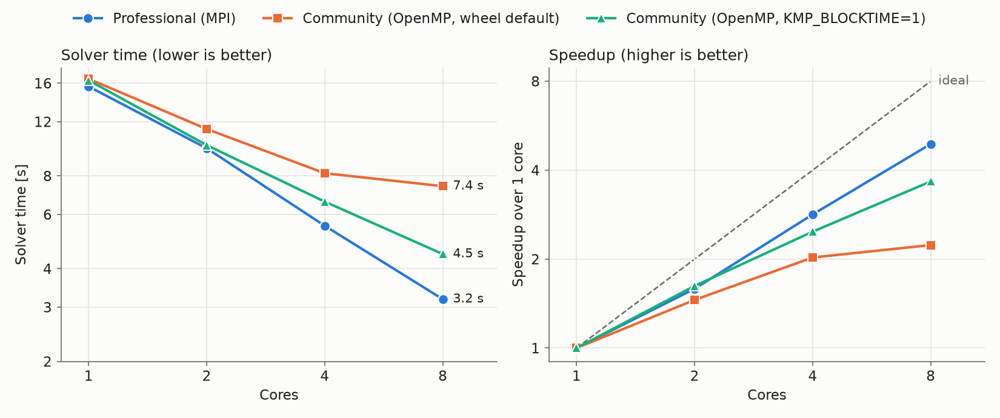

# Benchmarks

Performance measurements of mufem on reproducible cases. Each benchmark lists the machine, how it was
started and what was measured, so that the numbers can be compared and re-run.

**Contents:** [Strong scaling: TEAM 1b](#strong-scaling-team-1b)

## Strong scaling: TEAM 1b

How the solver time of a fixed problem drops with the number of cores, for the Community edition
(OpenMP threads in one process) and the Professional edition (MPI processes).

<div align="center">

<br/>
<em>Figure 1: Solver time (left) and speedup over one core (right) of TEAM 1b on 1, 2, 4 and 8 cores.</em>
</div>
<br/>

### Results

Median solver time of three runs, in seconds; the speedup over one core of the same configuration in
parentheses.

| Cores | Professional (MPI) | Community (OpenMP, wheel default) | Community (OpenMP, `KMP_BLOCKTIME=1`) |
|---|---|---|---|
| 1 | 15.60 | 16.52 | 16.34 |
| 2 | 9.83 (1.59x) | 11.36 (1.45x) | 10.07 (1.62x) |
| 4 | 5.51 (2.83x) | 8.16 (2.02x) | 6.60 (2.48x) |
| 8 | 3.18 (4.91x) | 7.41 (2.23x) | 4.46 (3.66x) |

- On one core the editions are within 6%.
- Professional scales furthest: 4.9x on 8 cores. Each MPI process owns a part of the mesh and
  works on its own data, so every phase of the solve runs in parallel. Processes synchronize only
  where they exchange data. In the OpenMP build some phases still run on one thread, such as the
  setup of the AMS preconditioner and the right-hand-side assembly. The remaining parallel
  regions are short and many, so starting and joining the thread team adds up.
- The case is small, which limits the scaling of both editions. With about 53,000 unknowns (one
  per mesh edge) and a solve of under a second per time step, 8 cores get about 6,600 unknowns
  each. At that size the parts that do not shrink with the core count weigh in more: the coarse
  AMG levels, synchronization and communication, and the serial work of each time step. Larger
  problems should scale further.
- The case is also short: 3 to 17 s of solving. Start-up, mesh loading and output take about
  1 s per run regardless of the core count, so they are left out of the plotted times (see
  [How it was run and measured](#how-it-was-run-and-measured)). End to end, 8 cores save less
  than the solver times suggest. Field export, the main output cost of a real run, is off and
  not measured.
- Community with the wheel's default wait policy (`OMP_WAIT_POLICY=passive`) levels off beyond
  4 cores. Idle threads sleep at once, and waking them for each of the many short parallel
  regions of the AMG V-cycles costs more than the work in them.
- With `KMP_BLOCKTIME=1` idle threads spin for 1 ms before sleeping, so they stay awake between
  back-to-back regions. This takes Community from 7.41 s to 4.46 s on 8 cores. Set it before
  starting Python, e.g. `KMP_BLOCKTIME=1 python case.py`; it is planned as the default for a
  later release.
- The three runs of each point differ by less than 3%. The raw times of every run are in
  [results/Team1b_Scaling.csv](./results/Team1b_Scaling.csv).

### Case

[Compumag TEAM 1b](../Validations/Electromagnetics/Compumag-Team1b-Felix-Cylinder/README.md):
eddy currents in an aluminum cylinder in a decaying field, as in the validation case.

- Time-domain magnetic model, order 1, with a magnetostatic initialization.
- 20 time steps of 1 ms, up to 3 nonlinear iterations each.
- 44,498 tetrahedra, 7,801 vertices.

### Machine and software

| | |
|---|---|
| CPU | AMD Ryzen 9 7950X3D, 16 cores / 32 threads, two CCDs |
| Cores used | 0 to n-1: physical cores of the CCD with the 3D V-cache (96 MB L3); no SMT siblings |
| Clock | boost enabled, up to 5.76 GHz, `amd-pstate` with the `powersave` governor |
| Memory | 64 GB |
| OS | Ubuntu 24.04.5 LTS, Linux 7.0 |
| Python | 3.12.3 |
| mufem | `mufem` 0.8.35 (Community) and `mufem-mpi` 0.8.35 (Professional), from the published wheels |

### How it was run and measured

[scaling.py](./scaling.py) runs every configuration on 1, 2, 4 and 8 cores, three times. The order is
interleaved (repeat, then cores, then configuration), so that a drift of the machine spreads over all
configurations. Every run is a separate process on an otherwise idle machine, pinned to the cores
`0` to `n-1` with `taskset -c 0-<n-1>`:

| Configuration | Started as |
|---|---|
| Professional | `pymufem <n> driver.py --no-field-export` with `OMP_NUM_THREADS=1`: `n` MPI ranks, each bound to one core (`--bind-to core`) |
| Community | `python driver.py --no-field-export` with `OMP_NUM_THREADS=<n> OMP_PROC_BIND=close OMP_PLACES=cores`: one process with `n` threads; the wheel sets `OMP_WAIT_POLICY=passive` |
| Community, `KMP_BLOCKTIME=1` | as Community, plus `KMP_BLOCKTIME=1` |

`driver.py` runs the TEAM 1b `case.py` unchanged and times `ValidationCase.solve()` on the main
process with `time.perf_counter()`. That is the time stepping: assembly, linear and nonlinear solves
and reports. Python start-up, the import, mesh loading, the validation checks and the plots are left
out; they add 0.7 to 1.0 s to every run, which the CSV also records as `wall_s`. Field export is off (`--no-field-export`). The plotted value is the median of
the three runs.

To reproduce, install each edition into its own environment together with casekit, then run the
benchmark and plot the results:

```bash
python -m venv community && community/bin/pip install mufem && community/bin/pip install -e ./casekit
python -m venv professional && professional/bin/pip install mufem-mpi \
    --extra-index-url https://mufem.raiden-numerics.com/packages/ && professional/bin/pip install -e ./casekit

cd Benchmarks
export MUFEM_LICENSE_KEY=...    # for the Professional edition
python scaling.py --community ../community --professional ../professional
python plot_scaling.py           # needs matplotlib
```
