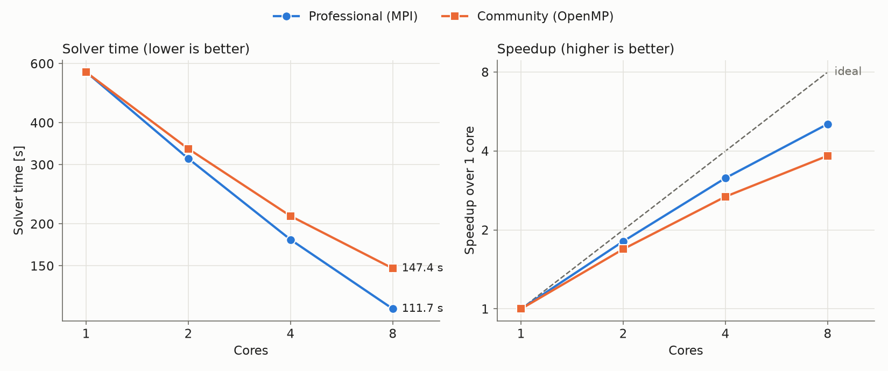

# Benchmarks

Performance measurements of mufem on reproducible cases. Each benchmark lists the machine, how it was
started and what was measured, so that the numbers can be compared and re-run.

**Contents:** [Strong scaling: TEAM 1b](#strong-scaling-team-1b) ·
[IEEJ Model D](#ieej-model-d)

## Strong scaling: TEAM 1b

How the solver time of a fixed problem drops with the number of cores, for the Community edition
(OpenMP threads in one process) and the Professional edition (MPI processes).

<div align="center">

<br/>
<em>Figure 1: Solver time (left) and speedup over one core (right) of TEAM 1b on 1, 2, 4 and 8 cores.</em>
</div>
<br/>

### Results

Median solver time of three runs, in seconds; the speedup over one core of the same edition in
parentheses.

| Cores | Professional (MPI) | Community (OpenMP) |
|---|---|---|
| 1 | 16.12 | 16.61 |
| 2 | 10.06 (1.60x) | 10.11 (1.64x) |
| 4 | 5.65 (2.85x) | 6.65 (2.50x) |
| 8 | 3.30 (4.88x) | 4.47 (3.72x) |

- On one core the editions are within 3%.
- Professional scales furthest: 4.9x on 8 cores. Each MPI process owns a part of the mesh and
  works on its own data, so every phase of the solve runs in parallel. Processes synchronize only
  where they exchange data. In the OpenMP build some phases still run on one thread, such as the
  setup of the AMS preconditioner and the right-hand-side assembly. The remaining parallel
  regions are short and many, so starting and joining the thread team adds up.
- The case is small, which limits the scaling of both editions. With about 53,000 unknowns (one
  per mesh edge) and a solve of under a second per time step, 8 cores get about 6,600 unknowns
  each. At that size the parts that do not shrink with the core count weigh in more: the coarse
  AMG levels, synchronization and communication, and the serial work of each time step. Larger
  problems should scale further.
- The case is also short: 3 to 17 s of solving. Start-up, mesh loading and output take about
  1 s per run regardless of the core count, so they are left out of the plotted times (see
  [How it was run and measured](#how-it-was-run-and-measured)). End to end, 8 cores save less
  than the solver times suggest. Field export, the main output cost of a real run, is off and
  not measured.
- Idle OpenMP threads of the Community edition spin for 1 ms before they sleep, so they stay
  awake between the many short parallel regions of the AMG V-cycles. Sleeping at once
  (`OMP_WAIT_POLICY=passive`, the default of 0.8.35) took 7.4 s on 8 cores with 0.8.35.
- The three runs of each point differ by less than 3%. The raw times of every run are in
  [results/Team1b_Scaling.csv](./results/Team1b_Scaling.csv).

### Case

[Compumag TEAM 1b](../Validations/Electromagnetics/Compumag-Team1b-Felix-Cylinder/README.md):
eddy currents in an aluminum cylinder in a decaying field, as in the validation case.

- Time-domain magnetic model, order 1, with a magnetostatic initialization.
- 20 time steps of 1 ms, up to 3 nonlinear iterations each.
- 44,498 tetrahedra, 7,801 vertices.

### Machine and software

| | |
|---|---|
| CPU | AMD Ryzen 9 7950X3D, 16 cores / 32 threads, two CCDs |
| Cores used | 0 to n-1: physical cores of the CCD with the 3D V-cache (96 MB L3); no SMT siblings |
| Clock | boost enabled, up to 5.76 GHz, `amd-pstate` with the `powersave` governor |
| Memory | 64 GB |
| OS | Ubuntu 24.04.5 LTS, Linux 7.0 |
| Python | 3.12.3 |
| mufem | development wheels of the version after 0.8.35, built from the main branch (`3c15cb7`) with the release compiler settings: Community (OpenMP) and Professional (MPI) |

### How it was run and measured

[scaling.py](./scaling.py) runs both editions on 1, 2, 4 and 8 cores, three times. The order is
interleaved (repeat, then cores, then edition), so that a drift of the machine spreads over both
editions. Every run is a separate process on an otherwise idle machine, pinned to the cores
`0` to `n-1` with `taskset -c 0-<n-1>`:

| Edition | Started as |
|---|---|
| Professional (MPI) | `pymufem <n> driver.py --no-field-export` with `OMP_NUM_THREADS=1`: `n` MPI ranks, each bound to one core (`--bind-to core`) |
| Community (OpenMP) | `python driver.py --no-field-export` with `OMP_NUM_THREADS=<n> OMP_PROC_BIND=close OMP_PLACES=cores`: one process with `n` threads |

`driver.py` runs the TEAM 1b `case.py` unchanged and times `ValidationCase.solve()` on the main
process with `time.perf_counter()`. That is the time stepping: assembly, linear and nonlinear solves
and reports. Python start-up, the import, mesh loading, the validation checks and the plots are left
out; they add 0.6 to 1.0 s to every run, which the CSV also records as `wall_s`. Field export is off
(`--no-field-export`). The plotted value is the median of the three runs.

To reproduce, install each edition into its own environment together with casekit, then run the
benchmark and plot the results. Until the next release, `pip install` gives 0.8.35; set
`KMP_BLOCKTIME=1` with it to match the Community numbers above:

```bash
python -m venv community && community/bin/pip install mufem && community/bin/pip install -e ./casekit
python -m venv professional && professional/bin/pip install mufem-mpi \
    --extra-index-url https://mufem.raiden-numerics.com/packages/ && professional/bin/pip install -e ./casekit

cd Benchmarks
export MUFEM_LICENSE_KEY=...    # for the Professional edition
python scaling.py --community ../community --professional ../professional
python plot_scaling.py           # needs matplotlib
```

## IEEJ Model D

A larger, nonlinear case with motion: the solver time of the
[IEEJ Model D](../Validations/Electromagnetics/IEEJ_2012_IPM_Motor_Model_D/README.md) interior
permanent magnet motor on 1, 2, 4 and 8 cores.

<div align="center">

<br/>
<em>Figure 2: Solver time of IEEJ Model D (left) and speedup over 1 core (right).</em>
</div>
<br/>

| Cores | Professional (MPI) | Community (OpenMP) |
|---|---|---|
| 1 | 566.3 s | 565.4 s |
| 2 | 312.8 s (1.81x) | 334.5 s (1.69x) |
| 4 | 179.5 s (3.15x) | 211.0 s (2.68x) |
| 8 | 111.7 s (5.07x) | 147.4 s (3.84x) |

- On 1 core both editions take the same time. With more cores Professional pulls ahead: 6% less
  solver time on 2 cores, 15% on 4 and 24% on 8, for the same reasons as in TEAM 1b. Here, too,
  some phases of the OpenMP build run on one thread.
- On 8 cores the parallel efficiency is 63% for Professional and 48% for Community, close to
  TEAM 1b (61% and 47%).
- Each time step does more work than in TEAM 1b: a saturating BH curve with up to 20 nonlinear
  iterations, the rotor turning on a sliding non-matching interface, and the coupling across it
  rebuilt every step. The mesh motion and the rebuild scale less well than the linear solves.
- The case is long enough (2 to 9.5 min of solving) that start-up, mesh loading and output, about
  2 s per run, hardly matter.
- One run per point, since every run takes minutes; the TEAM 1b runs, measured the same way,
  differ by less than 3%. The times are in
  [results/ModelD_Scaling.csv](./results/ModelD_Scaling.csv).

The case runs as in the validation: first-order field-conforming (T-Omega) formulation with a
magnetostatic initialization, one electrical period at 1500 rpm in 120 time steps. Machine,
software and measurement are those of TEAM 1b (see
[How it was run and measured](#how-it-was-run-and-measured)); to reproduce:

```bash
python scaling.py --case modeld --repeats 1 --community ../community --professional ../professional
python plot_scaling.py
```
