# Optimizing a Fan Grating Coupler for a Multimode Fiber Link

We combine mufem with the Bayesian optimizer Ax/BoTorch to optimize a published silicon-photonics
grating coupler, solving every design in full 3D. Within the fabrication constraints and meeting the
device's requirements, the optimized coupler performs 7.8 % better than the published one.

## Introduction

**The device.** Data centers and high-performance computers exchange growing amounts of data
between chips, boards and racks over short optical links, up to a few hundred meters of multimode
fiber. At each end of a link sits a transceiver: its transmitter turns the electrical signal into
modulated light, its receiver turns the light back into an electrical signal. Silicon photonics
builds the optical parts of a transceiver, the waveguides, modulators and photodetectors, on a
silicon chip with the processes of microelectronics. The difficult step is the connection between
the chip and the fiber: on the chip the light travels in waveguides less than half a micrometer
wide, while the core of a multimode fiber is 50 µm across. A grating coupler bridges the two: a
pattern of shallow grooves etched into the waveguide scatters the light out of the chip surface,
toward the fiber above it.

**The engineering question.** This study takes a specific, published device: a chip-scale
silicon-photonics transmitter [1]. It couples the chip to a graded-index multimode fiber (GI50, NA
0.2) through a fan-shaped grating coupler and an "optical pin" [1–3, 5]: a pillar of resin formed on
the chip over the coupler and tilted by 8°, whose core, of index 1.585 and 35 µm in diameter at its
base, guides the light up to the fiber. The coupler must therefore send its beam into the pin's
resin at 8° to the normal, with a spot that fits the core. Figure 1 shows the geometry of this
grating coupler.

<div align="center">
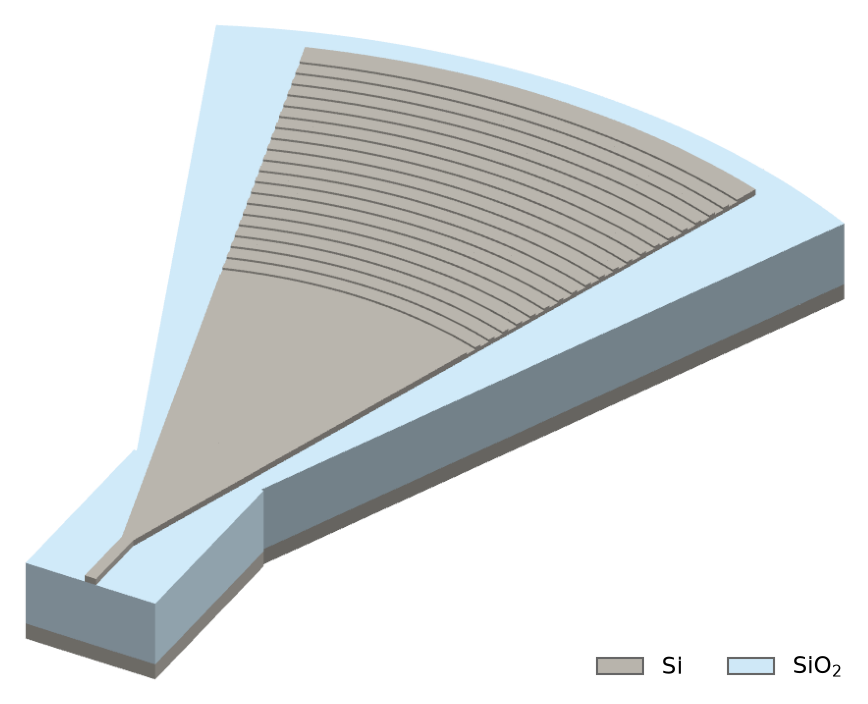
<br/>
<br/>
<em>Figure 1: The published coupler in 3D: the silicon feed wire and the fan with its curved grooves, on the buried oxide and the silicon substrate; the SiO₂ over-cladding and the resin above are not shown.</em>
</div>
<br/>

Here, we take the published coupler as the starting point and ask:

1. How much of the light does the published coupler deliver into the fiber's acceptance?
2. Can an optimizer driving 3D simulations find a better coupler on the same platform and chip
   area, within the fabrication rules and the beam requirements?
3. What limits the improvement: the physics, the fabrication rules or the footprint?

This case study answers them with mufem's Time-Harmonic Maxwell model, driven by the Bayesian
optimizer Ax/BoTorch [6, 7]: every design the optimizer proposes is solved in full 3D. The case is run
with [case.sh](case.sh).

**Outcome**

- The published coupler delivers **52.8 %** of the light into the fiber's acceptance.
- The optimized coupler delivers **56.9 %**, **+7.8 % (+0.33 dB)**, on **the same footprint** and
  within all constraints: its reflection is 0.86 % (−20.7 dB) and its beam is at 7.56°, inside the
  8° ± 0.5° window. The optimizer found it in 38 designs, each solved in 3D.
- The optimized design differs in its grating, narrower grooves started closer to the focus, so
  that 27 grooves fit where the published coupler has 20, and in its wider, shorter fan.
- The optimum lies at the edges of the search: the grating starts as close to the focus as its
  range allows, the beam sits near the low edge of the angle window, and the reflection is close to
  the 1 % limit.

**What mufem brings to this study**

- The complete coupler in full-wave 3D: the feed wire, the fan with its curved grooves and the
  whole layer stack down to the substrate, with no 2D cut or effective-index shortcut.
- Scriptable by design: a mufem model is a plain Python script, so it combines smoothly with
  existing tools for meshing and optimization. Here Ax proposes each design, Gmsh meshes it, and
  mufem solves it and returns its metrics, without user interaction.

## How a Grating Coupler Works

The light arrives in a silicon wire 350 nm wide and 200 nm thick, guided in its TE0 mode. The fan
widens it to several micrometers, and a grating of shallow grooves etched into the silicon scatters
it out of the plane (Figure 2, left). Each groove sends a small wavelet up and down; at the pitch of
the grating the wavelets add up in phase at one angle, 12.7° to the normal in air or 8° in the resin
above the chip. The grooves are not straight: they are confocal ellipses around a focus in the wire,
so that every ray from the focus crosses them at the same phase, and the fan focuses the beam in
both directions (Figure 2, right).

<div align="center">
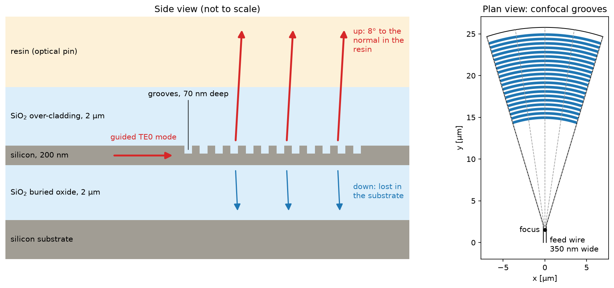
<br/>
<br/>
<em>Figure 2: Left: the layer stack in side view, not to scale, with the guided mode and the light scattered up and down. Right: the published fan in plan view, to scale, with its confocal grooves and rays from the focus.</em>
</div>
<br/>

Not all the light goes up: the grating unavoidably radiates downwards as well, through the buried
oxide into the substrate, where the light is lost. Additionally, part of the upward beam travels at
angles the fiber does not accept. A good coupler sends as much light as possible up and within the
fiber's acceptance, so the optimization goal of this study is the power within the fiber's
acceptance:

```math
P_\mathrm{GI50} = P_\mathrm{up} \cdot a_\mathrm{GI50}
```

with $`P_\mathrm{up}`$ the share of the input power going up, and $`a_\mathrm{GI50}`$ the share of
the upward beam whose direction in the resin lies within the acceptance of the graded-index fiber.

<details>
<summary>How the upward power and the acceptance are computed</summary>

**The upward power** is the flux of the Poynting vector $`\mathbf{S}`$ through a horizontal plane
$`S_\mathrm{up}`$ 0.5 µm above the silicon, relative to the power $`P_\mathrm{in}`$ of the wire's
mode:

```math
P_\mathrm{up} = \frac{1}{P_\mathrm{in}} \int_{S_\mathrm{up}} S_z \, \mathrm{d}A
```

**The acceptance** follows from the plane-wave spectrum of the beam. On a plane 1 µm above the
silicon, the field $`E_x(x, y)`$ of the TE beam is decomposed into plane waves,

```math
A(u_x, u_y) = \iint E_x(x, y) \, e^{-i k_0 (u_x x + u_y y)} \, \mathrm{d}x \, \mathrm{d}y ,
```

with $`k_0 = 2\pi/\lambda`$ and $`\mathbf{u} = (u_x, u_y)`$ the tangential wavenumber over
$`k_0`$. The planar layers above conserve $`\mathbf{u}`$, so each plane wave travels in the resin
at the angle $`\theta`$ to the normal with $`n_\mathrm{r} \sin\theta = |\mathbf{u}|`$, and
carries the power

```math
p(\mathbf{u}) = |A(\mathbf{u})|^2 \cos\theta ,
```

counted for the directions that propagate in the SiO₂, $`|\mathbf{u}| < n_\mathrm{SiO_2}`$. A
direction is inside the fiber's acceptance if its angle $`\gamma`$ to the pin axis, tilted by
$`\alpha = 8°`$ along the fan, is at most the fiber's acceptance angle in the resin,
$`\gamma_\mathrm{max}`$:

```math
\cos\gamma = \frac{u_y}{n_\mathrm{r}} \sin\alpha + \cos\theta \cos\alpha ,
\qquad
\sin\gamma_\mathrm{max} = \frac{\mathrm{NA}}{n_\mathrm{r}} ,
```

with NA = 0.2 and $`n_\mathrm{r}`$ = 1.585, $`\gamma_\mathrm{max}`$ = 7.25°. The acceptance is
the share of the power in these directions:

```math
a_\mathrm{GI50} = \frac{\sum_{\gamma \le \gamma_\mathrm{max}} p(\mathbf{u})}{\sum p(\mathbf{u})}
```

The same spectrum gives the beam angle, at the peak of $`p`$. The estimate ignores what happens
inside the pin, so $`P_\mathrm{GI50}`$ is an upper bound of the coupled power.

</details>

## The Device

| Quantity | Value |
| -------- | ----- |
| Platform | 200 nm silicon on 2 µm buried oxide, 70 nm shallow etch, 70 nm minimum feature [4] |
| Wavelength | 1310 nm, TE |
| Refractive indices at 1310 nm | silicon 3.503, SiO₂ 1.447, resin 1.585 |
| Published grating | 20 grooves, 524 nm pitch, groove width 0.60 of the pitch [1–3] |
| Published fan | half angle 16.7°, first groove 13.3 µm from the focus, footprint 172 µm² |
| Exit angle | 12.7° in air, 8° in the resin |
| Optical pin | resin pillar over the coupler, core Ø35 µm, tilted 8° [5]; GI50 fiber behind it (NA 0.2) |

## Setup

The model contains one half of the coupler, cut along the fan axis: the TE0 mode of the wire is
even, so the cut is a symmetry plane. It includes the layer stack of the chip, from the bottom 0.5
µm of the silicon substrate, the 2 µm SiO₂ buried oxide, the 200 nm silicon with the grooves, the 2
µm SiO₂ over-cladding and 1 µm of the resin (Figure 3, top). Absorbing faces close the model, apart
from the symmetry plane and the input port of the wire.

The mesh is built in plan view and extruded through the layers. Over the fan, structured cells
follow the grooves and the rays from the focus, so that the curved grooves are reproduced exactly;
triangles fill the region around the wire (Figure 3, middle). Through the layers, thin cells
resolve the silicon and grow thicker toward the substrate and the resin (Figure 3, bottom).

<div align="center">
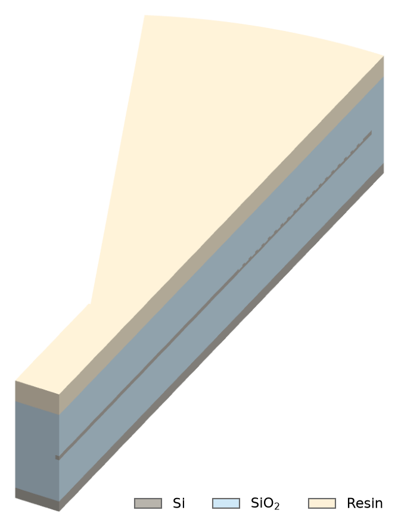
<br/>
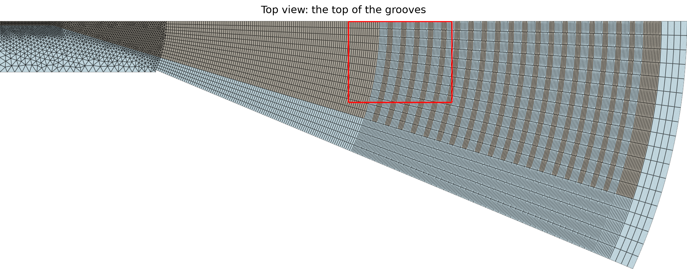&emsp;
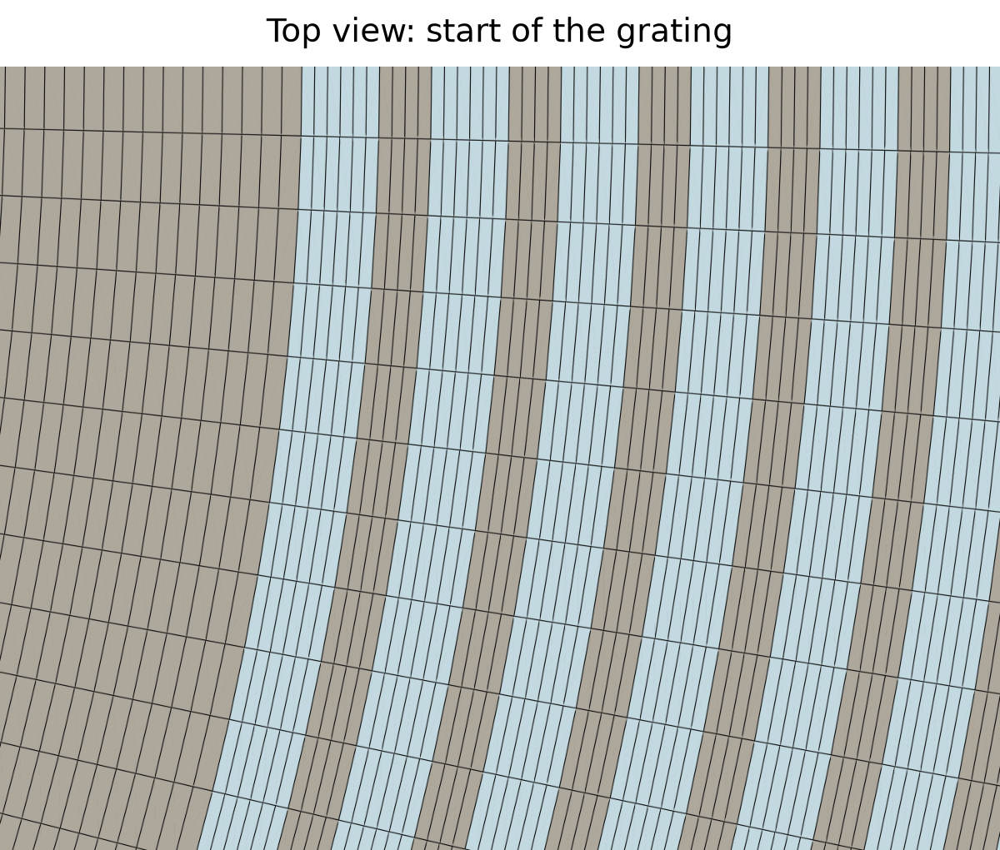
<br/>
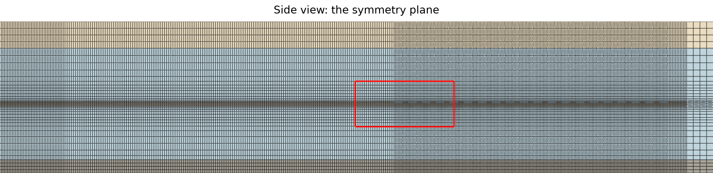&emsp;
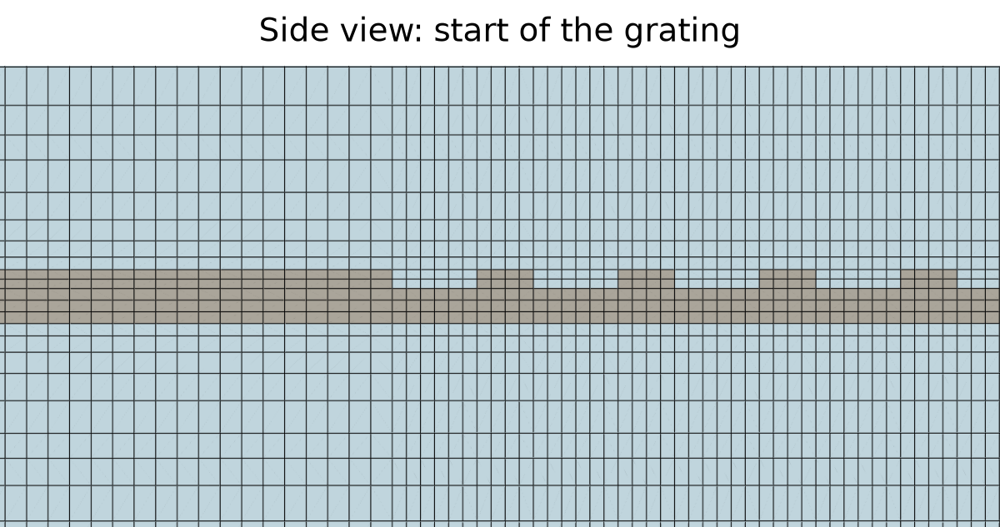
<br/>
<br/>
<em>Figure 3: The model of the published coupler. Top: in 3D, its face on the symmetry plane toward the camera. Below: its mesh in plan view and on the symmetry plane, with close-ups of the start of the grating on the right (red rectangles).</em>
</div>
<br/>

<details>
<summary>Model settings</summary>

| Setting | Value |
| ------- | ----- |
| Model | Time-Harmonic Maxwell, second-order Nédélec elements |
| Excitation | TE0 mode of the feed wire through a waveguide port, which also gives the reflection |
| Boundaries | absorbing on the outer faces, symmetry (PEC) on the plane through the fan axis |
| Mesh | hexahedra and prisms; 10 cells per period across the grooves, 40 layers (nominal) |
| Solver | direct (MUMPS), block low-rank, factors on disk, 8 OpenMP threads |
| Reports | power through planes 0.5 µm above and below the silicon, reflection $`\|S_{11}\|^2`$, $`E_x`$ on a plane 1 µm above the silicon for the near and far fields |

</details>

The optimization runs on a coarser mesh, 8 cells per period and 35 layers, 4–6 million unknowns. The
chosen design and the published one are then compared on the nominal mesh of the model settings, 10
cells per period and 40 layers, 7.4 million unknowns.

## Results

### The Published Coupler

Figure 4 shows the coupler at work. On the symmetry plane, the guided wave enters the fan in the
silicon; along the grating, tilted wavefronts leave it upwards through the cladding into the resin and
downwards through the buried oxide. On the top face, the beam leaves the model upwards.

<div align="center">
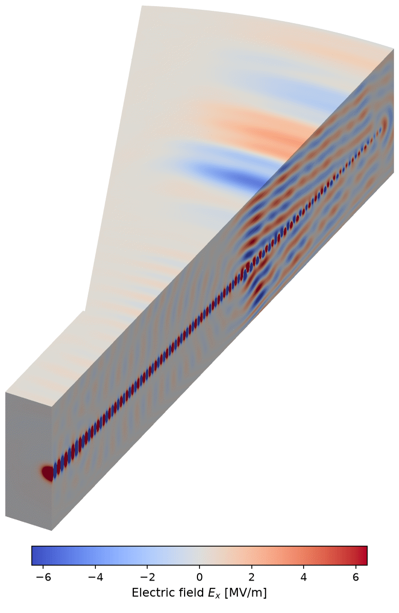
<br/>
<br/>
<em>Figure 4: The published coupler: the animated electric field E_x on the surface of the model.</em>
</div>
<br/>

| Published coupler, nominal mesh | Value |
| ------------------------------- | ----- |
| Power going up / down | 60.5 % / 37.5 % |
| Reflection into the wire | 0.64 % (−21.9 dB) |
| Beam angle in the resin | 8.02° |
| Near field (D4σ), across × along | 6.9 × 11.6 µm |
| Upward beam inside the fiber's acceptance | 87.2 % |
| **Into the fiber, $`P_\mathrm{GI50}`$** | **52.8 %** |

The beam leaves at 8°, as published, and its spot, the second-moment (D4σ) diameter of the upward
power 1 µm above the silicon, fits the pin's 35 µm core easily. The losses are in the power split:
more than a third of the light goes down into the substrate. The near field falls off steeply from
the start of the grating, and its far field has wings outside the fiber's acceptance.

### Optimization

The optimization maximizes $`P_\mathrm{GI50}`$, the power the coupler delivers into the fiber,
while it keeps the characteristics the transceiver relies on: the reflection back into the laser,
the beam angle along the pin and the size of the spot. These enter as constraints. The fabrication
rules bound the variables of the design, and the footprint of the fan stays the published one.

The optimizer may change the following variables of the coupler, explained below the table:

| Variable | Range | Published |
| -------- | ----- | --------- |
| Groove width | 0.15–0.85 of the pitch | 0.60 |
| Half angle of the fan | 10–25° | 16.7° |
| Share of the fan before the first groove | 0.35–0.8 of the last groove's radius | 0.55 |
| Soft-start grooves | 0–12 | 0 |
| First soft-start groove | 70 nm to the full width | – |
| Pitch | ±5 nm around a slab model of each groove width | 524 nm |

Due to technological limitations, the coupler cannot have features smaller than 70 nm [4], so the
grooves and the teeth between them must be at least 70 nm wide; this sets the range of the groove
width. The first groove meets the full guided wave and is the strongest scatterer of the grating: it
sends out much of the light at once and reflects part of it back into the wire. A soft start, a few
grooves at the start of the grating that widen from a narrow first one to the full width, makes this
transition gradual; its first groove is again at least 70 nm wide.

The pitch is not free: the grooves change the effective index of the guided wave, and with it the
angle at which a given pitch sends the beam. For each groove width, a slab model, which averages the
effective indices of the etched and the unetched silicon over the period, gives the pitch for 8°,
and the optimizer may shift it by up to ±5 nm to tune the beam; the angle thus follows the groove
width, and the search does not waste designs on beams far off the axis.

The other ranges are chosen wide: the fan may be long and narrow or wide and short, and the grating
may start anywhere from 0.35 to 0.8 of the radius of the last groove from the focus, the lower bound
keeping it out of the narrow start of the fan.

The footprint is fixed at the published fan's, 172 µm²: the fan may be wider and shorter or
narrower and longer, but not larger. The footprint and the half angle set the radius of the last
groove, and the grating fills the fan from the first groove with whole periods, so that every
design has exactly the published area and the same size of model.

The designs must meet the constraints below; a design that meets all of them is called feasible:

| Constraint | Limit | Why |
| ---------- | ----- | --- |
| Reflection into the wire | ≤ 1 % (−20 dB) | the transmitter's laser runs without an isolator [3] |
| Beam angle in the resin | 8° ± 0.5° | along the axis of the pin |
| Near field (D4σ), across and along | ≤ 20 µm | the spot stays inside the pin's 35 µm core |

Figure 5 sketches the constraints on the beam and the variables of the fan at the fixed footprint.

<div align="center">
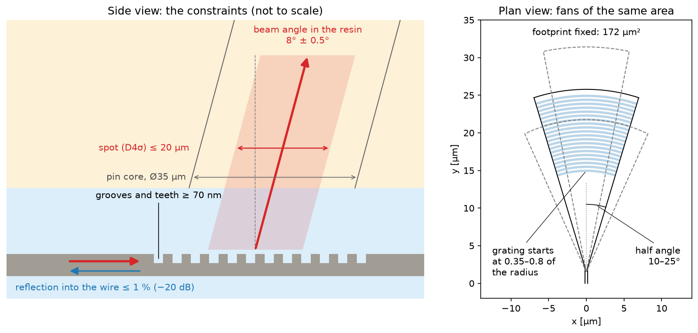
<br/>
<br/>
<em>Figure 5: Left: the constraints in side view, not to scale: the reflection into the wire, the beam angle in the resin, the spot of the beam in the pin's core, and the minimum feature of the grooves. Right: the published fan and, dashed, two other fans of the same footprint, with the ranges of the half angle and of the start of the grating.</em>
</div>
<br/>

Each design requires a time-consuming 3D solve, so the study uses Bayesian optimization, which finds
good designs in few evaluations: it builds a statistical model of the objective and the constraints
from the designs solved so far and proposes as the next design the one most likely to improve on the
best feasible design. It runs on the open-source Ax platform with its BoTorch back end [6, 7].

<details>
<summary>How the optimization is set up in Ax</summary>

[optimize.py](optimize.py) defines the variables as Ax range parameters, the objective, and the
constraints as outcome constraints, each a limit on a metric that
[grating_coupler.py](grating_coupler.py) returns for a design:

```python
PARAMETERS = [
    dict(name="groove", type="range", bounds=[0.15, 0.85], value_type="float"),
    dict(name="fan_angle", type="range", bounds=[10.0, 25.0], value_type="float"),
    dict(name="taper", type="range", bounds=[0.35, 0.8], value_type="float"),
    dict(name="ramp_grooves", type="range", bounds=[0, 12], value_type="int"),
    dict(name="ramp_start", type="range", bounds=[0.0, 1.0], value_type="float"),
    dict(name="pitch_offset", type="range", bounds=[-0.005, 0.005], value_type="float"),
]
client.create_experiment(
    name="grating_coupler",
    parameters=PARAMETERS,
    objectives={"p_gi50": ObjectiveProperties(minimize=False)},
    outcome_constraints=[
        "r <= 0.01",
        "angle_core >= 7.5",
        "angle_core <= 8.5",
        "spot_x <= 20.0",
        "spot_y <= 20.0",
    ],
)
```

The fabrication rules and the fixed footprint are not outcome constraints: they are built into the
variables. The bounds of the groove width keep grooves and teeth at least 70 nm wide, and
`Coupler.at_area` in [mesh.py](mesh.py) turns the variables into a design of exactly the published
footprint. After each solve, the metrics go back to Ax with a fixed standard error, the scatter of
the coarse mesh from remeshing, so that its model does not fit that scatter:

```python
client.complete_trial(trial_index=index, raw_data={"p_gi50": (p_gi50, 0.005), "r": (r, 0.0005), ...})
```

Ax models every constrained metric alongside the objective and proposes the design most likely to
improve on the best feasible one.

</details>

The run starts from the published coupler, explores with 12 quasi-random (Sobol) designs and then
lets the Bayesian model propose each next design. After at least 30 designs, it stops once the best
feasible design has gained no more than 0.5 percentage points over the last 10.

The quasi-random designs mostly reflect too much; from the first Bayesian proposal on, every design
beats the published coupler (Figure 6), and after 38 designs the run stops, 21 of them feasible.

<div align="center">
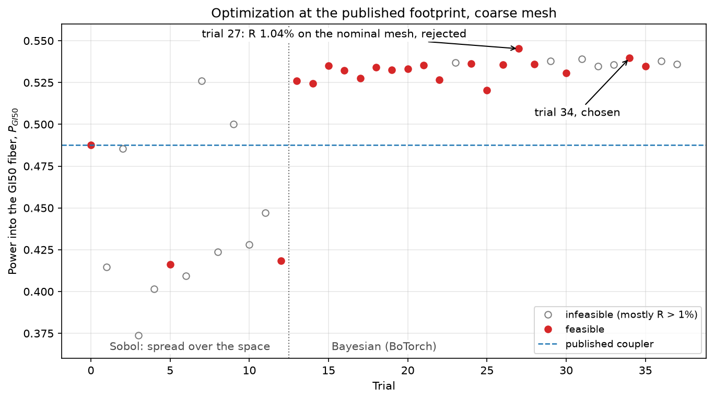
<br/>
<br/>
<em>Figure 6: The power into the fiber of each design on the coarse mesh: feasible (red), infeasible (open), and the published coupler (dashed).</em>
</div>
<br/>

Many quite different designs perform almost equally well: twelve feasible designs reach 53.2–54.5 %
on the coarse mesh, with half angles from 15° to 23°. The soft start brings little: the best designs
reach almost the same power without one and with up to 12 soft-start grooves. Narrow fans lose
acceptance, because their narrow near field diverges more; wide, short fans reflect more than 1 %.
Design 34 is chosen: the optimizer's model, which accounts for the scatter of the coarse mesh from
remeshing, about 0.5 percentage points, rates it best, and its reflection keeps a margin. It has a
minimal soft start, a single narrower first groove of 158 nm. Design 27 scores 0.6 points higher on
the coarse mesh, and 57.5 % on the nominal mesh, but is rejected: on the nominal mesh it reflects
1.04 %, above the limit.

### The Optimized Coupler

The optimized coupler differs from the published one in three ways (Figure 7):

- **Narrower grooves**, 201 nm instead of 314 nm (0.40 of the pitch instead of 0.60).
- **The grating starts closer to the focus**, 7.6 µm instead of 13.3 µm, so that 27 grooves fit in
  the published footprint instead of 20.
- **A wider, shorter fan**, 20.7° instead of 16.7°, and a pitch of 507.9 nm for the narrower grooves.

<div align="center">
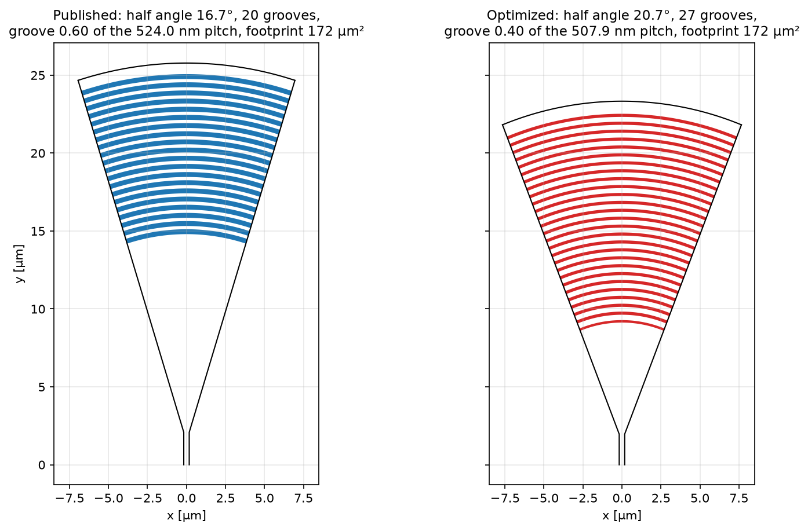
<br/>
<br/>
<em>Figure 7: The published and the optimized fan in plan view, to scale, on the same footprint.</em>
</div>
<br/>

The fields show the effect. The optimized grating starts radiating closer to the wire and over a
longer stretch of the fan (Figure 8), and its near field is stronger close to the focus (Figure 9).
Both beams lie centered in the fiber's acceptance (Figure 10).

<div align="center">

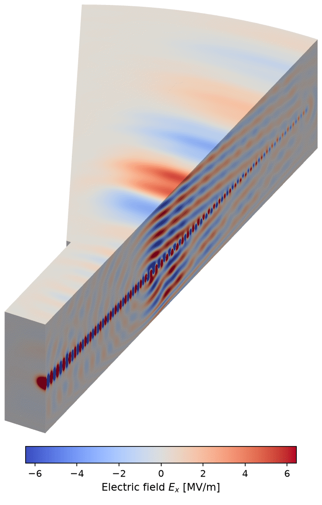
<br/>
<br/>
<em>Figure 8: The electric field of the published (left) and the optimized coupler (right), as in Figure 4, on the same scale.</em>
</div>
<br/>

<div align="center">
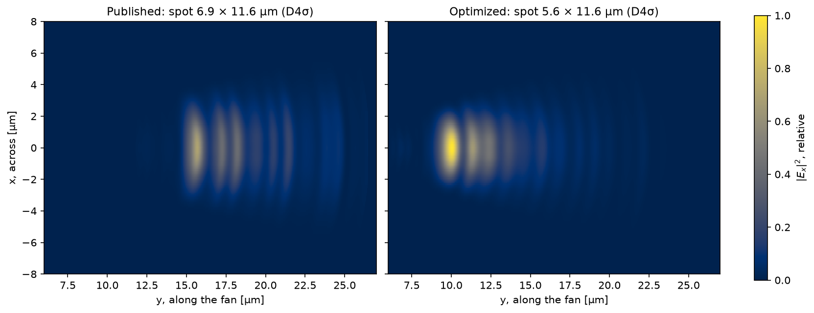
<br/>
<br/>
<em>Figure 9: The near field 1 µm above the silicon of both couplers, on the same scale.</em>
</div>
<br/>

<div align="center">
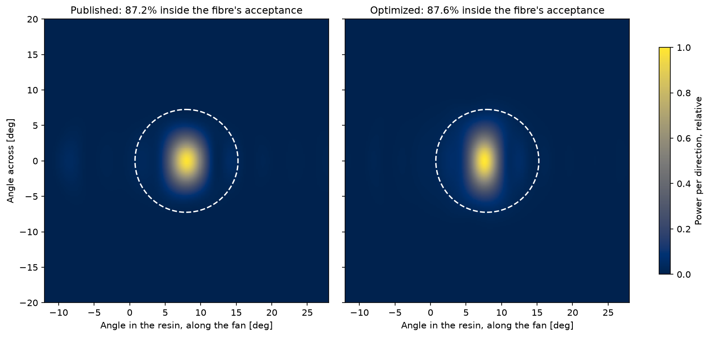
<br/>
<br/>
<em>Figure 10: The power per direction in the resin of both couplers, with the fiber's acceptance (dashed).</em>
</div>
<br/>

| Nominal mesh | Published | Optimized | Change |
| ------------ | --------- | --------- | ------ |
| Power going up | 60.5 % | 65.0 % | +4.5 points |
| Reflection into the wire | 0.64 % (−21.9 dB) | 0.86 % (−20.7 dB) | |
| Beam angle in the resin | 8.02° | 7.56° | −0.46° |
| Near field (D4σ), across × along | 6.9 × 11.6 µm | 5.6 × 11.6 µm | |
| Upward beam inside the fiber's acceptance | 87.2 % | 87.6 % | +0.4 points |
| **Into the fiber, $`P_\mathrm{GI50}`$** | **52.8 %** | **56.9 %** | **+7.8 % (+0.33 dB)** |

- **The gain is in the power split:** 4.5 points more of the light goes up. The acceptance barely
  changes; both beams are well centered in it.
- **The optimum lies at the edges of the constraints:** the beam at 7.56°, near the low edge of the
  ±0.5° window, and the reflection, 0.86 %, close to the 1 % limit.
- **The coarse mesh kept the order of the two designs:** it gave 48.8 % and 54.0 %, +5.2 points;
  the nominal mesh gives +4.1.

## Discussion

1. **The published coupler delivers 52.8 % of the light into the fiber**, limited by the third of
   the light that goes down into the substrate and by the share of the upward beam outside the
   fiber's acceptance.
2. **An optimizer driving 3D simulations finds a better coupler on the same footprint**, +7.8 %
   (+0.33 dB), within all constraints, in 38 designs.
3. **What limits the improvement:** not the fabrication rules, since the optimized grooves and teeth
   are far wider than 70 nm. The footprint is fixed by the setup, so its effect is not tested here.
   The optimum lies where the grating starts as close to the focus as its range allows and the beam
   near the low edge of the angle window; the designs there already reflect 0.8–1.5 %, close to the
   1 % limit. Many quite different designs reach almost the same power.

The same workflow can take the study further:

| Direction | Question | Tool |
| --------- | -------- | ---- |
| Fabrication tolerance | How does the performance of the coupler change when the groove width, the etch depth or the silicon thickness deviates by ±10 nm (typical fabrication tolerance)? | 3D runs per deviation |
| Operating temperature | How does the performance change as the chip heats up, with the uncooled laser drifting to longer wavelengths and the silicon index rising? | 3D runs over temperature |
| Coupler, pin and fiber | How much of $`P_\mathrm{GI50}`$ reaches the fiber through a real pin? | one 3D model of the whole path |

## Workflow and Compute

| Step | Model size | Hardware | Wall time |
| ---- | ---------- | -------- | --------- |
| One design, coarse mesh | 4–6 M unknowns | 8 cores | 15–23 min |
| Optimization, 38 designs | as above | 8 cores | 13 h elapsed |
| Published and optimized coupler, nominal mesh | 7.4 M unknowns | 8 cores, 39 GB | 26 min each |

All runs on one workstation: Intel Core i9-13900K, 64 GB of memory, mufem with 8 OpenMP threads.

## Running the Case

The scripts need Python 3 with mufem and a few common packages; Ax is needed only for the
optimization:

```bash
pip install mufem gmsh numpy matplotlib pyvista meshio
pip install ax-platform==0.4.3
```

[case.sh](case.sh) is the single entry point; `./case.sh --help` lists its commands:

```bash
./case.sh run --design published --resolution nominal --out results_published
./case.sh run --design optimized --resolution nominal --out results_optimized
./case.sh optimize --trials 60
./case.sh figures
```

- `run` meshes one design with [mesh.py](mesh.py) and solves it with
  [grating_coupler.py](grating_coupler.py) under `pymufem`, which uses OpenMP threads or, when mufem
  is installed with MPI, MPI ranks (`-n 8`), for example on a cluster when the model needs more
  memory than one machine has. It writes the metrics, the beam plane, the electric field and the
  mesh to `--out`.
- `optimize` runs [optimize.py](optimize.py), the optimization with Ax 0.4.3: it meshes and solves
  every design Ax proposes on the coarse mesh, writes the trials to `results_optimization/` and
  resumes when run again. The variables, bounds and constraints are set at the top of the script,
  the trial budget and the footprint on its command line.
- `figures` runs [figures.py](figures.py), which draws the figures of this page from the two runs
  and the data in [data](data); on a machine without a display it runs under `xvfb-run` (on Debian
  or Ubuntu: `sudo apt install xvfb`).

Each script also runs on its own; `--help` lists its options.

The inputs and the results behind the numbers of this page are in [data](data) and the run folders:

| File | Content |
| ---- | ------- |
| [Design_Published.json](data/Design_Published.json), [Design_Optimized.json](data/Design_Optimized.json) | the two designs: groove width, grooves, first groove, half angle, pitch, soft start |
| [Optimization_Trials.jsonl](data/Optimization_Trials.jsonl) | the 38 designs of the optimization with their metrics, coarse mesh (`results_optimization/Trials.jsonl` of the run) |
| `results_*/metrics.json` | the metrics of the published and the optimized coupler, nominal mesh; the meshes (`mesh.msh`, 42 MB each) are not part of the repository |

## Get in Touch

Would you like to run a study like this on your own device, or see mufem on your design
questions? Contact us at [info@raiden-numerics.com](mailto:info@raiden-numerics.com) or visit
[mufem.raiden-numerics.com](https://mufem.raiden-numerics.com).

## References

[1] K. Yashiki, T. Uemura, M. Kurihara, Y. Suzuki, M. Tokushima, Y. Hagihara and K. Kurata (2016). *25-Gbps/ch Error-Free Operation over 300-m MMF of Low-Power-Consumption Silicon-Photonics-Based Chip-Scale Optical I/O Cores*. IEICE Transactions on Electronics, E99-C(2), 148–156. https://doi.org/10.1587/transele.E99.C.148

[2] J. Ushida, M. Tokushima, T. Uemura and K. Kurata (2015). *Highly Fabrication-Tolerant Shallow-Grating Coupler for Robust Coupling to Multimode "Optical Pin"*. Extended Abstracts of the 2015 International Conference on Solid State Devices and Materials (SSDM), Sapporo, 248–249.

[3] M. Tokushima, J. Ushida and K. Kurata (2017). *Folded Shallow Grating Couplers with Minimal Back Reflection and Extended Coupling Bandwidth for Robust Coupling to Multimode Fibers*. Journal of Lightwave Technology, 35(2), 246–257. https://doi.org/10.1109/JLT.2016.2639544

[4] T. Mogami, T. Horikawa, K. Kinoshita, Y. Hagihara, J. Ushida, M. Tokushima, J. Fujikata, S. Takahashi, T. Shimizu, A. Ukita, K. Takemura, M. Kurihara, K. Yashiki, D. Okamoto, Y. Suzuki, Y. Sobu, S.-H. Jeong, Y. Tanaka, T. Nakamura and K. Kurata (2018). *1.2 Tbps/cm² Enabling Silicon Photonics IC Technology Based on 40-nm Generation Platform*. Journal of Lightwave Technology, 36(20), 4701–4712. https://doi.org/10.1109/JLT.2018.2863779

[5] T. Uemura, A. Ukita, K. Takemura, M. Kurihara, D. Okamoto, J. Ushida, K. Yashiki and K. Kurata (2015). *125-µm-pitch × 12-channel "Optical Pin" Array as I/O Structure for Novel Miniaturized Optical Transceiver Chips*. IEEE 65th Electronic Components and Technology Conference (ECTC), 1305–1309. https://doi.org/10.1109/ECTC.2015.7159766

[6] M. Balandat, B. Karrer, D. R. Jiang, S. Daulton, B. Letham, A. G. Wilson and E. Bakshy (2020). *BoTorch: A Framework for Efficient Monte-Carlo Bayesian Optimization*. Advances in Neural Information Processing Systems, 33, 21524–21538.

[7] Meta. *Ax: Adaptive Experimentation Platform*. https://ax.dev
