# Step Skew in a Hairpin IPM Traction Motor

## Introduction

**The engineering question.** An e-drive team has a hairpin interior permanent-magnet (IPM)
traction motor with 48 slots and 8 poles whose torque ripple is too high for a quiet drive train.
The usual remedy is a step skew: the rotor is cut into axial steps, each turned by a small angle
against its neighbours. Before committing to a 7-step V skew, the team needs answers to three
questions:

1. How much does the skew reduce the cogging torque and the load ripple, and what does it cost in
   mean torque?
2. Is the fast 2D multi-slice method accurate enough to design the skew, or is 3D needed?
3. What does the skew do to the copper losses, including those in the end windings that 2D cannot
   see?

This case study answers them with mufem, from 2D to the complete machine in 3D: the 165 mm stack
with all 7 rotor steps, the connected hairpin winding with its end turns and terminal leads, the
turning rotor, saturating iron and, for the losses, eddy currents in all copper. The case is run
with [pmsm_motor.py](pmsm_motor.py).

<div align="center">
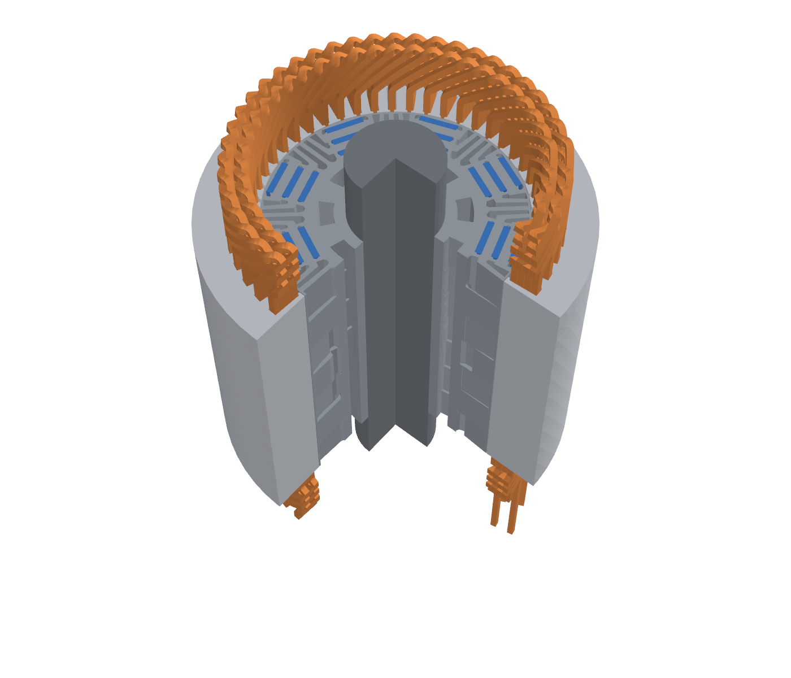
<br/>
<br/>
<em>Figure 1: The modeled machine with a quarter cut away: laminations (grey), magnets (blue) and the hairpin winding with crowns (top), welds and terminal leads (bottom).</em>
</div>
<br/>

**Outcome**

- The 7-step V skew cuts the load ripple by **two thirds** and the cogging torque by **86 %**, for
  **2.4 % (2D) to 4.0 % (3D)** of the mean torque.
- The copper loss at the operating point is **3.5 kW**, and the 3D model shows that **about 30 % of
  it is in the end turns**. The skew leaves this loss unchanged.
- The 2D multi-slice method predicts the effect of the skew well: the full 3D model gives
  **−65 %** ripple and **−85 %** cogging, against −67 % and −86 % from 2D.
- **Recommendation:** lay out the skew with the 2D multi-slice method, and use one full 3D run per
  candidate design to sign off the losses and the 3D effects of the skew.

## Why Skew?

Each axial step of a skewed rotor produces the same torque ripple, shifted in time, so the ripples
of the steps partly cancel along the axis [4]. A V arrangement is symmetric about the stack centre
and balances the axial forces [5].

<div align="center">
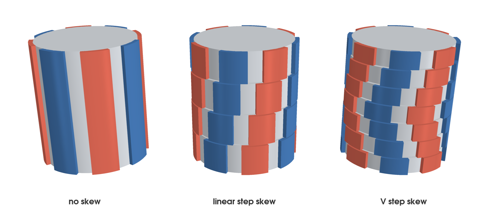
<br/>
<br/>
<em>Figure 2: Schematic 8-pole rotors: no skew, a linear step skew and a V step skew (step angle exaggerated).</em>
</div>
<br/>

## The Machine

The rotor and stator geometry are those of a production traction motor [1, 2], as provided in
pyleecan's machine data set [3]. The winding is our own definition, as the source data contain
none.

<div align="center">
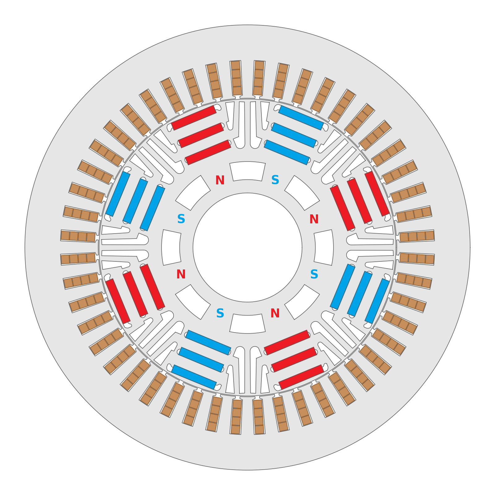
<br/>
<br/>
<em>Figure 3: The cross-section: 3 magnet slabs per pole (red: north, blue: south), flux barriers between the poles and 4 hairpin bars in each of the 48 slots.</em>
</div>
<br/>

| Quantity | Value |
| -------- | ----- |
| Slots / poles | 48 / 8 |
| Stack length, air gap | 165.1 mm, 0.4 mm |
| Rotor | 3 NdFeB magnet slabs and 6 flux barriers per pole |
| Winding | hairpin wave winding, 4 bars per slot, 2 parallel paths per phase |
| Skew | 7 equal steps in a V, 7.5° mech in total (one slot pitch) |
| Operating point | 550 A peak, $`\beta = 40°`$ (maximum torque per ampere), 4030 rpm (268.7 Hz) |
| Iron (stator, rotor, shaft) | HF-10X $`B(H)`$ curve |
| Magnets | NdFeB, $`B_r = 1.45\,\mathrm{T}`$, $`\mu_r = 1.05`$, along the pole axis of each step |
| Copper | $`\sigma = 58\,\mathrm{MS/m}`$, with eddy currents for the loss runs |

<div align="center">
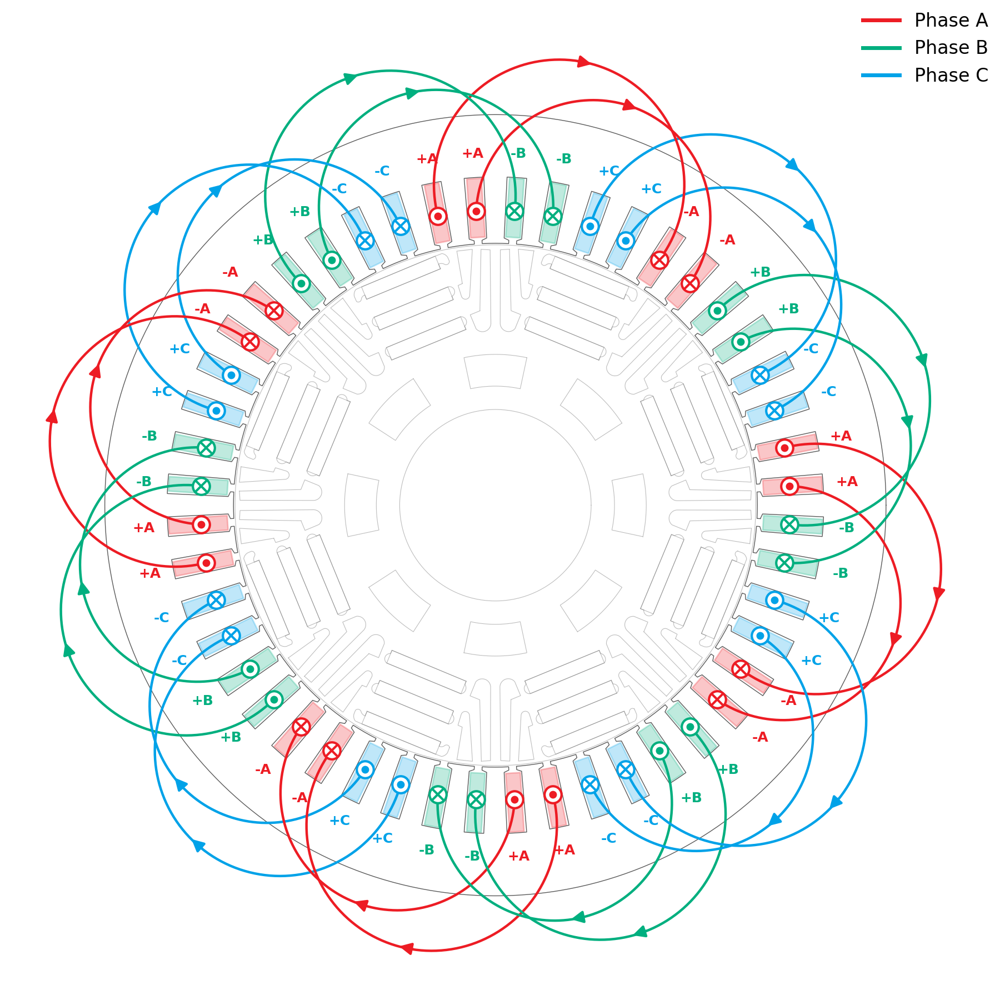
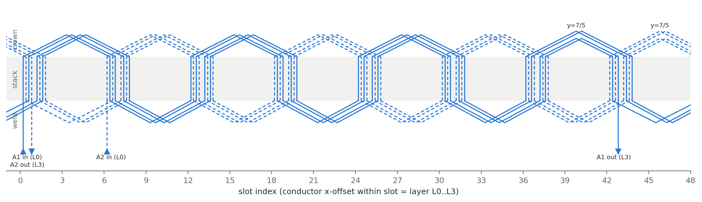
<br/>
<br/>
<em>Figure 4: The winding. Left: phase and current direction of each slot and the end connections. Right: phase A developed, its 2 parallel paths wave-wound through the 4 layers.</em>
</div>
<br/>

The end connections span 6 slots, a full pole pitch: the crowns make them at one end of the stack,
the welds at the other.

## Setup

The full machines, skewed and unskewed, are modeled in 3D with about 13 million tetrahedra each,
including the air around the stack ends. Each of the 6 parallel paths of the winding is one solid
conductor, fed with half the phase current between its two terminal faces. The rotor turns, and
rotor and stator meet at a sliding interface in the middle of the air gap. A magnetostatic
initialization is followed by 30 time steps of 0.5°, which cover 15° mech, one full period of the
dominant 6th torque harmonic.

| Setting | Value |
| ------- | ----- |
| Model | Time-Domain Magnetic, field-conforming ($`T`$-$`\Omega`$) formulation |
| Non-linear iron | material-state Newton stabilization with an energy line search |
| Motion | rotating rotor, non-matching (sliding) interface, conservative coupling |
| Magnets | one material per skew step and pole, remanence fixed in the rotor frame |
| Winding | 6 solid conductors (`CoilTypeSolid`), open between their terminals, current-driven |
| Losses | conducting copper with eddy currents in the whole winding (`--eddy`) |
| Reports | rotor torque, flux linkage per path, Ohmic loss of the winding |

## Results

### 2D: the Unskewed Baseline and Multi-Slice Skew

A 2D model of one pole gives the baseline: 313 N m mean torque with a ripple of 49 N m peak to peak
(16 %), and 25 N m cogging torque. The multi-slice method models each skew step as its own 2D slice
with the rotor turned by the step angle, and sums torque and flux linkage with the step lengths as
weights.

<div align="center">
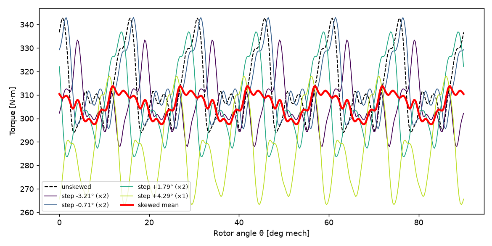
<br/>
<br/>
<em>Figure 5: 2D load torque per skew step (thin), their weighted sum (red) and the unskewed machine (dashed).</em>
</div>
<br/>

Under load each step runs at its own load angle, between 23° and 53°, with its own saturation, so
the multi-slice sum captures how the steps differ, not only how they are shifted.

### 3D: Agreement with 2D on an Extruded Slice

On a thin extruded slice of the unskewed machine, where 2D and 3D must agree, the 3D torque matches
the 2D one to 0.14 % under load and to 0.6 % for the cogging torque.

<div align="center">
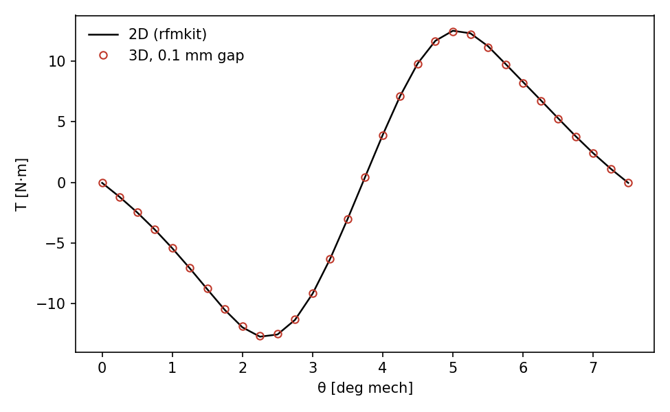
<br/>
<br/>
<em>Figure 6: Cogging torque over one period on the extruded slice: 2D (line) and mufem 3D (circles).</em>
</div>
<br/>

### 3D: the Full Skewed and Unskewed Machines

<div align="center">
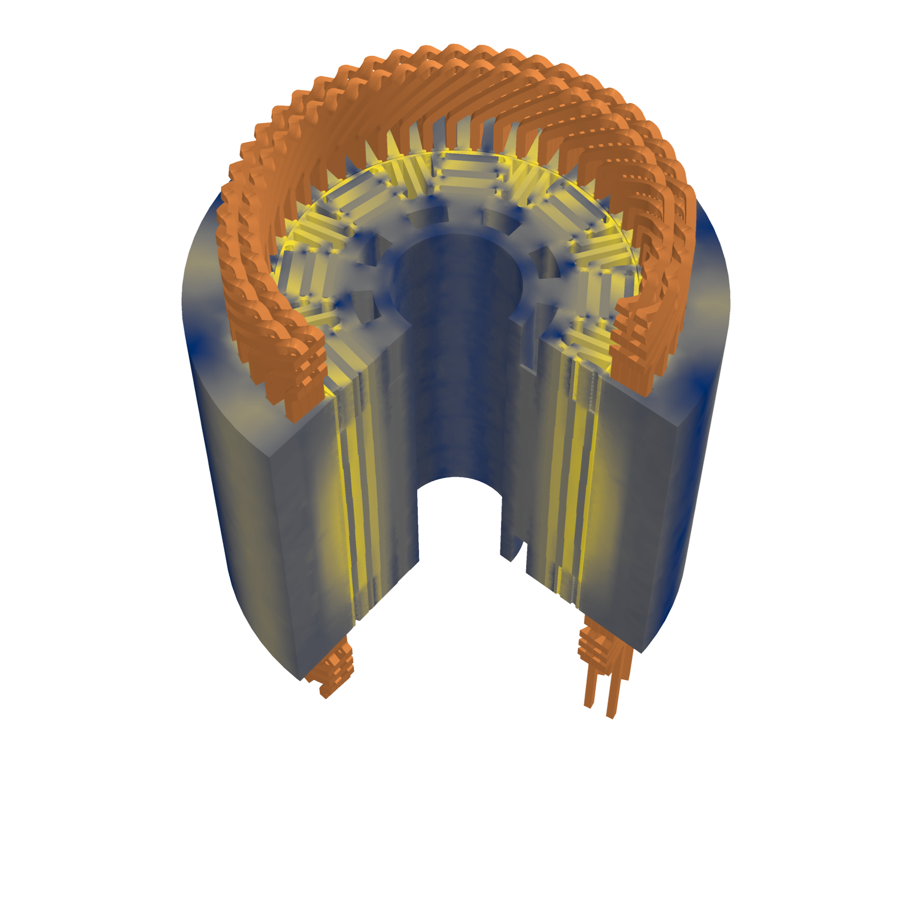
<br/>
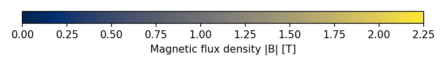
<br/>
<br/>
<em>Figure 7: Magnetic flux density in the skewed machine at load (air and shaft not shown). The cut face shows the staggered magnet steps of the skew.</em>
</div>
<br/>

| Effect of the skew | 2D multi-slice | 3D full machine |
| ------------------ | -------------- | --------------- |
| Load ripple | **−67 %** | **−65 %** |
| Cogging torque | **−86 %** | **−85 %** |
| Mean torque | −2.4 % | −4.0 % |

- **2D and 3D agree on the benefit of the skew:** −67 % and −65 % ripple, −86 % and −85 % cogging.
- **The 3D model captures the axial flux between the steps,** which the multi-slice method
  ignores [4]; it shows a slightly larger cost in mean torque.
- **The back EMF agrees within 1 %:** 153 V in 3D and 154 V in 2D for the unskewed machine.

### Copper Loss in the Whole Winding

At 268.7 Hz the skin depth in copper is 4.0 mm, about the height of a hairpin bar. The slot leakage
field pushes the current towards the slot opening, and the AC loss rises well above the DC loss. In
the 3D runs the whole winding conducts with eddy currents, end turns and leads included, with the
rotor turning and the iron saturating.

<div align="center">
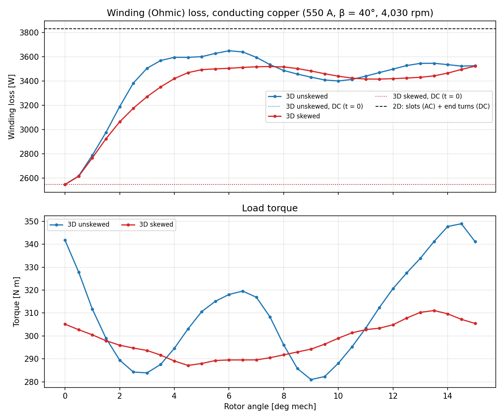
<br/>
<br/>
<em>Figure 8: Winding loss (top) and torque (bottom) with conducting copper, skewed and unskewed.</em>
</div>
<br/>

<div align="center">
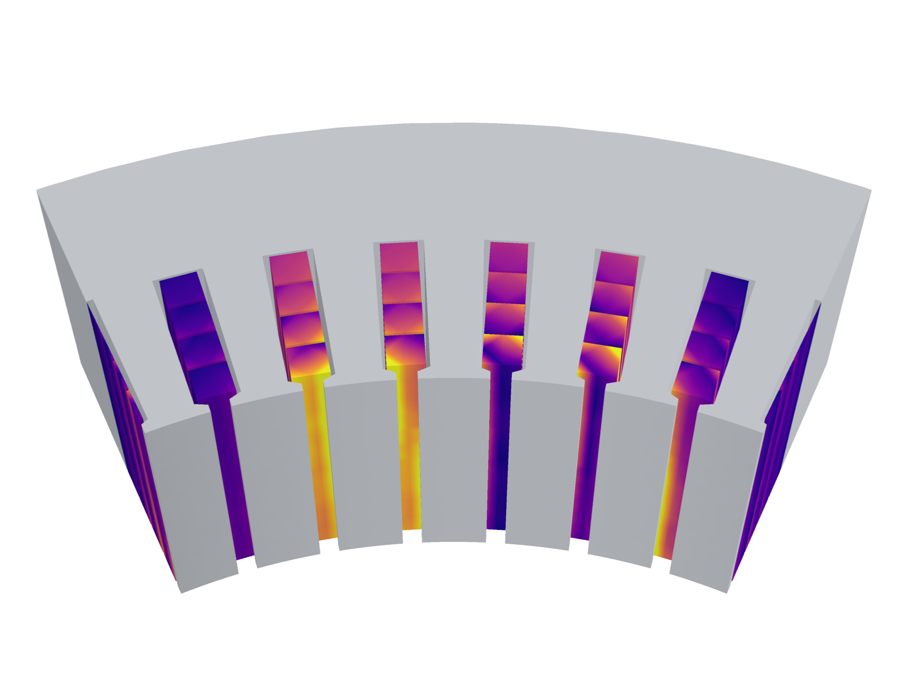
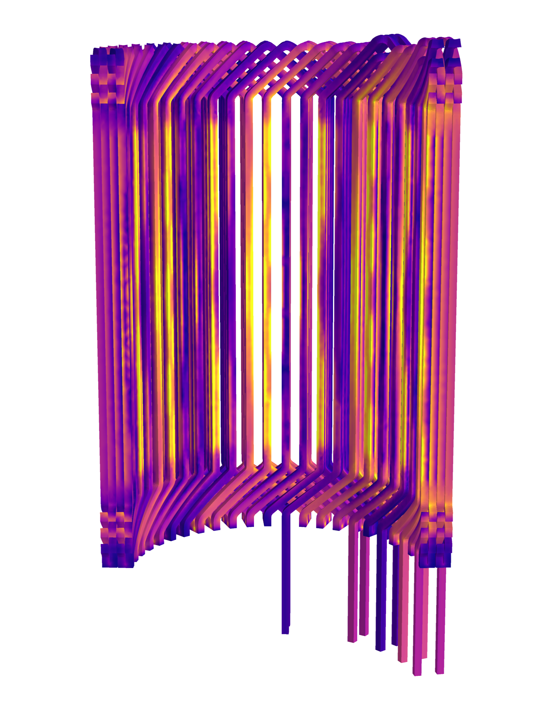
<br/>
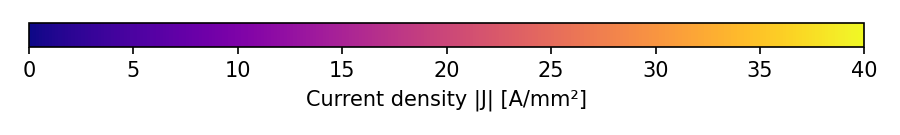
<br/>
<br/>
<em>Figure 9: Current density in the skewed machine. Left: the bars at mid-stack, crowding towards the slot opening. Right: the whole winding with its end turns.</em>
</div>
<br/>

| Winding loss | 3D unskewed | 3D skewed |
| ------------ | ----------- | --------- |
| DC | 2,545 W | 2,545 W |
| AC, mean over 7.5–15° | 3,480 W | 3,457 W |
| … in the slots / end turns | ≈ 2,400 / 1,080 W | ≈ 2,440 / 1,080 W |

- **The DC loss matches the 2D value to 0.4 %:** the 3D winding has the right length and
  cross-section.
- **About 30 % of the copper loss is in the end turns,** which a 2D model can only estimate.
- **The skew leaves the AC loss unchanged** (−0.7 %), and the eddy currents barely change the
  torque (−0.2 to −0.5 %).

## Workflow and Compute

| Step | Model size | Hardware | Wall time |
| ---- | ---------- | -------- | --------- |
| 2D baseline and multi-slice skew (6 sweeps) | one pole, 2D | workstation, 5 cores | minutes |
| 3D extruded slice, agreement with 2D | 0.3–2.8 M tetrahedra, second order | 8 cores | 0.5–5.5 h |
| 3D full machine, load or no-load sweep (31 positions) | 12.8–13.9 M tetrahedra | 8 cores, 29–32 GB | about 1 h each |
| 3D full machine with eddy currents in the winding | same, conducting copper | 32 cores (cloud), 48 GB | 44–51 min |

The 2D multi-slice method gives the skew layout in minutes; one full 3D run per design adds the
end-winding losses and the 3D effects of the skew within an hour.

## Running the Case

[pmsm_motor.py](pmsm_motor.py) sets up and runs the full machine at the operating point; it requires
mufem 0.8 or newer:

```bash
mpirun -np 8 python pmsm_motor.py --machine skewed --steps 30 --out results_skewed
mpirun -np 32 python pmsm_motor.py --machine skewed --steps 30 --eddy --out results_skewed_eddy
```

It writes the rotor torque, the flux linkage of each path and, with `--eddy`, the winding loss as
CSV files, and the fields at the end of the run. Its inputs are in [data](data):

| File | Content |
| ---- | ------- |
| [Winding_Skewed.json](data/Winding_Skewed.json), [Winding_Unskewed.json](data/Winding_Unskewed.json) | parallel paths and their terminals, magnet groups with their directions, main dimensions |
| [HF10X_BH.csv](data/HF10X_BH.csv) | $`B(H)`$ curve of the laminations |
| `Geometry_Skewed.msh`, `Geometry_Unskewed.msh` | the meshes, about 0.7 GB each, not part of the repository |

## References

1. A. J. Pina Ortega, S. Das, R. Islam, M. Bahrami Kouhshahi, *High-Fidelity Analysis with
   Multiphysics Simulation for Performance Evaluation of Electric Motors Used in Traction
   Applications*, IEEE Trans. Ind. Appl. 59(2), 1273–1282, 2023,
   doi:[10.1109/TIA.2022.3215967](https://doi.org/10.1109/TIA.2022.3215967).
2. A. Krings, C. Monissen, *Review and Trends in Electric Traction Motors for Battery Electric and
   Hybrid Vehicles*, 2020 International Conference on Electrical Machines (ICEM), vol. 1,
   pp. 1807–1813, 2020, doi:[10.1109/ICEM49940.2020.9270946](https://doi.org/10.1109/ICEM49940.2020.9270946).
3. pyleecan machine data set (Apache-2.0), [github.com/Eomys/pyleecan](https://github.com/Eomys/pyleecan):
   geometry of [1, 2]; materials and winding are not part of the source data.
4. X. Ge, Z. Q. Zhu et al., *Optimal Step-Skew Methods for Cogging Torque Reduction Accounting for
   Three-Dimensional Effect of Interior Permanent Magnet Machines*, IEEE Trans. Energy Convers.
   32(1), 222–232, 2017.
5. J. Blum, J. Merwerth, H.-G. Herzog, *Investigation of the segment order in step-skewed
   synchronous machines on noise and vibration*, EDPC 2014.
