# Step Skew in a Hairpin IPM Traction Motor

| Full 3D machine | Load ripple | Cogging torque | Copper loss | In the end turns | Per 3D run |
| :-------------: | :---------: | :------------: | :---------: | :--------------: | :--------: |
| **13 M** elements | **−65 %** | **−85 %** | **3.5 kW** | **≈ 30 %** | **≈ 1 h**, 8 cores |

## Introduction

**The engineering question.** An e-drive team has a hairpin interior permanent-magnet (IPM)
traction motor with 48 slots and 8 poles whose torque ripple is too high for a quiet drive train.
The usual remedy is a step skew: the rotor is cut into axial steps, each turned by a small angle
against its neighbours. Before committing to a 7-step V skew, the team needs answers to three
questions:

1. How much does the skew reduce the cogging torque and the load ripple, and what does it cost in
   mean torque?
2. Is the fast 2D multi-slice method accurate enough to design the skew, or is 3D needed?
3. What does the skew do to the copper losses, including those in the end windings that 2D cannot
   see?

This case study answers them with mufem, from 2D to the complete machine in 3D: the 165 mm stack
with all 7 rotor steps, the connected hairpin winding with its end turns and terminal leads, the
turning rotor, saturating iron and, for the losses, eddy currents in all copper. The case is run
with [pmsm_motor.py](pmsm_motor.py).

<div align="center">
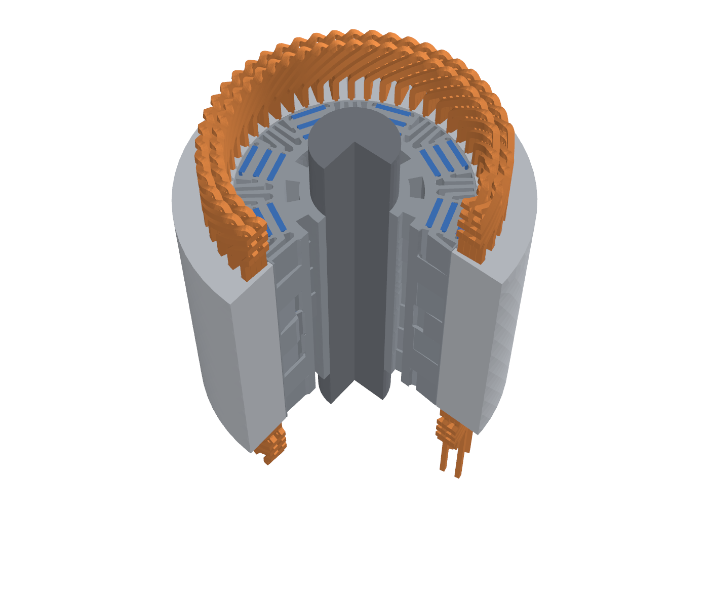
<br/>
<br/>
<em>Figure 1: The modeled machine with a quarter cut away: laminations (grey), magnets (blue) and the hairpin winding with crowns (top), welds and terminal leads (bottom).</em>
</div>
<br/>

**Outcome**

- The 7-step V skew cuts the load ripple by **two thirds** and the cogging torque by **86 %**, for
  **2.4 % (2D) to 4.0 % (3D)** of the mean torque.
- The copper loss at the operating point is **3.5 kW**, and the 3D model shows that **about 30 % of
  it is in the end turns**. The skew leaves this loss unchanged.
- The 2D multi-slice method predicts the effect of the skew well: the full 3D model gives
  **−65 %** ripple and **−85 %** cogging, against −67 % and −86 % from 2D.
- **Recommendation:** lay out the skew with the 2D multi-slice method, and use one full 3D run per
  candidate design to sign off the losses and the 3D effects of the skew.

**What mufem brings to this study**

- Eddy currents together with a sliding rotor–stator interface and non-linear iron, in one
  time-domain run of the complete machine.
- A complete hairpin winding, each parallel path a solid conductor with its own current, end turns
  and terminal leads included.
- The AC loss of the whole winding, slots and end turns, from the same model that gives the torque
  and the back EMF.
- One tool from the 2D sweep to the 13-million-element 3D machine, so the 2D and 3D results share
  materials, operating point and post-processing.

## Why Skew?

An IPM machine makes torque from its magnets and from the saliency of its rotor. This torque is not
constant over a revolution:

- **Cogging torque:** without current, the magnets are pulled towards the stator teeth. It is felt
  at standstill and at low speed, for example when creeping in traffic.
- **Load ripple:** with current, the slotted winding and the saturating rotor bridges create an air
  gap field that is not a pure sine wave, and the torque pulsates at multiples of 6 times the
  electrical frequency.

In a traction drive the ripple excites the gearbox and the housing and is heard as whine; NVH
targets are typically a few per cent of the rated torque. A step skew addresses both effects: each
axial step produces the same ripple, shifted in time, so the ripples of the steps partly cancel
along the axis [4]. A V arrangement, turning the steps out and back again, is symmetric about the
stack centre and balances the axial forces on the rotor [5].

<div align="center">
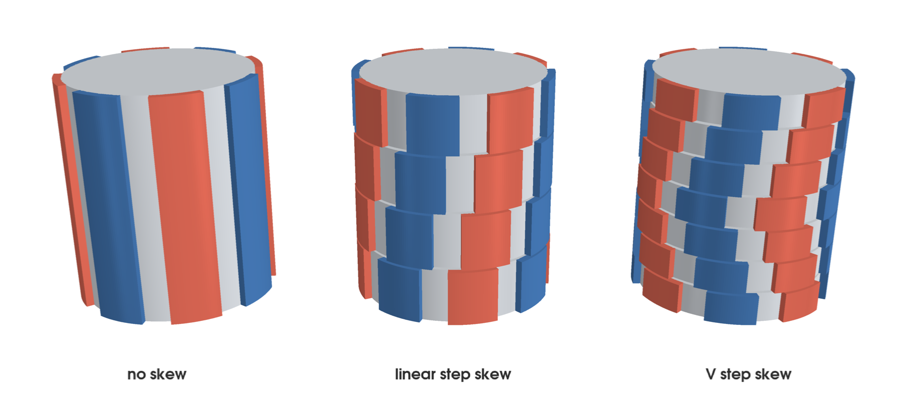
<br/>
<br/>
<em>Figure 2: Schematic 8-pole rotors: no skew, a linear step skew and a V step skew (step angle exaggerated).</em>
</div>
<br/>

The skew also turns the fundamental field of each step slightly away from the stator currents, so
it costs some mean torque, and it lets flux cross axially between neighbouring steps. How large
these effects are for a given design is exactly what the simulation has to tell.

## The Machine

The rotor and stator geometry are those of a production traction motor [1, 2], as provided in
pyleecan's machine data set [3]. The winding is our own definition, as the source data contain
none.

<div align="center">
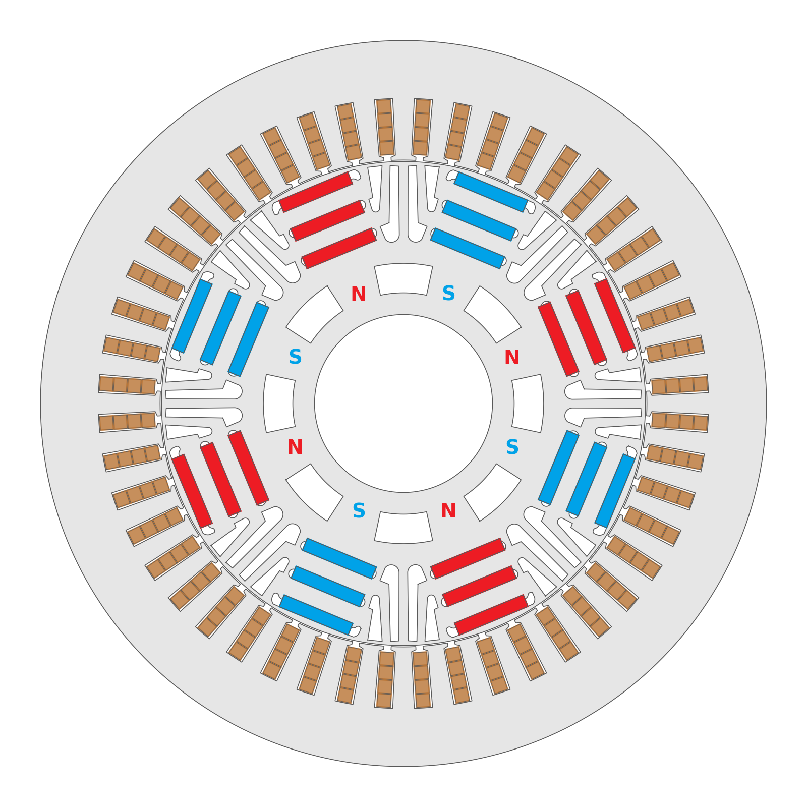
<br/>
<br/>
<em>Figure 3: The cross-section: 3 magnet slabs per pole (red: north, blue: south), flux barriers between the poles and 4 hairpin bars in each of the 48 slots.</em>
</div>
<br/>

Each rotor pole carries 3 magnet slabs, and finger-shaped flux barriers between the poles raise the
saliency for reluctance torque. The thin iron bridges between the barriers and the rotor surface
hold the rotor together at speed and saturate in operation; their non-linear behaviour shapes both
the torque ripple and the response to the skew.

| Quantity | Value |
| -------- | ----- |
| Slots / poles | 48 / 8 |
| Stack length, air gap | 165.1 mm, 0.4 mm |
| Rotor | 3 NdFeB magnet slabs and 6 flux barriers per pole |
| Winding | hairpin wave winding, 4 bars per slot, 2 parallel paths per phase |
| Skew | 7 equal steps in a V, 7.5° mech in total (one slot pitch) |
| Operating point | 550 A peak, $`\beta = 40°`$ (maximum torque per ampere), 4030 rpm (268.7 Hz) |
| Iron (stator, rotor, shaft) | HF-10X $`B(H)`$ curve |
| Magnets | NdFeB, $`B_r = 1.45\,\mathrm{T}`$, $`\mu_r = 1.05`$, along the pole axis of each step |
| Copper | $`\sigma = 58\,\mathrm{MS/m}`$, with eddy currents for the loss runs |

<div align="center">
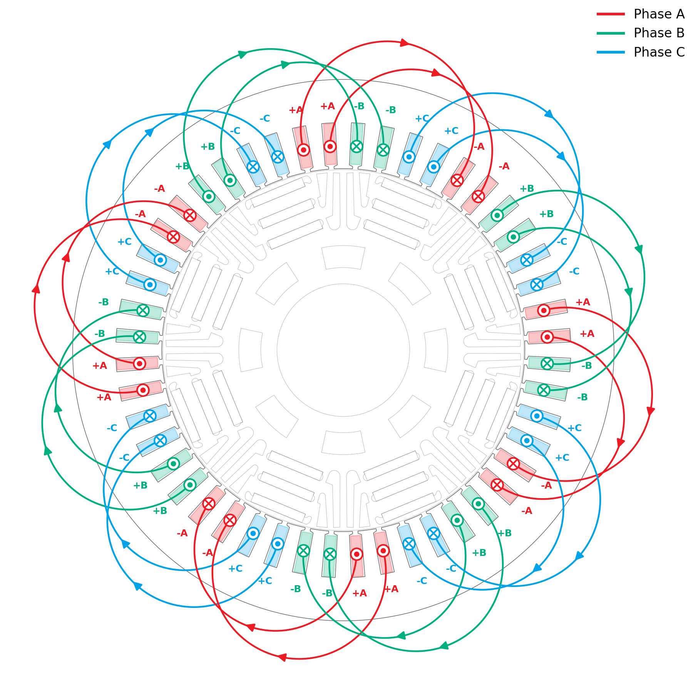
<br/>
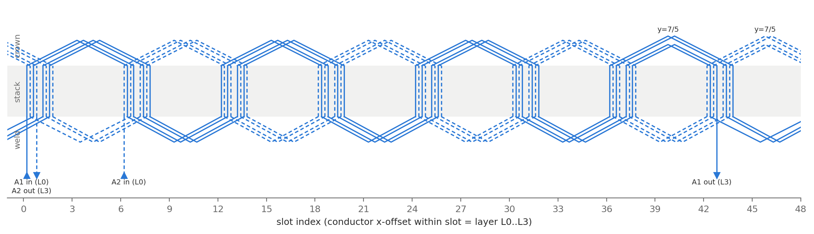
<br/>
<br/>
<em>Figure 4: The winding. Top: phase and current direction of each slot and the end connections. Bottom: phase A developed, its 2 parallel paths wave-wound through the 4 layers.</em>
</div>
<br/>

Each parallel path has 32 bars and passes through all 4 layers, so both paths of a phase see the
same slot leakage field and carry the same loss. The end connections span 6 slots, a full pole
pitch: the crowns make them at one end of the stack, the welds at the other. Phases B and C are
copies of phase A, shifted by 4 and 8 slots.

## Setup

The full machines, skewed and unskewed, are modeled in 3D with about 13 million tetrahedra each,
including the air around the stack ends. Each of the 6 parallel paths of the winding is one solid
conductor, fed with half the phase current between its two terminal faces. The rotor turns, and
rotor and stator meet at a sliding interface in the middle of the air gap. A magnetostatic
initialization is followed by 30 time steps of 0.5°, which cover 15° mech, one full period of the
dominant 6th torque harmonic.

<details>
<summary>Model settings</summary>

| Setting | Value |
| ------- | ----- |
| Model | Time-Domain Magnetic, field-conforming ($`T`$-$`\Omega`$) formulation |
| Non-linear iron | material-state Newton stabilization with an energy line search |
| Motion | rotating rotor, non-matching (sliding) interface, conservative coupling |
| Magnets | one material per skew step and pole, remanence fixed in the rotor frame |
| Winding | 6 solid conductors (`CoilTypeSolid`), open between their terminals, current-driven |
| Losses | conducting copper with eddy currents in the whole winding (`--eddy`) |
| Reports | rotor torque, flux linkage per path, Ohmic loss of the winding |

</details>

The skewed and unskewed machines differ only in the rotor: stator, winding, materials and
operating point are the same, so the differences in the results come from the skew.

## Results

### 2D: the Unskewed Baseline and Multi-Slice Skew

A 2D model of one pole gives the baseline: 313 N m mean torque with a ripple of 49 N m peak to peak
(16 %), and 25 N m cogging torque, both well above the levels a quiet traction drive needs.

The multi-slice method models each skew step as its own 2D slice with the rotor turned by the step
angle, and sums torque and flux linkage with the step lengths as weights. For 7 steps and a full
period of rotor positions this takes a few minutes on a workstation.

<div align="center">
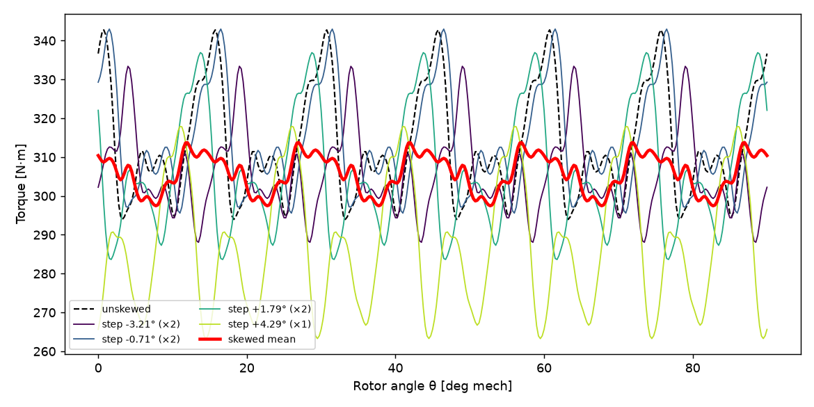
<br/>
<br/>
<em>Figure 5: 2D load torque per skew step (thin), their weighted sum (red) and the unskewed machine (dashed).</em>
</div>
<br/>

| 2D | Unskewed | Skewed (multi-slice) | Change |
| -- | -------- | -------------------- | ------ |
| Mean torque | 313.2 N m | 305.9 N m | −2.4 % |
| Load ripple, peak to peak | 48.8 N m | 16.3 N m | **−67 %** |
| Cogging torque, peak to peak | 25.3 N m | 3.6 N m | **−86 %** |

The cogging torque nearly vanishes: without current, the steps are shifted copies of each other
and their ripples cancel almost completely. Under load the picture is richer. The stator currents
follow the mean rotor position, so each step runs at its own load angle, between 23° and 53°, with
its own saturation of the rotor bridges. The steps are then no longer identical copies, and the
cancellation is less complete. The ripple that remains is mostly the 6th harmonic, of which a skew
of one slot pitch spans half a period. This tells the designer where further gains lie: a longer
skew, or a shaping of the rotor barriers that targets the 6th harmonic.

### 3D: Agreement with 2D on an Extruded Slice

Before comparing complete machines, the 3D model is checked against 2D where both must agree: on a
thin extruded slice of the unskewed machine, with flux-tangential end faces and each bar a separate
conductor. Swept over the rotor position, the 3D torque matches the 2D one to **0.14 %** under load
and to **0.6 %** for the cogging torque, with second-order fields and 0.1 mm elements in the air
gap. This confirms that rotor position, magnet directions, current phase and signs are consistent
between the 2D and 3D models, so the differences in the full machines are physics.

<div align="center">
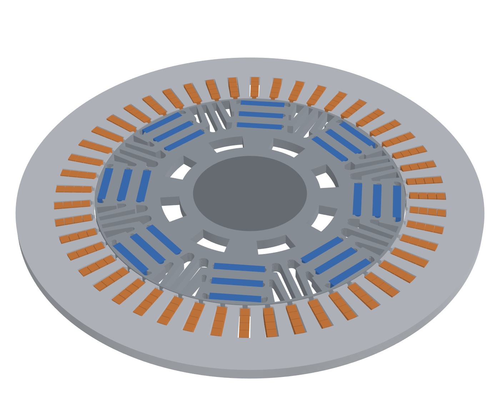
<br/>
<br/>
<em>Figure 6: The 3D validation model, the 2D section extruded to a 5 mm slice: stator and rotor core (grey), magnets (blue) and the 192 bars (orange), each a separate conductor; the air is not shown.</em>
</div>
<br/>

<div align="center">
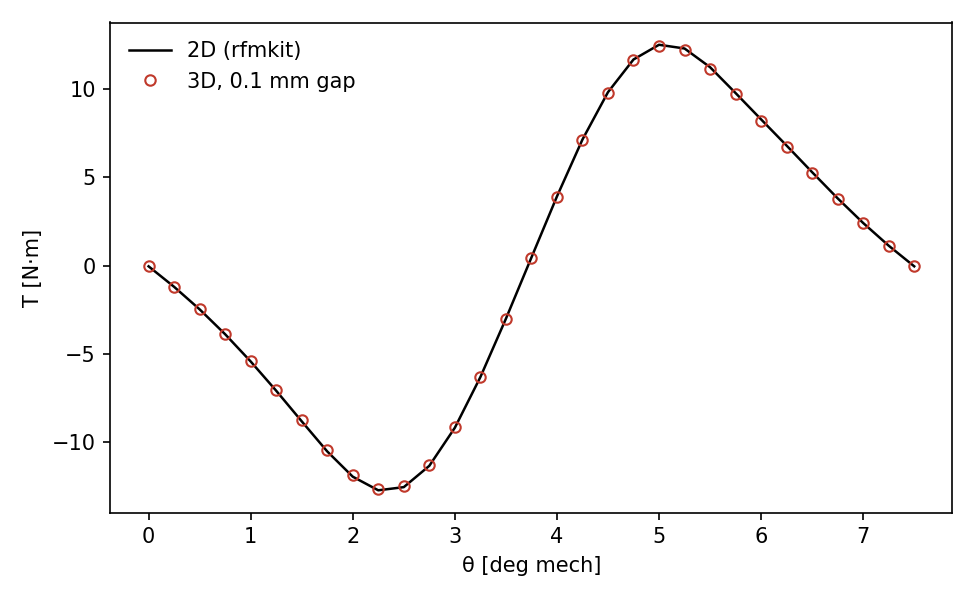
<br/>
<br/>
<em>Figure 7: Cogging torque over one period on the extruded slice: 2D (line) and mufem 3D (circles).</em>
</div>
<br/>

### 3D: the Full Skewed and Unskewed Machines

The full models contain everything a 2D model leaves out: the fringing field at both ends of the
165 mm stack, the 7 rotor steps turned against each other, the connected hairpin winding with its
end turns and terminal leads, and the air around the stack ends.

<div align="center">
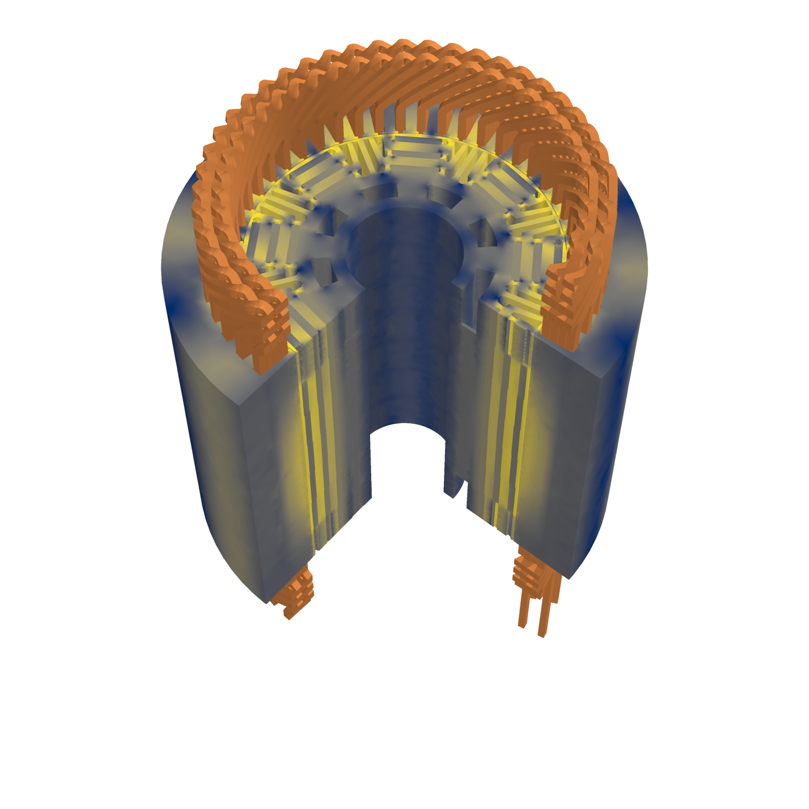
<br/>
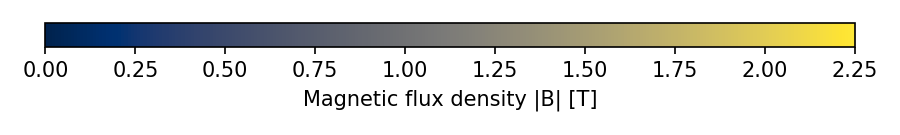
<br/>
<br/>
<em>Figure 8: Magnetic flux density in the skewed machine at load (air and shaft not shown). The cut face shows the staggered magnet steps of the skew.</em>
</div>
<br/>

The flux density is highest in the saturated rotor bridges and the stator teeth. On the cut face
the magnet steps are staggered from one end of the stack to the centre and back, the V of the skew.

| Effect of the skew | 2D multi-slice | 3D full machine |
| ------------------ | -------------- | --------------- |
| Load ripple | **−67 %** | **−65 %** |
| Cogging torque | **−86 %** | **−85 %** |
| Mean torque | −2.4 % | −4.0 % |
| Back EMF peak | −3 % | −4 % |

- **2D and 3D agree on the benefit of the skew:** −67 % and −65 % ripple, −86 % and −85 % cogging.
- **The 3D model captures the axial flux between the steps,** which the multi-slice method
  ignores [4]; it shows a slightly larger cost in mean torque, 4.0 % instead of 2.4 %.
- **The back EMF agrees within 1 %:** 153 V in 3D and 154 V in 2D for the unskewed machine. In both
  models the skew smooths its trapezoidal shape towards a sine wave.

### Copper Loss in the Whole Winding

At 268.7 Hz the skin depth in copper is 4.0 mm, about the height of a hairpin bar. The slot leakage
field, which grows from the slot bottom towards the slot opening, pushes the current towards the
opening, and the AC loss rises well above the DC loss. In the 3D runs the whole winding conducts
with eddy currents, end turns and leads included, with the rotor turning, the magnets and the
saturating iron at the operating point. The runs start from the DC current distribution, and the
eddy currents build up within the first 4–5° of rotation.

<div align="center">
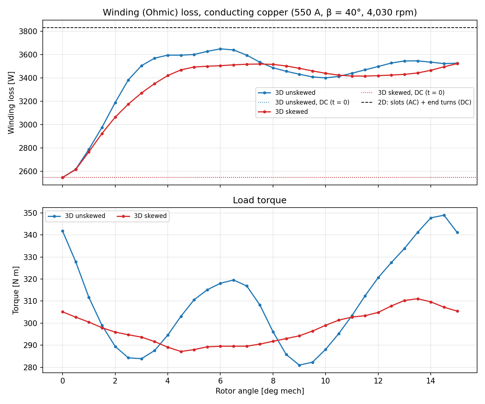
<br/>
<br/>
<em>Figure 9: Winding loss (top) and torque (bottom) with conducting copper, skewed and unskewed. Dotted: the DC loss; dashed: a conventional 2D estimate with AC loss in the slots and DC loss in the end turns.</em>
</div>
<br/>

<div align="center">
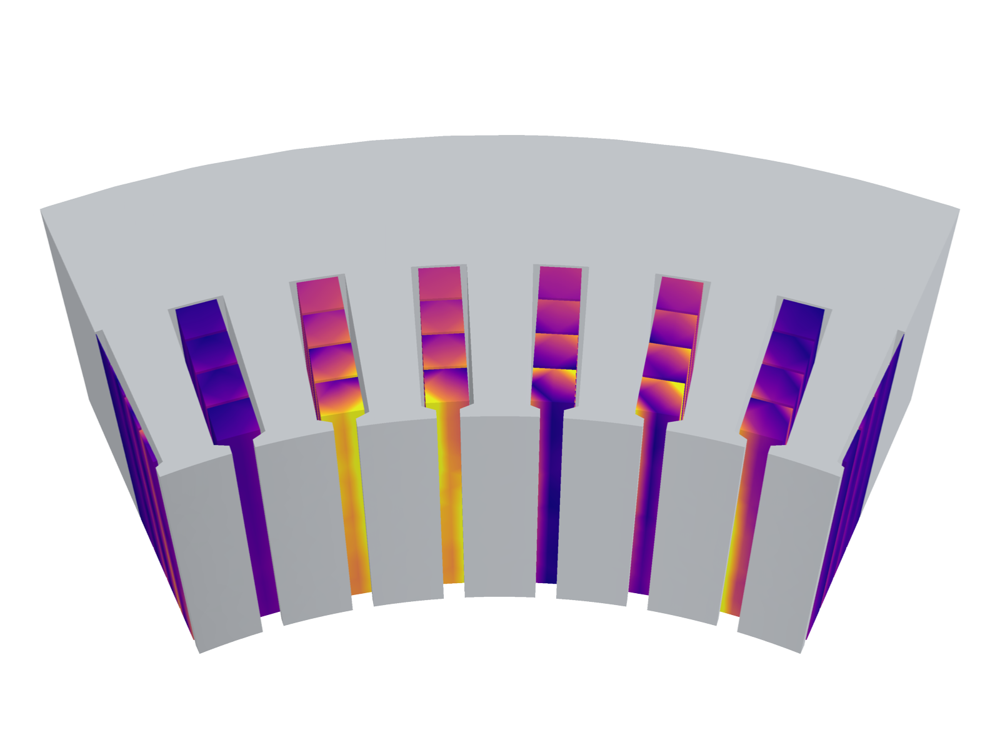
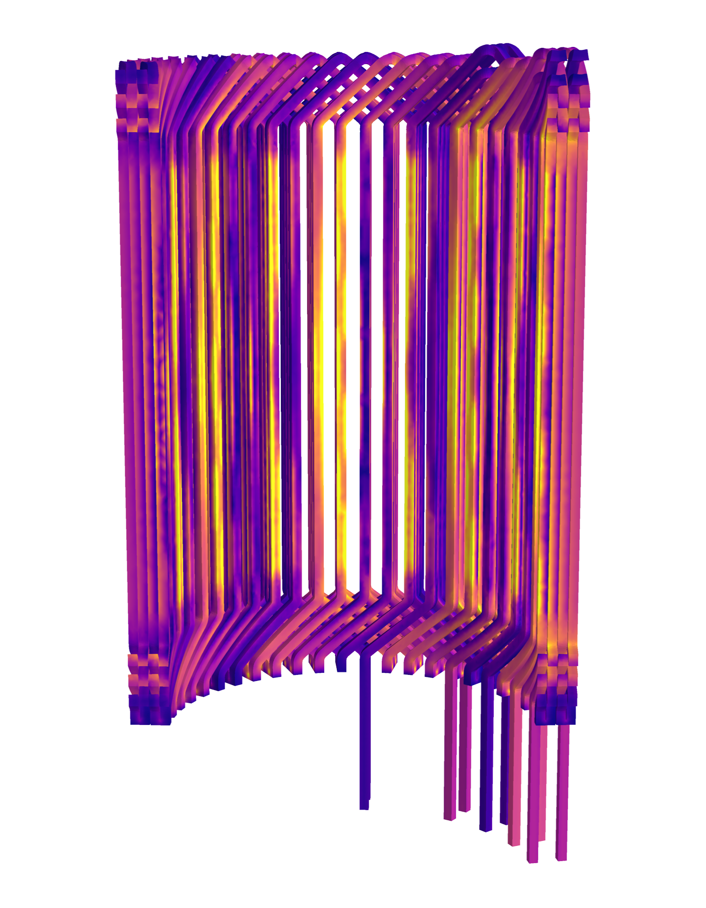
<br/>
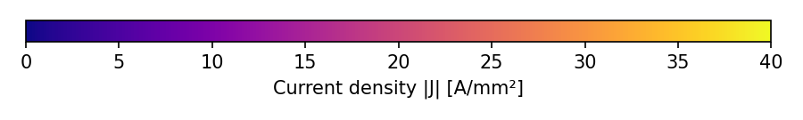
<br/>
<br/>
<em>Figure 10: Instantaneous current density in the skewed machine. Left: the bars in a 50° sector at mid-stack, seen from the bore; in the loaded slots the current crowds into the bar next to the slot opening, up to about 40 A/mm². Right: the back half of the winding with the crowns at the top and the welds and leads at the bottom; in the end turns the current spreads almost evenly over the cross-section.</em>
</div>
<br/>

The current density is a snapshot: the bars of the phase near its peak current show the strongest
crowding, those of a phase near its zero crossing carry little current. Over an electrical period
every slot passes through the same states, so the averaged loss is the same in every slot.

<div align="center">
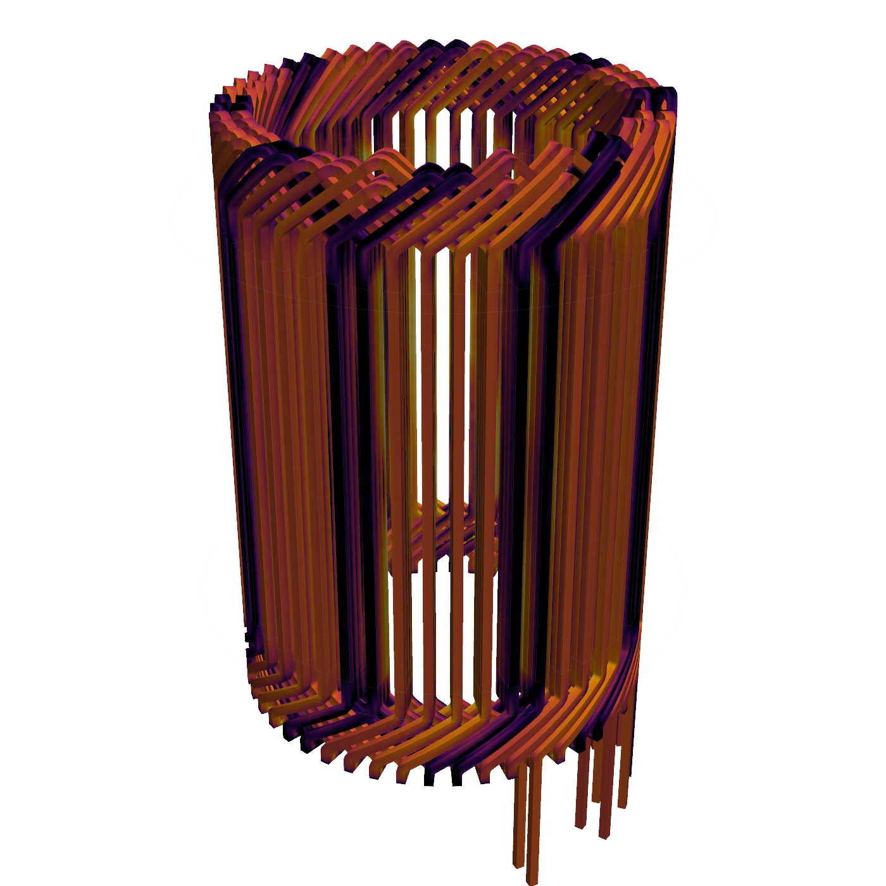
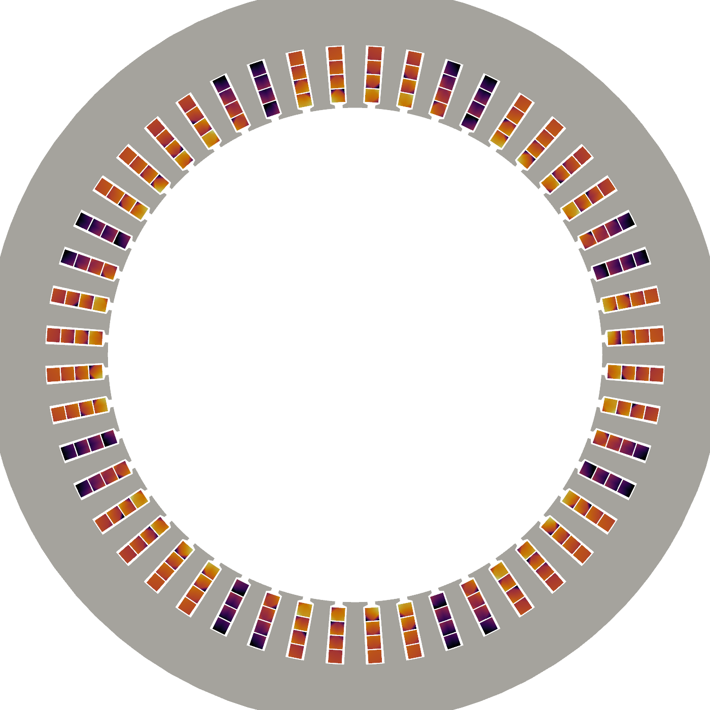
<br/>
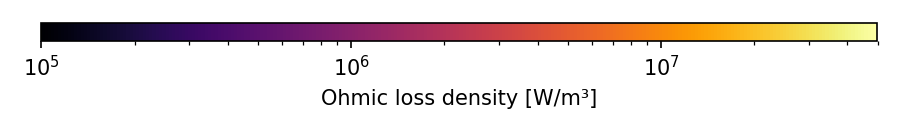
<br/>
<br/>
<em>Figure 11: Instantaneous Ohmic loss density in the skewed machine, log scale. Left: the whole winding; the crowns, welds and leads carry a large share of the loss. Right: the cross-section at mid-stack; in each loaded slot the loss concentrates in the bar next to the slot opening.</em>
</div>
<br/>

The loss density makes the split between slots and end turns visible: inside the stack the loss
concentrates where the slot leakage field is strongest, while the long end connections add a
nearly uniform DC-like loss along their whole length.

| Winding loss | 3D unskewed | 3D skewed |
| ------------ | ----------- | --------- |
| DC | 2,545 W | 2,545 W |
| AC, mean over 7.5–15° | 3,480 W | 3,457 W |
| … in the slots / end turns | ≈ 2,400 / 1,080 W | ≈ 2,440 / 1,080 W |

- **The DC loss matches the 2D value to 0.4 %:** the 3D winding has the right length and
  cross-section.
- **About 30 % of the copper loss is in the end turns.** The 3D model computes it directly, where a
  2D model has to add it as an estimate from the conductor length.
- **The crowding sits in the bar next to the slot opening,** which makes that bar the first
  candidate for a smaller height or a transposition in a next design iteration.
- **The skew leaves the AC loss unchanged** (−0.7 %), so its NVH benefit comes without a thermal
  penalty, and the eddy currents barely change the torque (−0.2 to −0.5 %).

## Discussion

The study gives the e-drive team a clear path:

1. **The skew works as designed.** A 7-step V skew of one slot pitch removes two thirds of the load
   ripple and 86 % of the cogging torque, for 2–4 % of the mean torque. The residual ripple is the
   6th harmonic, which a longer skew or a change of the rotor barriers can address next.
2. **Multi-slice 2D is a good design tool for the skew.** It predicts the relative reductions within
   2 percentage points of the full 3D model, in minutes instead of an hour, and is the right tool
   to sweep the number of steps, their angles and their order.
3. **3D signs off the design.** The end turns carry about 30 % of the copper loss, and the axial
   coupling of the steps costs a little extra torque; both come directly out of one full 3D run.
   For the thermal design, the end-winding cooling deserves as much attention as the slot cooling.

The same workflow carries straight into the next design iteration:

| Design variation | Question | Tool |
| ---------------- | -------- | ---- |
| Number of steps, skew angle | How far can the residual 6th harmonic be pushed down? | 2D multi-slice sweep |
| Step order (V, linear, zig-zag) | Which order balances ripple, axial force and mean torque best? | 2D multi-slice, 3D for the axial effects |
| Rotor barrier shape | Can the barriers target the 6th harmonic directly? | 2D sweep, 3D sign-off |
| Bar height, layer split | How much AC loss does a lower bar at the slot opening save? | 3D with eddy currents |
| Operating points | How do ripple and losses change over the torque–speed map? | 3D runs per point, in parallel |

## Workflow and Compute

| Step | Model size | Hardware | Wall time |
| ---- | ---------- | -------- | --------- |
| 2D baseline and multi-slice skew (6 sweeps) | one pole, 2D | workstation, 5 cores | minutes |
| 3D extruded slice, agreement with 2D | 0.3–2.8 M tetrahedra, second order | 8 cores | 0.5–5.5 h |
| 3D full machine, load or no-load sweep (31 positions) | 12.8–13.9 M tetrahedra | 8 cores, 29–32 GB | about 1 h each |
| 3D full machine with eddy currents in the winding | same, conducting copper | 32 cores (cloud), 48 GB | 44–51 min |

The 2D multi-slice method gives the skew layout in minutes; one full 3D run per design adds the
end-winding losses and the 3D effects of the skew within an hour. The 13-million-element machine
with a turning rotor and non-linear iron runs on a single 8-core workstation.

## Running the Case

[pmsm_motor.py](pmsm_motor.py) sets up and runs the full machine at the operating point; it requires
mufem 0.8 or newer:

```bash
mpirun -np 8 python pmsm_motor.py --machine skewed --steps 30 --out results_skewed
mpirun -np 32 python pmsm_motor.py --machine skewed --steps 30 --eddy --out results_skewed_eddy
```

It writes the rotor torque, the flux linkage of each path and, with `--eddy`, the winding loss as
CSV files, and the fields at the end of the run. Its inputs are in [data](data):

| File | Content |
| ---- | ------- |
| [Winding_Skewed.json](data/Winding_Skewed.json), [Winding_Unskewed.json](data/Winding_Unskewed.json) | parallel paths and their terminals, magnet groups with their directions, main dimensions |
| [HF10X_BH.csv](data/HF10X_BH.csv) | $`B(H)`$ curve of the laminations |
| `Geometry_Skewed.msh`, `Geometry_Unskewed.msh` | the meshes, about 0.7 GB each, not part of the repository |

## Get in Touch

Would you like to run a study like this on your own machine, or see mufem on your design
questions? Contact us at [info@raiden-numerics.com](mailto:info@raiden-numerics.com) or visit
[mufem.raiden-numerics.com](https://mufem.raiden-numerics.com).

## References

1. A. J. Pina Ortega, S. Das, R. Islam, M. Bahrami Kouhshahi, *High-Fidelity Analysis with
   Multiphysics Simulation for Performance Evaluation of Electric Motors Used in Traction
   Applications*, IEEE Trans. Ind. Appl. 59(2), 1273–1282, 2023,
   doi:[10.1109/TIA.2022.3215967](https://doi.org/10.1109/TIA.2022.3215967).
2. A. Krings, C. Monissen, *Review and Trends in Electric Traction Motors for Battery Electric and
   Hybrid Vehicles*, 2020 International Conference on Electrical Machines (ICEM), vol. 1,
   pp. 1807–1813, 2020, doi:[10.1109/ICEM49940.2020.9270946](https://doi.org/10.1109/ICEM49940.2020.9270946).
3. pyleecan machine data set (Apache-2.0), [github.com/Eomys/pyleecan](https://github.com/Eomys/pyleecan):
   geometry of [1, 2]; materials and winding are not part of the source data.
4. X. Ge, Z. Q. Zhu et al., *Optimal Step-Skew Methods for Cogging Torque Reduction Accounting for
   Three-Dimensional Effect of Interior Permanent Magnet Machines*, IEEE Trans. Energy Convers.
   32(1), 222–232, 2017.
5. J. Blum, J. Merwerth, H.-G. Herzog, *Investigation of the segment order in step-skewed
   synchronous machines on noise and vibration*, EDPC 2014.
