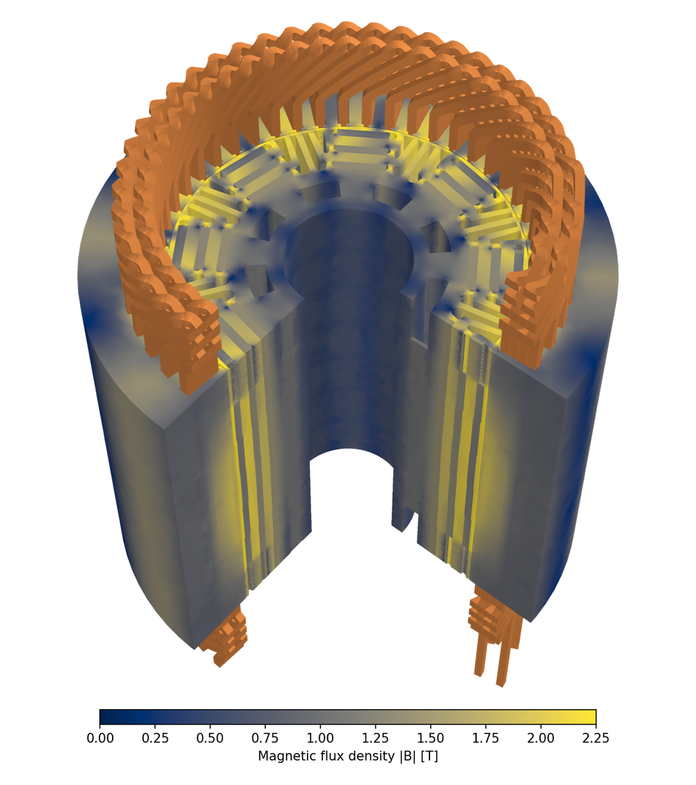
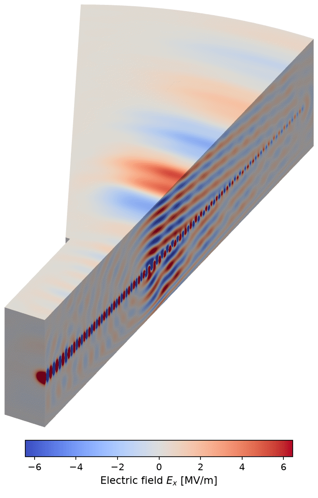

# Case Studies

This page lists the case studies of mufem. Each case study applies mufem to a complete engineering
problem, from the geometry to the design decision. Where possible, a case study first checks its
method against a reference, then uses it to answer the engineering question.

The [validation cases](../Validations/README.md) check single models against published, measured, or
analytical reference values. The case studies show how these models work together on an industrial
design task.

## Cases

<table>
<tr>
<td width="25%" height="130" align="center"></td>
<td width="75%" valign="top">
<strong><a href="PMSM-Motor/README.md">Step Skew in a Hairpin IPM Traction Motor</a></strong> 
A 48-slot, 8-pole interior permanent-magnet traction motor with a hairpin winding and a 7-step V
skew of the rotor. The study finds how much the skew reduces the cogging torque and the load
ripple, and what it costs in mean torque. It compares the fast 2D multi-slice method with a full 3D
model of the machine: turning rotor, saturating iron, the connected hairpin winding with its end
turns, and eddy currents in all copper. The 3D model gives the AC copper loss of the whole winding,
end turns included.
</td>
</tr>
<tr></tr>
<tr>
<td width="25%" height="130" align="center"></td>
<td width="75%" valign="top">
<strong><a href="Grating-Coupler/README.md">Optimizing a Fan Grating Coupler for a Multimode Fiber Link</a></strong> 
A fan-shaped silicon-photonics grating coupler that sends the light of a chip-scale transmitter
through a tilted resin pillar into a 50 µm multimode fiber. The study first finds how much light the
published coupler delivers into the fiber's acceptance, then lets the Bayesian optimizer Ax/BoTorch
drive full 3D time-harmonic Maxwell simulations to improve it, on the same chip area and within the
fabrication rules and beam requirements. The optimized coupler delivers 7.8 % more light into the
fiber, with the reflection below 1 %.
</td>
</tr>
</table>

## Get in Touch

Would you like a case study on your own design? Contact us at
[info@raiden-numerics.com](mailto:info@raiden-numerics.com) or visit
[mufem.raiden-numerics.com](https://mufem.raiden-numerics.com).
