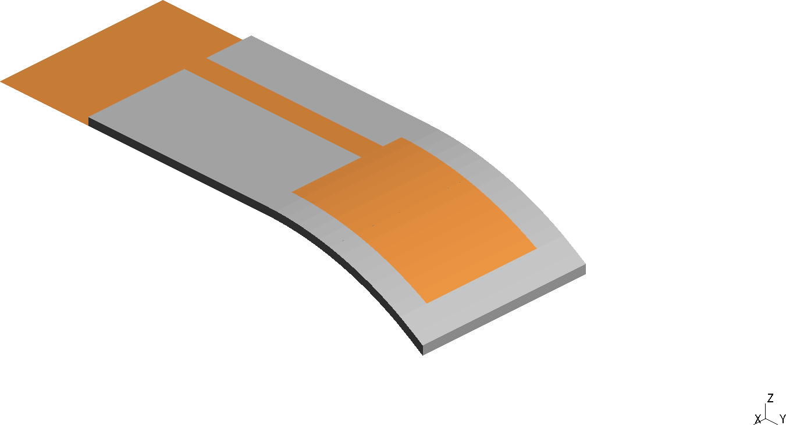
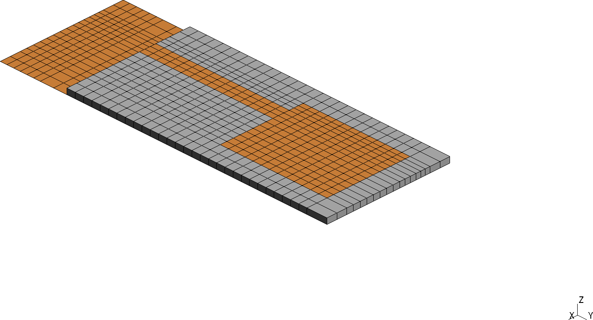
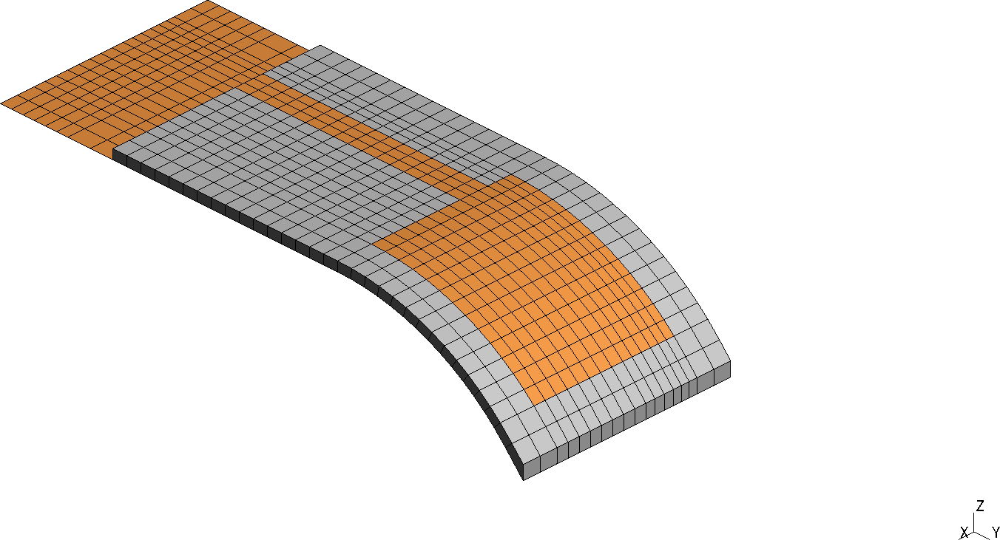

# Oonishi 1993: Conformal Patch Antenna


## Introduction

Microstrip patch antennas are thin and light, so they are often mounted on curved
surfaces such as aircraft fuselages or vehicle bodies, where they have to follow the
shape of the surface (conformal antennas).
Oonishi, Kashiwa and Fukai [1] took the line-fed rectangular patch antenna of Sheen,
Ali, Abouzahra and Kong [2], bent its patch onto cylinders of radius 20 mm and 30 mm,
and compared conformal-grid FDTD calculations with their own measurements of the
reflection coefficient $`|S_{11}|`$ and the radiation pattern.

This case reproduces that study with the planar antenna and both bend radii.
It checks that the bend leaves the resonance frequency of the patch nearly unchanged,
as both the calculation and the measurement of [1] show.

<div align="center">
    
    
    
    <br/>
    <br/>
    Figure 1: Geometry of the antenna: (left) planar, (center) r = 30 mm and (right)
    r = 20 mm.
</div>
<br/>


## Setup

The antenna follows Fig. 3 of [2] and Fig. 2 of [1]: a 12.45 mm x 16.0 mm patch on a
0.794 mm thick Duroid 5880 substrate (relative permittivity 2.2, lossless) over a ground
plane, fed by a 2.46 mm wide microstrip line whose left edge lies 2.09 mm from the left
edge of the patch.
The feed line is 20 mm long, and all metal is a perfect conductor, modeled with the
Perfect Electric Conductor Condition on zero-thickness sheets.

**The bend.** The laminate is wrapped onto a cylinder whose axis runs along x.
The feed line stays straight; the bend starts at the leading edge of the patch, as in
Fig. 3 of [1].
The substrate keeps its thickness and the patch keeps its 16 mm length along the
surface, so the patch turns through 44 degrees at r = 20 mm and 30 degrees at
r = 30 mm.
The last 1.0 mm of bare substrate beyond the arc runs straight along the end tangent,
so the laminate ends on a vertical face.

**The enclosure.** Unlike [1] and [2], the ground plane is finite: it ends with the
substrate on the -x, +x and +y sides and continues to the outer wall on the -y side,
behind the port.
The antenna sits in a rectangular box, 34.45 mm x 57.00 mm x 37.25 mm, with a 6 mm
perfectly matched layer (PML) on all six sides, backed by a perfect conductor.
The box is the same for all three variants, so the bend is the only difference
between them.

**The mesh.** The mesh is a structured all-hexahedral mesh built with
[Gmsh](https://gmsh.info/) in the `generate_mesh` method of [case.py](case.py): the
y-z cross section is assembled from quadrilateral blocks, which are extruded along x.
The bend rows are radial, so the cells follow the arc without thinning:

| Variant | Mesh | Hexahedra | Minimum scaled Jacobian |
| ------- | ---- | --------: | ----------------------: |
| planar | `geometry_planar.msh` | 33,120 | 1.000 |
| r = 30 mm | `geometry_r=30mm.msh` | 34,592 | 0.822 |
| r = 20 mm | `geometry_r=20mm.msh` | 34,592 | 0.772 |

<div align="center">
    
    
    
    <br/>
    <br/>
    Figure 2: Mesh of the antenna: (left) planar, (center) r = 30 mm and (right)
    r = 20 mm.
</div>
<br/>

**The model.** The fields are computed with the Time-Domain Maxwell model, a
discontinuous Galerkin method with polynomial order 2 and second-order Runge-Kutta
time stepping.
The explicit scheme sub-steps the 5 ps outer time step at its stable step size, and
the run covers 3.5 ns, as in [1] and [2].

**The excitation.** A Lumped Port Condition across the gap between the feed line and
the ground, 20 mm in front of the patch, launches a Gaussian-modulated sine pulse
(center frequency 8.5 GHz, envelope width 18 ps) toward the patch.
Its surface impedance of 155 Ohm matches the 50 Ohm line.

**The reflection coefficient.** As in [2], $`S_{11}`$ comes from a single run: the line
voltage $`V(t) = -E_z t`$ on the feed line, 16.875 mm in front of the patch, is split in
time into the incident pulse and the wave reflected from the patch, which the 20 mm
feed line separates, and

```math
    S_{11}(f) = \frac{\mathcal{F}[V_\mathrm{reflected}](f)}{\mathcal{F}[V_\mathrm{incident}](f)}.
```

The input impedance at the patch edge follows from moving $`S_{11}`$ along the 50 Ohm
line to the edge with the effective permittivity 1.9 of [2], Eq. (15).

A Far-Field Radiation Sensor on the inner face of the PML gives the radiation pattern
at 7.1, 7.4 and 7.7 GHz.


## Running

The bend radius is set by the `radius` attribute of the case class in
[case.py](case.py): `20.0` (default), `30.0`, or `None` for the planar antenna.
It selects the mesh and the names of the result files.
To run the simulation:

```bash
pymufem case.py
```

To regenerate the mesh of the selected radius:

```bash
pymufem case.py --rebuild-mesh
```

The 3D radiation pattern is written to `results/Far_Field_3D_<variant>.npz` and plotted
in ParaView with [paraview_radiation_pattern.py](paraview_radiation_pattern.py), which
takes the variant (`r=20mm`, `r=30mm` or `planar`) as its argument.


## Results

<!-- TODO: fill in from the runs of all three variants. -->

Figure 3 shows the line voltage at the reference plane: the incident pulse, followed by
the reflection from the patch.

<div align="center">
    
    
    
    <br/>
    <br/>
    Figure 3: Line voltage at the reference plane: (left) planar, (center) r = 30 mm
    and (right) r = 20 mm.
</div>
<br/>

Figure 4 compares $`|S_{11}|`$ around the resonance with the calculation and the
measurement of [1], Fig. 5, for each variant.

<div align="center">
    
    
    
    <br/>
    <br/>
    Figure 4: Reflection coefficient around the resonance: (left) planar, (center)
    r = 30 mm and (right) r = 20 mm.
</div>
<br/>

Over the full band, Fig. 5 compares $`|S_{11}|`$ with the calculation and the
measurement of the planar antenna in [2], Fig. 5, which serve as a common reference for
all three variants.

<div align="center">
    
    
    
    <br/>
    <br/>
    Figure 5: Reflection coefficient over the full band: (left) planar, (center)
    r = 30 mm and (right) r = 20 mm.
</div>
<br/>

Figure 6 shows the input impedance at the patch edge; [1], Fig. 6, is digitized for the
planar antenna only.

<div align="center">
    
    
    
    <br/>
    <br/>
    Figure 6: Input impedance at the patch edge: (left) planar, (center) r = 30 mm and
    (right) r = 20 mm.
</div>
<br/>

The resonance is the frequency of the deepest $`|S_{11}|`$ dip:

| Variant | Resonance frequency, mufem / calculated [1] / measured [1] [GHz] | $`\|S_{11}\|`$ minimum, mufem [dB] | Input resistance at resonance, mufem [Ohm] |
| ------- | ---: | ---: | ---: |
| planar | — / 7.47 / 7.58 | — | — |
| r = 30 mm | — / 7.48 / 7.60 | — | — |
| r = 20 mm | — / 7.48 / 7.60 | — | — |

Figure 7 shows the E-plane (xz) and H-plane (yz) cuts of the radiation pattern at the
resonance and 300 MHz to either side, normalized to the peak at the resonance.
The ground plane is finite, so the antenna also radiates into the lower half-space.

<div align="center">
    
    
    
    <br/>
    
    
    
    <br/>
    <br/>
    Figure 7: E-plane (top) and H-plane (bottom) cuts of the radiation pattern:
    (left) planar, (center) r = 30 mm and (right) r = 20 mm.
</div>
<br/>

The case checks the resonance frequency against the calculated and the measured value
of [1], and that the field energy does not grow and the PML stays quiet after the pulse.


## Scenes

Figure 8 shows the normalized radiation pattern at the resonance over the whole sphere.

<div align="center">
    
    
    
    <br/>
    <br/>
    Figure 8: Radiation pattern at the resonance: (left) planar, (center) r = 30 mm and
    (right) r = 20 mm.
</div>
<br/>


## References

[1] T. Oonishi, T. Kashiwa and I. Fukai (1993). *Analysis of microstrip antennas on a curved surface using the conformal grids FD-TD method*. Electronics and Communications in Japan, Part 1, 76(12), 73–81. https://doi.org/10.1002/ecja.4410761207

[2] D. M. Sheen, S. M. Ali, M. D. Abouzahra and J. A. Kong (1990). *Application of the three-dimensional finite-difference time-domain method to the analysis of planar microstrip circuits*. IEEE Transactions on Microwave Theory and Techniques, 38(7), 849–857. https://doi.org/10.1109/22.55775
