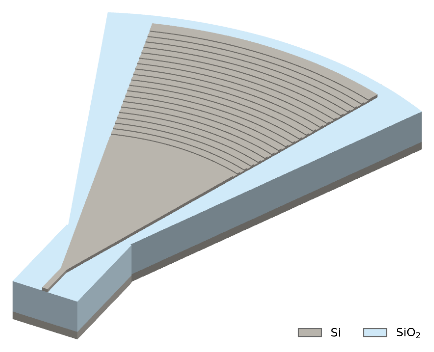
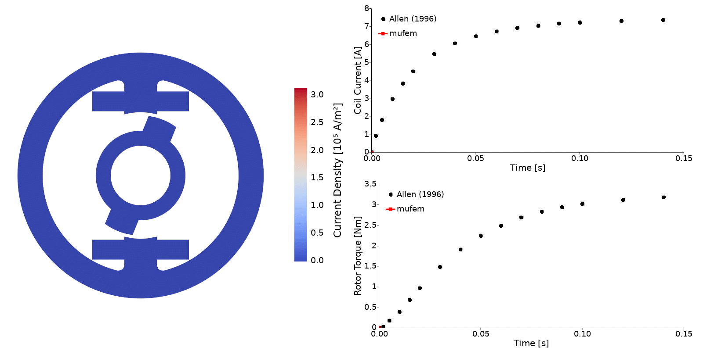

# mufem: fast and accurate simulations

mufem (pronounced /ˈmjuːfɛm/) is an API-first finite-element simulation code for
**electromagnetics**, **photonics**, and **plasmas**, and their **coupled multi-physics problems**,
built for **industry-relevant** engineering applications.

mufem is driven through a **Python interface**, making it ideal for exploratory work, **parametric studies**
and **design optimization**, and a natural fit for **agentic workflows**.

For questions or support, please [open an issue](https://github.com/Raiden-Numerics/mufem/issues/new/choose)
or contact us at [info@raiden-numerics.com](mailto:info@raiden-numerics.com).

**Contents:** [Introduction](#introduction) · [Getting Started](#getting-started) ·
[Case Studies](#case-studies) · [Models](#models) · [Validations](#validations) ·
[Tested Platforms](#tested-platforms)

## Introduction

This repository hosts a quick introduction to mufem together with a collection of validation and example
cases. For platform-specific setup see the
[Installation guide](https://raiden-numerics.github.io/mufem-doc/getting_started/installation.html), and for
tutorials and the full API reference see the
[mufem documentation](https://raiden-numerics.github.io/mufem-doc/index.html).


### Why mufem

<table>
<tr>
<td width="50%" valign="top"> <strong>Python-native</strong><br>build, run, and post-process simulations from a clean Python API; ideal for parametric sweeps, optimization, and agentic workflows.</td>
<td width="50%" valign="top"> <strong>Multi-physics</strong><br>model electromagnetic, thermal, and structural phenomena and their interactions, all within a single framework.</td>
</tr>
<tr>
<td width="50%" valign="top"> <strong>Advanced discretization</strong><br>built on <a href="https://mfem.org/">MFEM</a> for high-order finite elements on curved, unstructured, non-conformal, and Cartesian meshes.</td>
<td width="50%" valign="top"> <strong>GPU-accelerated</strong><br>parallel CPU and GPU solvers that scale efficiently from a single laptop to a large cluster.</td>
</tr>
<tr>
<td width="50%" valign="top"> <strong>Validated</strong><br>continuously tested against established benchmark suites and published experimental, analytical, and reference results.</td>
<td width="50%" valign="top"> <strong>Free</strong><br>mufem (Community) is free for academic and commercial use, with no license fees, covering most workflows on a single workstation. See <a href="https://mufem.raiden-numerics.com/#pricing">pricing</a> for paid tiers.</td>
</tr>
</table>

### Licensing

mufem (Community) is **free for academic and commercial use**. It needs no license key, includes
all physics models, and runs multithreaded, making good use of the cores of typical desktops and laptops,
so you can run real projects and client work without paying anything.

When your models outgrow a single machine, a paid license for mufem (Professional) lets mufem grow with them.
The Professional packages are `mufem-mpi`, `mufem-cuda` and `mufem-hip`:

- **Bigger models, faster answers**: distributed parallel computing that keeps scaling where threads level off, on a
  many-core workstation, across a compute cluster, or on GPUs. Run times keep dropping as you add cores,
  nodes or GPUs, which makes large models and parametric studies practical. See
  [benchmarks](https://github.com/Raiden-Numerics/mufem/blob/main/Benchmarks/README.md) for more
  details.
- **Direct support** from the developers by email, instead of community support via GitHub Issues.
- **Enterprise options**: multi-seat and on-premises licensing, integration and validation services.

See [mufem.raiden-numerics.com](https://mufem.raiden-numerics.com/#pricing) for plans and pricing.

## Getting Started

https://github.com/user-attachments/assets/50112394-3092-4bda-8332-ef08e0b85296

*Introduction to mufem (7 min): what it is, API first and AI ready, and a walkthrough of the quick example.*

The video walks through the [QuickExample](https://github.com/Raiden-Numerics/mufem/tree/main/QuickExample):
`setup.py` builds the geometry and mesh of a cube with gmsh (and saves it as a STEP file), and `case.py`
solves the electrostatic field with 1 V across the cube. The results are then viewed in PyVista and ParaView.
To run it yourself:

```bash
python -m venv mufem-venv
source mufem-venv/bin/activate
pip install mufem gmsh pyvista
cd QuickExample
python setup.py   # geometry and mesh; add -nopopup to skip the gmsh GUI
python case.py    # prints the stored electric energy, about 4.43e-13 J
```

For platform-specific installation, the mufem (Professional) packages, tutorials, and the API reference, see
the [mufem documentation](https://raiden-numerics.github.io/mufem-doc/index.html).

## Case Studies

Case studies apply mufem to complete engineering problems, from the geometry to the design decision.

[Browse all case studies here](https://github.com/Raiden-Numerics/mufem/blob/main/CaseStudies/README.md).

<table>
<tr>
<td width="40%"><a href="https://github.com/Raiden-Numerics/mufem/blob/main/CaseStudies/PMSM-Motor/README.md"></a></td>
<td width="60%" valign="top">
<strong><a href="https://github.com/Raiden-Numerics/mufem/blob/main/CaseStudies/PMSM-Motor/README.md">Step skew in a hairpin IPM traction motor</a></strong><br>
Follow a skew design from 2D to full 3D on a 48-slot, 8-pole traction motor.
<ul>
<li>Cogging torque and load ripple of the skewed and unskewed machine</li>
<li>Comparison with the fast 2D multi-slice method</li>
<li>AC copper losses of the whole hairpin winding, end turns included</li>
<li>Full 3D model: turning rotor, sliding interface, non-linear iron, eddy currents</li>
</ul>
</td>
</tr>
<tr>
<td width="40%"><a href="https://github.com/Raiden-Numerics/mufem/blob/main/CaseStudies/Grating-Coupler/README.md"></a></td>
<td width="60%" valign="top">
<strong><a href="https://github.com/Raiden-Numerics/mufem/blob/main/CaseStudies/Grating-Coupler/README.md">Optimizing a fan grating coupler for a multimode fiber link</a></strong><br>
Drive full 3D optical simulations with a Bayesian optimizer to improve a published silicon-photonics grating coupler.
<ul>
<li>Coupling efficiency into the fiber's acceptance, published vs. optimized design</li>
<li>Bayesian optimization with Ax/BoTorch under fabrication and beam constraints</li>
<li>+7.8 % coupled light on the same footprint, reflection below 1 %</li>
<li>Full 3D model: time-harmonic Maxwell, curved grooves, near- and far-field evaluation</li>
</ul>
</td>
</tr>
</table>

## Models

mufem provides finite-element models across several physics domains, composable for coupled multi-physics:

- **[Electrostatics](https://raiden-numerics.github.io/mufem-doc/models/electromagnetics/electrostatics/model.html)**: electric fields,
  capacitances, and electrostatic forces in conductors and dielectrics.
- **[Time-Domain Magnetic](https://raiden-numerics.github.io/mufem-doc/models/electromagnetics/time_domain_magnetic/model.html)**
  (magnetostatics, transient eddy currents): low-frequency magnetic fields, including nonlinear
  materials, permanent magnets, and superconductors.
- **[Time-Harmonic Magnetic](https://raiden-numerics.github.io/mufem-doc/models/electromagnetics/time_harmonic_magnetic/model.html)**
  (AC magnetics): eddy currents and skin and proximity effects at a single frequency.
- **[Time-Harmonic Maxwell](https://raiden-numerics.github.io/mufem-doc/models/electromagnetics/time_harmonic_maxwell/model.html)**
  (full-wave): high-frequency electromagnetics, waveguides, and antennas.
- **[Solid Temperature](https://raiden-numerics.github.io/mufem-doc/models/mechanical/solid_temperature/model.html)** (thermal): steady and
  transient heat conduction.
- **[Solid Mechanics](https://raiden-numerics.github.io/mufem-doc/models/mechanical/solid_mechanics/model.html)** (structural): linear
  elasticity.

See the [documentation](https://raiden-numerics.github.io/mufem-doc/index.html) for the full model list and details.

## Validations

This repository collects validation cases for mufem, each comparing its results with published,
measured, or analytical reference values.

[Browse all validation cases here](https://github.com/Raiden-Numerics/mufem/blob/main/Validations/README.md).

<div align="center">
<a href="https://github.com/Raiden-Numerics/mufem/blob/main/Validations/Electromagnetics/Compumag-Team24-Locked-Rotor/README.md"></a>
<br>
<sub>TEAM 24: eddy currents in a locked rotor after a voltage step (left), and the coil current and the
rotor torque over time compared with measurements (right).</sub>
</div>

## Tested Platforms

[](https://pypi.org/project/mufem/)

Automated tests install the released packages of the tested version on each platform and run the
validation cases of this repository with them. Each badge shows the result of the latest run.

### mufem (Community)

|  | Python 3.12 | Python 3.13 | Python 3.14 | Python 3.15 |
|---|---|---|---|---|
| **Linux** x86-64 | [](https://github.com/Raiden-Numerics/mufem/actions/workflows/smoke_py312.yml) | [](https://github.com/Raiden-Numerics/mufem/actions/workflows/smoke_py313.yml) | [](https://github.com/Raiden-Numerics/mufem/actions/workflows/smoke_py314.yml) | [](https://github.com/Raiden-Numerics/mufem/actions/workflows/smoke_py315.yml) |
| **Windows** x86-64 | [](https://github.com/Raiden-Numerics/mufem/actions/workflows/validations_windows_py312.yml) | [](https://github.com/Raiden-Numerics/mufem/actions/workflows/smoke_windows_py313.yml) | [](https://github.com/Raiden-Numerics/mufem/actions/workflows/smoke_windows_py314.yml) | [](https://github.com/Raiden-Numerics/mufem/actions/workflows/smoke_windows_py315.yml) |
| **macOS** arm64 | [](https://github.com/Raiden-Numerics/mufem/actions/workflows/validations_macos_py312.yml) | [](https://github.com/Raiden-Numerics/mufem/actions/workflows/smoke_macos_py313.yml) | [](https://github.com/Raiden-Numerics/mufem/actions/workflows/smoke_macos_py314.yml) | [](https://github.com/Raiden-Numerics/mufem/actions/workflows/smoke_macos_py315.yml) |
| **Linux distros**¹ | [](https://github.com/Raiden-Numerics/mufem/actions/workflows/smoke_linux_distros.yml) |  |  |  |

- **validations**: the moderate tier on macOS and Windows (without the `long`, `eternal` and `mumps` cases).
- **smoke**: a single case (TEAM 1b), confirming that the release installs and runs.

¹ Ubuntu 26.04, Debian 13, Fedora 43, AlmaLinux 10, openSUSE Tumbleweed and Arch Linux.
Linux requires glibc ≥ 2.39; Ubuntu 22.04, Debian 12, RHEL 8/9 and SLES 15 are not yet supported.

### mufem (Professional)

| Package | Platform | Run | Status |
|---|---|---|---|
| `mufem-mpi` | Linux x86-64 | 15 MPI ranks | [](https://github.com/Raiden-Numerics/mufem/actions/workflows/validations_linux.yml) [](https://github.com/Raiden-Numerics/mufem/actions/workflows/validations_linux_e2e.yml) |
| `mufem-cuda` | Linux x86-64, NVIDIA GPU | 1 MPI rank | [](https://github.com/Raiden-Numerics/mufem/actions/workflows/smoke_pro_cuda.yml) |
| `mufem-hip` | Linux x86-64, AMD GPU | 1 MPI rank | [](https://github.com/Raiden-Numerics/mufem/actions/workflows/smoke_pro_hip.yml) |

Each package is installed from the mufem package index on Python 3.12. `mufem-mpi` runs all validation cases
(**validations**), and weekly with every geometry, mesh and scene regenerated from scratch (**e2e**); the GPU
packages run a single case (TEAM 1b).
