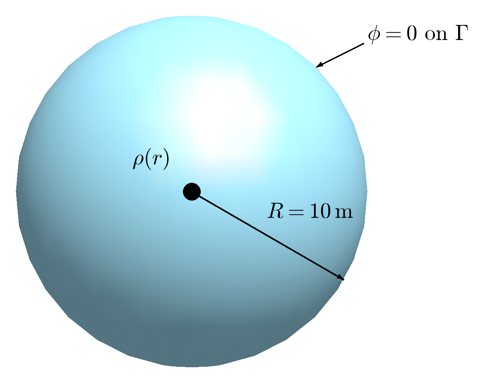
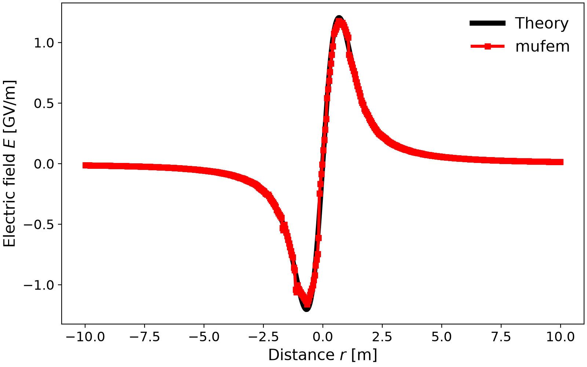

# David 2019: Nonuniform Charge Density

## Introduction

In this tutorial, we will explore the basic usage of mufem, focusing on several
key aspects of the simulation process.
Our goal is to demonstrate how to create a mesh, set up a simulation, utilize
markers, define materials and boundary conditions, apply coefficient functions,
and analyze simulation results through reports.

Each mufem simulation is executed through a Python script.
Utilizing Python scripts offers the flexibility to customize simulations,
especially when performing parameter sweeps.
Furthermore, the capabilities of mufem simulations can be enhanced by integrating
additional Python libraries such as NumPy, SciPy, and Matplotlib.

To run a mufem simulation defined in a Python script file (for example,
`case.py`), you simply execute the following command in the terminal:

```bash
pymufem case.py
```

For those who prefer an interactive approach, you can also launch simulations by
entering mufem commands directly in an IPython shell or Jupyter notebook.


## Mathematical Description of the Problem

In this example, we analyze the electrostatic electric field generated by a
nonuniform charge density distribution, a three-dimensional version of the
two-dimensional example of [1].
This problem can be mathematically described using Gauss's law, where the charge
density $`\rho`$ acts as the source term.
In terms of the electric potential $`\phi`$, the problem can be formulated as
follows:

```math
\begin{align}
    \nabla \cdot \left(\varepsilon \nabla \phi\right) & = -\rho, \\
    \left. \phi \right|_{\Gamma} & = 0,  \\
    \rho(r) & = \frac{Q}{4 \pi} \exp\left(-\frac{r^2}{2 a^2}\right).
\end{align}
```

Here, we have chosen a Gaussian distribution for the charge density $`\rho`$,
characterized by the radius $`a`$ and the amplitude $`Q`$ (in C/m³, so that
$`\rho(0) = Q / 4\pi`$).
To model this charge distribution in free space, we define the computational
domain as a sphere that encircles the charge distribution.
Assuming that the radius of this sphere is much larger than $`a`$, we set the
electric potential at its boundary $`\Gamma`$ to zero.
After solving this problem, we can determine the electric field using the
relationship: $`\vec{E} = -\nabla \phi`$.

To validate our results, we will compare them to an analytical solution derived
from the integral form of Gauss's law, expressed as an integral over a surface
enclosing the total charge $`Q_\text{tot}`$:

```math
\begin{align}
    \oint \vec{E} \cdot d\vec{\Gamma}
    = \frac{Q_\text{tot}}{\varepsilon_0},
\end{align}
```

where $`\varepsilon_0`$ is the electric permittivity of free space, $`\vec{E}`$
is the electric field we seek, and $`d\vec{\Gamma}`$ is a vector representing
an infinitesimal area element of the surface.
By choosing a sphere of arbitrary radius $`R`$ as the enclosing surface, we can
rewrite the equation as $`4 \pi R^2 E = Q_\text{tot} / \varepsilon_0`$, which
simplifies to $`E = Q_\text{tot} / (4 \pi \varepsilon_0 R^2)`$, where $`4 \pi R^2`$
represents the surface area of the sphere.
The total charge $`Q_\text{tot}`$ enclosed by the sphere of radius $`R`$ can be
calculated using the following integral of the charge density $`\rho`$:

```math
\begin{align}
    Q_\text{tot}
    & = \int_0^R \rho(r) r^2 dr
        \int_0^{2\pi} d\varphi \int_0^\pi \sin\theta\, d\theta \notag \\
    & = Q \left[
        \sqrt{\frac{\pi}{2}} a^3 \mathrm{erf}\left(\frac{R}{\sqrt{2} a}\right) -
        a^2 R \exp\left(-\frac{R^2}{2 a^2}\right)
    \right],
\end{align}
```

where $`\mathrm{erf}`$ is the error function.

Since the radius $`R`$ of the enclosing sphere is arbitrary, we can express the
electric field at any distance $`r`$ as

```math
\begin{align}
    E(r)
    = \frac{Q}{4 \pi \varepsilon_0 r^2} \left[
        \sqrt{\frac{\pi}{2}} a^3 \mathrm{erf}\left(\frac{r}{\sqrt{2} a}\right) -
        a^2 r \exp\left(-\frac{r^2}{2 a^2}\right)
    \right].
\end{align}
```


<!-- *********************************************************************** -->
## Mesh Generation

In this section, we define the geometry of our problem and generate the
corresponding mesh.
For this example, we use the [Netgen](https://ngsolve.org/) mesh generator through
its [OpenCASCADE](https://dev.opencascade.org/) interface `netgen.occ`, although
any software that produces a mesh in a format recognized by MFEM can be utilized
([supported mesh formats](https://mfem.org/mesh-formats/)).

Our computational domain is a sphere placed at the center (0, 0, 0) with a radius
`sphere_radius` of 10 m, which is sufficiently large to simulate free space:

```python
from netgen.occ import Glue, Pnt, Sphere

sphere_radius = 10.0  # [m] radius of the spherical domain

domain = Sphere(Pnt(0, 0, 0), sphere_radius)
```

<div align="center">

<br/>
<br/>
<em>Figure 1: The computational domain, a sphere of radius <i>R</i> = 10 m, with the charge density <i>ρ</i>(<i>r</i>) at its center and the potential <i>φ</i> = 0 on its boundary <i>Γ</i>.</em>
</div>
<br/>

We will now assign name attributes to the geometry for reference in the mufem
code.
This will help us mark the computational domain and its boundary for applying
boundary conditions.
The `name_body` helper of the shared `casekit` package assigns the name "Domain"
to the sphere and, with `individual_names=False`, the name "Domain::Boundary" to
all of its faces, which for a sphere is its single surface:

```python
from casekit.colors import color_air
from casekit.netgen_geometry import name_body

name_body(domain, "Domain", color=color_air, individual_names=False)
```

Finally, we save the geometry as a STEP file and generate the mesh from it with a
maximum element size of 0.5 m.
The mesh is written in the MFEM format, which keeps the name attributes:

```python
from casekit.netgen_meshing import mesh_and_save

geometry = Glue([domain])

geometry.WriteStep("geometry.step")

mesh_and_save("geometry.step", basesize=0.5, path="geometry.mesh")
```

In [case.py](case.py), these steps are the `build_geometry` and `generate_mesh`
methods of the case class.
They run only when the mesh is regenerated with `pymufem case.py --rebuild-mesh`;
a normal run loads the committed `geometry.mesh`.


<!-- *********************************************************************** -->
## Simulation Code

### Setting Up the Simulation

In this section, we begin the mufem Python script by importing the mufem library.
For convenience, we also import the electrostatics module under the alias
`estat`:

```python
import mufem
import mufem.electromagnetics.electrostatics as estat
```

Next, we perform the basic setup for the simulation.
We create a new `mufem.Simulation` object, providing a custom name for the
simulation ("Nonuniform Charge Density") and the path to the mesh file:

```python
sim = mufem.Simulation.New(
    name="David 2019: Nonuniform Charge Density",
    mesh_path="geometry.mesh",
)
```

We then create an instance of the `mufem.SteadyRunner` class, which governs the
execution of the simulation, and specify the total number of iterations (more
information on simulation runners can be found in
[Runners](https://raiden-numerics.github.io/mufem-doc/framework/runners.html)).
We register the runner in the simulation by calling the `set_runner` method:

```python
runner = mufem.SteadyRunner(total_iterations=3)
sim.set_runner(runner)
```

The total number of iterations is determined empirically by observing the
residual error printed by the runner at each step of the simulation.
In this example the runner will output the following table:

```bash
Iteration | Electrostatics |
        1 |   1.000000e+00 |
        2 |   2.715810e-09 |
        3 |   4.788548e-16 |
```

In this table, the first number represents the iteration index, while the second
indicates the residual error relative to the first iteration.
We can see that three iterations are sufficient to achieve a sufficiently small
residual error.

After setting up the simulation object and the runner, we configure the model
for our simulations.
To solve electrostatic problems, such as the one described in Eqs. (1)–(3), mufem
utilizes the
[Electrostatics Model](https://raiden-numerics.github.io/mufem-doc/models/electromagnetics/electrostatics/model.html).
We create this model by calling the constructor of the `ElectrostaticsModel`
class; without a marker, the model applies to the whole mesh. The marker
`domain_marker`, which refers to the computational domain, is used below for the
material and the charge density.
We register the model in our simulation by adding it to the
`mufem.ModelManager`:

```python
domain_marker = "Domain" @ mufem.Vol

model = estat.ElectrostaticsModel(order=2)
sim.get_model_manager().add_model(model)
```

In this case, the `domain_marker`, an instance of the `mufem.Marker`, refers to
the mesh volume with the name attribute "Domain" that we defined during mesh
generation (more information on markers can be found in
[Markers](https://raiden-numerics.github.io/mufem-doc/framework/markers.html)).
To enhance simulation precision, we also pass the `order=2` argument, indicating
that the model should use second-order polynomial functions to approximate the
solution within each finite element.

Next, we specify the type of material filling the computational domain.
In our simulation, we assume that the domain is filled with air, which can be
treated as having the same electric permittivity as vacuum.
This material can be defined using the `ElectrostaticMaterial` class,
which specifies an electrostatic material with constant electric permittivity,
defaulting to the vacuum value.
After creating the material, we register it by adding it to the model:

```python
material = estat.ElectrostaticMaterial(name="Air", marker=domain_marker)
model.add_material(material)
```

We then define the Gaussian charge density distribution as a string expression
that mufem parses into a scalar coefficient function.
The expression uses the built-in `{Position}` symbol to access the spatial
coordinates and supports standard mathematical operators and functions:

```python
charge = 1.0  # [C/m^3] amplitude Q of the charge density
charge_radius = 0.5  # [m] radius a of the charge distribution

charge_expr = f"""
    var r := sqrt({{Position}}.X^2 + {{Position}}.Y^2 + {{Position}}.Z^2);
    var Q := {charge};
    var a := {charge_radius};

    Q / (4 * pi) * exp(-r^2 / (2 * a^2))
"""
```

More information on mufem coefficients can be found in
[Coefficients](https://raiden-numerics.github.io/mufem-doc/framework/coefficients.html).

We pass this expression directly to the source condition via an instance of the
`ChargeDensityCondition` class:

```python
charge_density_condition = estat.ChargeDensityCondition(
    name="Volume Charge", marker=domain_marker, charge_density=charge_expr
)
```

In this example, we utilize the previously created marker `domain_marker` to
specify the region where this source condition is defined.

Following Eq. (2), we specify the boundary condition at the boundary of the
computational domain.
For this purpose, we use an instance of the
`ElectricPotentialCondition` class, which allows us to set a constant
electric potential of zero at the boundary:

```python
boundary_marker = "Domain::Boundary" @ mufem.Bnd
potential_condition = estat.ElectricPotentialCondition(
    name="Potential = 0V", marker=boundary_marker, electric_potential=0
)
```

To indicate the boundary of the computational domain, we use the marker that
refers to the corresponding mesh entity with the name attribute
"Domain::Boundary".

Having created the source condition and the boundary condition, we register them
in the model by calling the following function:

```python
model.add_conditions([charge_density_condition, potential_condition])
```

Now that the entire simulation is set up, we can run it simply by executing:

```python
sim.run()
```


### Analyzing the Results

After the simulation finishes, we are ready to analyze the obtained data.
First, we load necessary Python libraries:

```python
import math

import matplotlib.pyplot as plt
import numpy as np
```

Next, we create a function that calculates the theoretical electric field given
by Eq. (6):

```python
def electric_field_theory(r):
    """Radial electric field of the Gaussian charge distribution from Gauss's law."""
    Q, a = charge, charge_radius

    eps0 = 8.8541878188e-12  # [F/m] vacuum permittivity
    factor = Q / (4 * np.pi * eps0 * r**2)
    term1 = np.sqrt(np.pi / 2) * a**3 * math.erf(r / (np.sqrt(2) * a))
    term2 = a**2 * r * np.exp(-(r**2) / (2 * a**2))
    return factor * (term1 - term2)
```

For simplicity, we will compare the electric field obtained from the simulations
with the theoretical one only along the x-axis.
To do this, we create a one-dimensional array of 500 positions that spans the
diameter of the sphere representing the computational domain, from
`-sphere_radius` to `sphere_radius`.
To avoid issues when the mesh does not have an element exactly at the distance
`sphere_radius`, we add a small tolerance:

```python
positions = np.linspace(-sphere_radius + 0.01, sphere_radius - 0.01, 500)
```

To access the electric field calculated by mufem at a position on the x-axis, we
create a `mufem.ProbeReport` for a single point (more information about reports can
be found in
[Reports and Monitors](https://raiden-numerics.github.io/mufem-doc/framework/reports_and_monitors.html)).
After evaluating this report, we extract the desired component of the electric
field:

```python
def electric_field_x(x):
    report = mufem.ProbeReport.SinglePoint(
        name="Electric Field Report", cff_name="Electric Field", x=x, y=0, z=0
    )
    return report.evaluate().x
```

We evaluate it at all positions and, similarly, the previously defined
`electric_field_theory` function:

```python
e_mufem = [electric_field_x(x) for x in positions]
e_theory = [electric_field_theory(x) for x in positions]
```

Finally, we plot both arrays. [case.py](case.py) uses the `xy_plot` helper of the shared
`casekit` package for this; with plain Matplotlib functions the plot reads:

```python
plt.figure(constrained_layout=True)
plt.plot(positions, np.array(e_theory) / 1e9, "k-", label="Theory")
plt.plot(positions, np.array(e_mufem) / 1e9, label="$\\mu$fem")
plt.legend(loc="best", frameon=False)
plt.xlabel("Distance $r$ [m]")
plt.ylabel("Electric field $E$ [GV/m]")
plt.savefig("results/Electric_Field.png")
```

Also, for further postprocessing and visualization, we export the electric field
data into a [VTK](https://vtk.org/) file using the field exporter (more
information about the field exporter can be found in the
[Field Exporter](https://raiden-numerics.github.io/mufem-doc/framework/visualization.html#field-exporter)):

```python
field_exporter = sim.get_field_exporter()
field_exporter.add_field_output("Electric Field")
field_exporter.add_field_output("Electric Potential")
field_exporter.save(order=2)
```

Here, we utilize the `order=2` option in the `field_exporter.save` function.
This explicitly instructs the field exporter to use second-order polynomial
functions to represent the field data.
This choice aligns with the second-order representation used when setting up the
electrostatics model, ensuring consistency in our analysis.


### The Complete Code

The complete code for the example can be found in the [case.py](case.py) file,
where the steps above are organized in a `ValidationCase` class: `build_geometry`
and `generate_mesh` create the mesh, `setup_case` sets up the simulation, `validate`
compares the electric field with the theory at two points, and `postprocess` plots
the field along the x-axis and exports it.

Figure 2 demonstrates that the electric field obtained from the mufem
simulation closely matches the field calculated using the analytical formula.

<div align="center">

<br/>
<br/>
<em>Figure 2: Electric field along the x-axis: mufem and the analytical solution.</em>
</div>
<br/>

The case checks the field at $`r = 1`$ m, near its maximum, where mufem is 3.4 % above the
analytical value (the mesh size of 0.5 m equals the width $`a`$ of the charge
distribution), and at $`r = 5`$ m, outside the charge, where it is 0.5 % below.

The exported electric field is visualized with [PyVista](https://pyvista.org/) by
`create_scenes()` in [case.py](case.py) (run the case with `--render-scenes`, or with `--render-scenes-only`
after a run; see [Scenes](../../Validations.md#scenes)).
Figure 3 illustrates the distribution of the $`x`$-component of the
electric field in the $`z=0`$ cross-section.

<div align="center">

<br/>
<br/>
<em>Figure 3: The <i>x</i>-component of the electric field in the cross-section <i>z</i> = 0.</em>
</div>
<br/>


## References

[1] ComPhys (2019). *Electrostatic simulations with non-uniform charge density distributions*. https://comphysblog.wordpress.com/2019/08/22/electrostatic-simulations-with-non-uniform-charge-density-distributions/