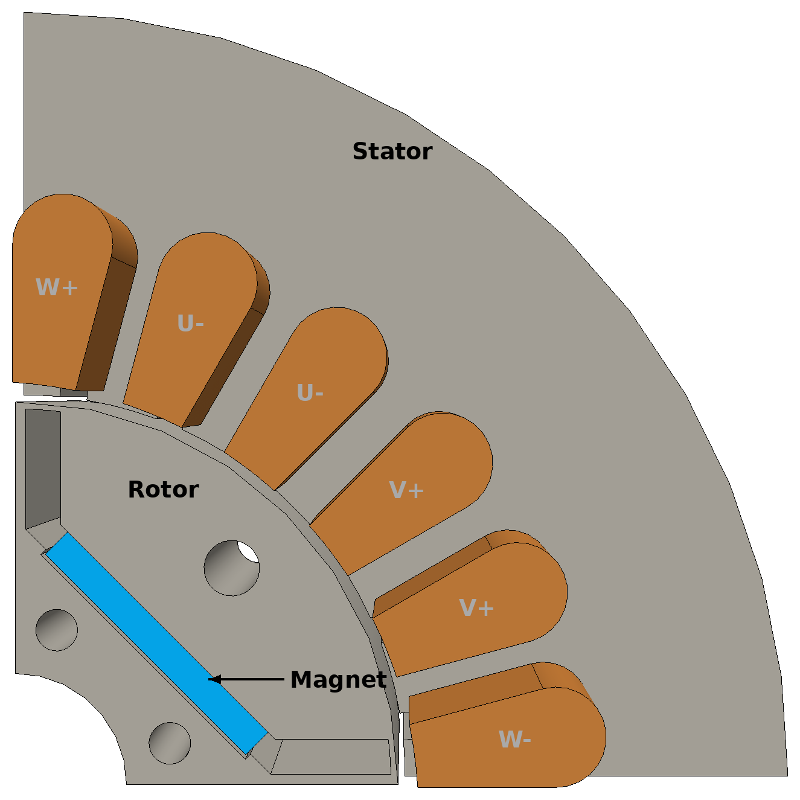
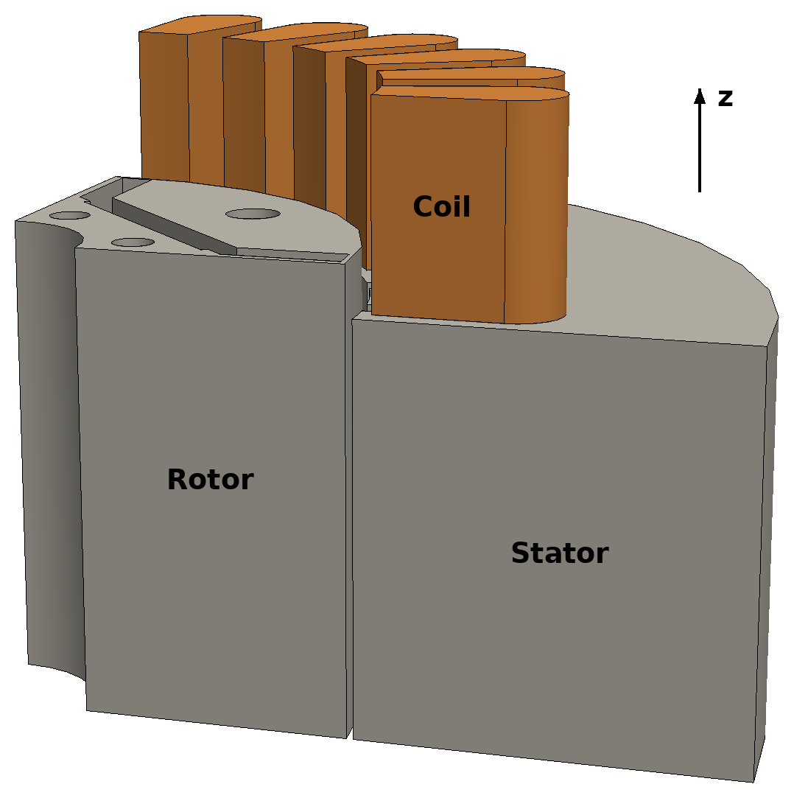
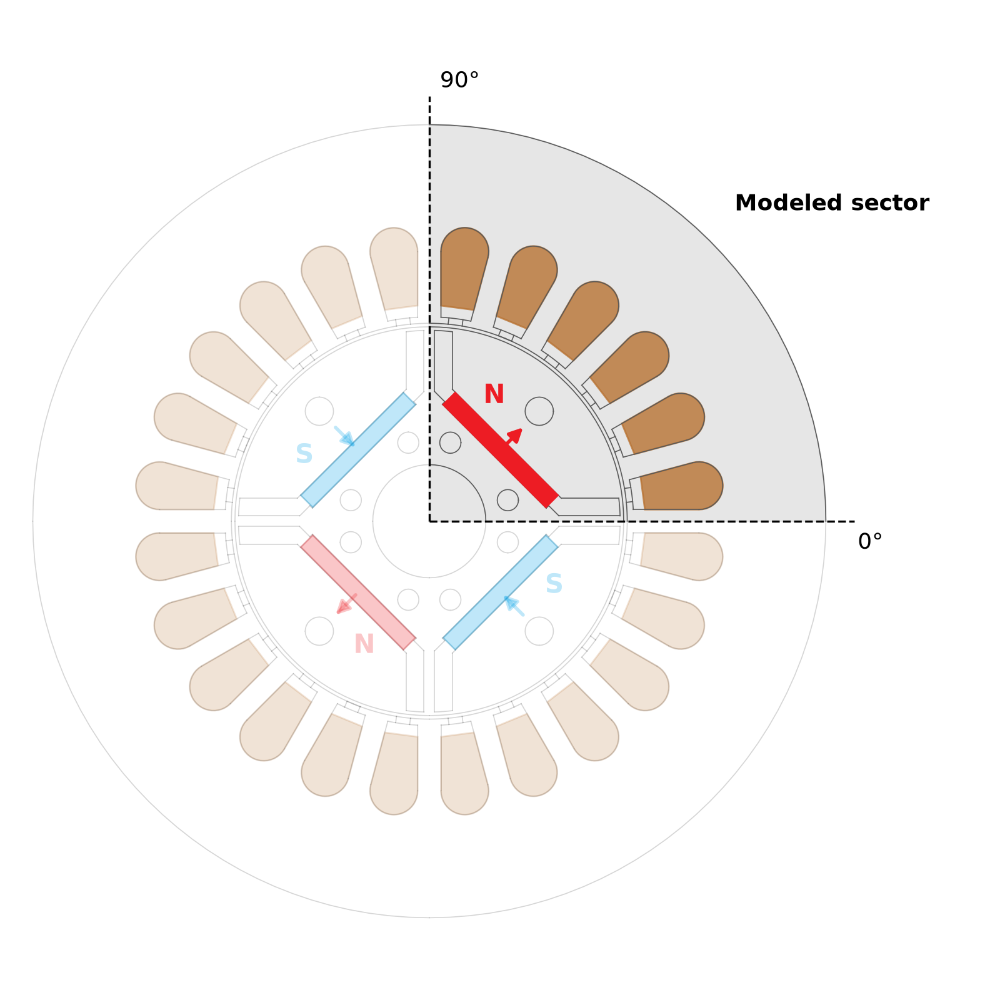
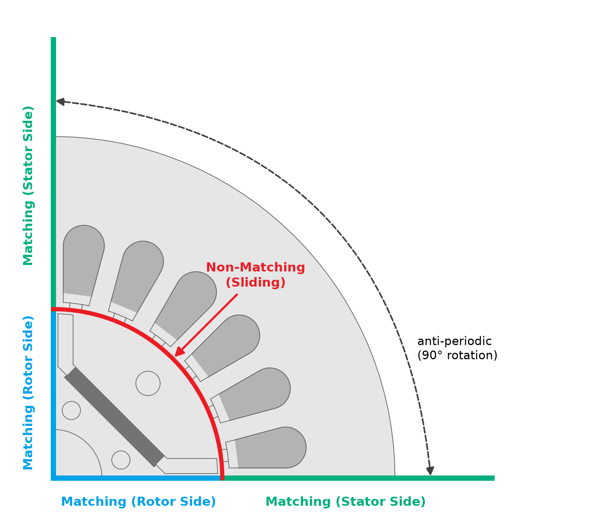
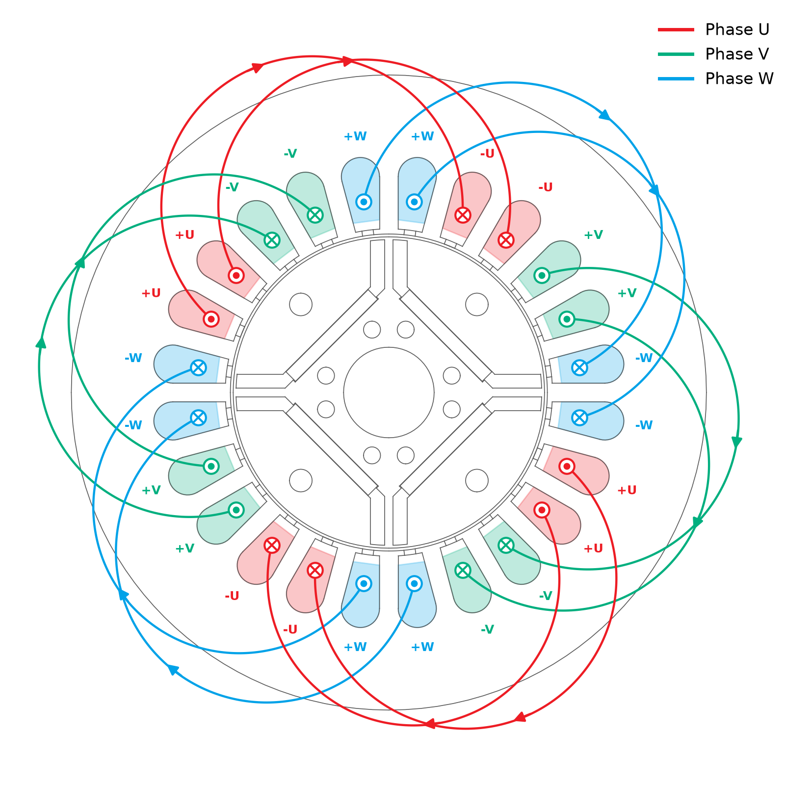
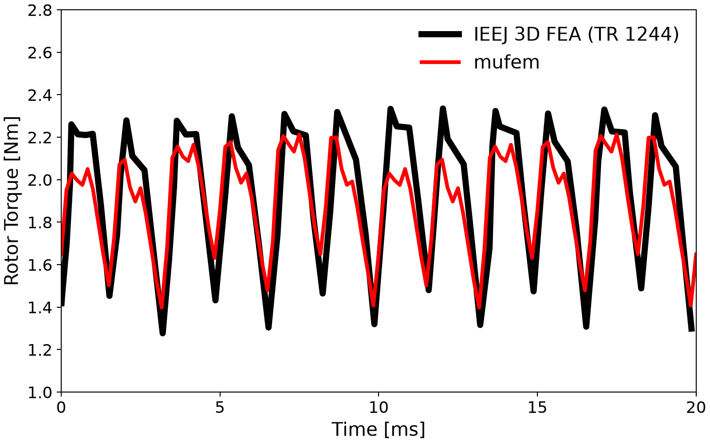
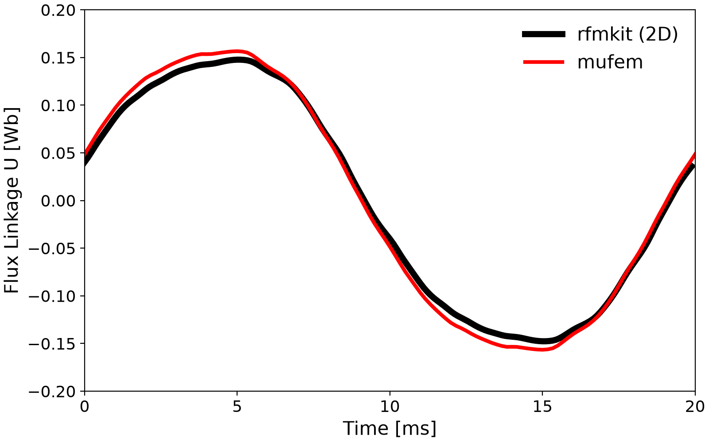
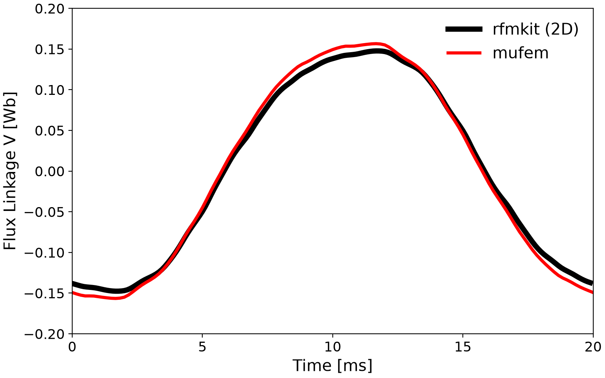
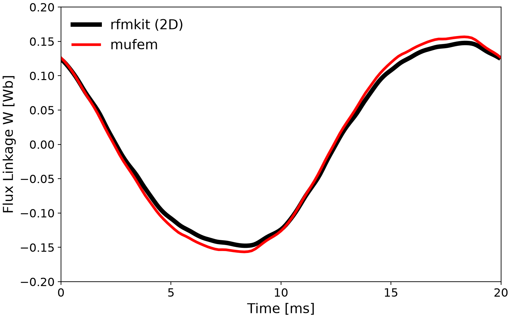
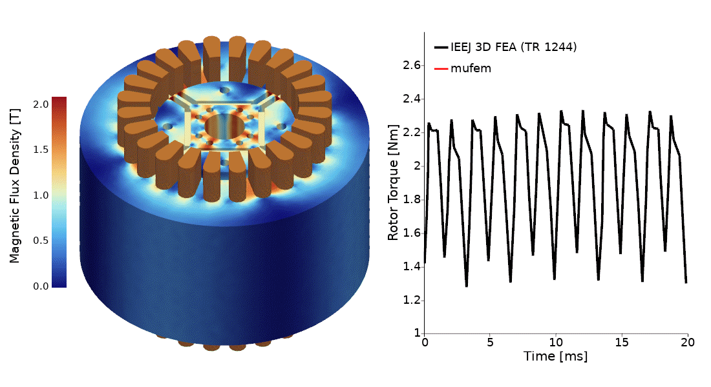

# IEEJ 2009: IPM Motor Model D

## Introduction

The *IEEJ Model D* is the four-pole, 24-slot interior permanent magnet synchronous motor (IPMSM) of
the *IEEJ Public Use Motors* [1], measured and analyzed by the *Investigation R&D Committee for
Industrial Motor Analysis Technology* of the *Institute of Electrical Engineers of Japan* [2, 3]. It
combines saturating laminated iron with thin rotor bridges, buried rare-earth magnets, a distributed
three-phase winding, and a turning rotor. The rated load is solved over one electrical period and
compared with the published 3D analyses, the measurement, and a 2D calculation. It is solved using
[case.py](case.py).

<div align="center">


<br/>
<br/>
<em>Figure 1: The modeled sector, without the air: stator, coils, rotor, and magnet, from the top and from the side. The rotor and the coils extend beyond the stator stack; only z &ge; 0 is modeled.</em>
</div>
<br/>

## Setup

### Geometry and Materials

The cross-section is the drawing [Dmodel_CAD.dxf](data/Dmodel_CAD.dxf) of the portal [1]. The motor
is modeled in 3D, over one pole pitch (Figure 2).

<div align="center">

<br/>
<br/>
<em>Figure 2: The cross-section with the modeled sector and the polarity of the four magnets. The faded sectors follow from the modeled one by anti-periodicity.</em>
</div>
<br/>

| Quantity | Value |
| -------- | ----- |
| Poles / slots | $`4`$ / $`24`$ |
| Stator / rotor outer diameter | $`112.2`$ / $`55\,\mathrm{mm}`$, air gap $`0.5\,\mathrm{mm}`$ |
| Stack: stator / rotor / magnets | $`60`$ / $`67.5`$ / $`65\,\mathrm{mm}`$ |
| Iron (stator, rotor) | JIS 50A350 $`B(H)`$ curve ([table](data/JIS50A350_BH.csv)), no eddy currents |
| Magnets | $`\vert\vec{B}_r\vert = 1.25\,\mathrm{T}`$, $`\mu_r = 1.05`$, along the pole axis in the frame of the rotor, no eddy currents |
| Coils | stranded copper, no eddy currents |
| Air, shaft, pockets, bolt holes | $`\mu_0`$ |

**Why a 90° sector is enough.** Turning the machine by one pole pitch ($`90°`$) reverses every
source: the next magnet has the opposite polarity (Figure 2), and the slots six further on carry
the same phase in the opposite direction (Figure 4). The sources are therefore anti-periodic, at
every rotor position. The $`B(H)`$ curve depends only on $`|\vec{B}|`$, so the reversed field is a
solution as well, even with saturation, and the field itself is anti-periodic:

```math
\vec{B}(R_{90°}\,\vec{x}) = -R_{90°}\,\vec{B}(\vec{x}) .
```

<div align="center">

<br/>
<br/>
<em>Figure 3: The interface conditions of the modeled sector. Each pair of cut faces is coupled anti-periodically. The rotor-side faces turn with the rotor, and the two sides of the sliding cylinder are meshed independently.</em>
</div>
<br/>

The model uses this in three places (Figure 3), with the results multiplied by $`2 \cdot 4 = 8`$ for
the full machine:

* The cut faces at $`0°`$ and $`90°`$ are meshed periodically and coupled with the opposite sign by
  an anti-periodic `MatchingInterfaceCondition`. A periodic condition would need twice the model,
  $`180°`$, because the sources only repeat after two poles.
* A cylinder in the middle of the air gap separates the air turning with the rotor from the outer
  air. The two sides are meshed independently and coupled by a `NonMatchingInterfaceCondition`. Where
  the rotor sector has turned past the end of the stator sector, it couples to the anti-periodic
  image of the stator, so the rotor turns freely without remeshing.
* The axial midplane $`z = 0`$ is a symmetry plane with a tangential-flux condition, and only
  $`z \ge 0`$ is modeled. The coils extend $`15\,\mathrm{mm}`$ beyond the stack, where the air ends.

### Formulation

The case uses the field-conforming ($`T`$-$`\Omega`$) formulation with first-order elements.

### Winding and Excitation

A single-layer full-pitch winding with $`q = 2`$, 35 conductors per slot and 140 turns per phase in
series; the slots from $`7.5°`$ counter-clockwise are

```
-W, +V, +V, -U, -U, +W, +W, -V, -V, +U, +U, -W   (repeated twice)
```

<div align="center">

<br/>
<br/>
<em>Figure 4: The winding over the drawing of the portal, seen from +z. Positive current leaves the page in the +slots (dot) and enters it in the -slots (cross). The lines show which slots form a coil; the model has no end windings, and the coils of a phase are in series. Created with <a href="data/plot_winding_diagram.py">plot_winding_diagram.py</a>.</em>
</div>
<br/>

The rated load is $`3\,\mathrm{A_{rms}}`$ at a current phase of $`\beta = 25°`$ and $`1500\,\mathrm{min^{-1}}`$.
With the d-axis at the electrical angle $`\theta_e = \omega t - 120°`$ from the axis of phase U, the
currents $`i_d = -I \sin\beta`$, $`i_q = I \cos\beta`$ give

```math
i_k(t) = \sqrt{2}\, I_\mathrm{rms} \cos\left(\theta_e + \beta + 90° - 120°\, k\right),
\quad k = 0, 1, 2 \quad (U, V, W), \quad \omega = 2\pi \cdot 50\,\mathrm{Hz} .
```

One electrical period ($`20\,\mathrm{ms}`$) is integrated in 120 steps of $`1/6\,\mathrm{ms}`$
($`1.5°`$ mechanical), starting from a converged magnetostatic solution. A time step ends when the
torque has settled, at the latest after 20 nonlinear iterations.

## Reference Data

* **IEEJ 3D FEA** (TR 1244 [2], Fig. 3.36): the digitized torque waveform of analyses No. 1/2 at the
  rated point. The figure has no angle origin, so its 12th torque harmonic is put in phase with
  the 2D calculation.
* **Measurement** (portal [1], `Dmodel_T-beta.csv`): the mean torque at the rated point. No measured
  waveform is published.
* **rfmkit** (2D, second-order elements, same cross-section): flux linkage and torque over one
  electrical period. This is a calculation, not a published value; it is the only
  reference for the flux linkage waveform.

[prepare_references.py](data/prepare_references.py) writes them on the time base of the case.

## Running

Run the case with `pymufem case.py`. It takes about 12 minutes on 5 MPI ranks without the field
export (`--no-field-export`) and about $`1\,\mathrm{GB}`$ of memory.

## Results

All values are for the full machine.

| Quantity | mufem | IEEJ 3D FEA | rfmkit (2D) | Measured |
| -------- | ----: | ----------: | ----------: | -------: |
| Mean torque [Nm] | 1.904 | 1.941 | 1.861 | 1.746 |
| Torque ripple, peak-to-peak [Nm] | 0.82 | 1.02 | 0.99 | - |
| 12th harmonic of the torque [Nm] | 0.25 | 0.37 | 0.33 | - |
| Fundamental of the flux linkage [mWb] | 163.4 | - | 153.8 | - |

The case checks:

| Check | Reference | Tolerance | Deviation |
| ----- | --------: | --------: | --------: |
| Mean torque against IEEJ 3D FEA | 1.941 Nm | 5 % | -1.9 % |
| Mean torque against the measurement | 1.746 Nm | 15 % | +9.0 % |
| Fundamental of the flux linkage against rfmkit | 153.8 mWb | 10 % | +6.3 % |

* **Torque.** The waveform follows the IEEJ 3D result in phase and shape, and the mean lies between
  the 3D and the 2D analyses. Like all analyses it is above the measurement (IEEJ: 5 to 13 %). The
  slot ripple is not resolved as well: the peak-to-peak ripple is about 20 % and the 12th harmonic
  23 to 32 % below the references, which are not checked.
* **Flux linkage.** The shape agrees with the 2D calculation and the amplitude is about 6 % higher.
  A run with the flux-conforming formulation on a mesh of the same settings gives 156.6 mWb, so most
  of the difference comes from the formulation. The 10 % tolerance of this check reflects that.

| Rotor Torque |
| ------------ |
|  |

| Flux Linkage U | Flux Linkage V | Flux Linkage W |
| -------------- | -------------- | -------------- |
|  |  |  |

## Scenes

<div align="center">

<br/>
<br/>
<em>Figure 5: Magnetic flux density on the full machine, repeated from the modeled eighth, and the rotor torque over time.</em>
</div>
<br/>

## Notes

* The $`B(H)`$ table ends at $`1.8\,\mathrm{T}`$; its continuation to $`3\,\mathrm{T}`$ with a slope of
  $`\mu_0`$ stays commented out in the table.
* The inductances of the portal (`Dmodel_inductances.csv`) are single-axis values from dq current
  sweeps and are not compared.

## References

[1] IEEJ Public Use Motors, D-model. http://www2.iee.or.jp/~drm/PublicUseMotors/actualMotors/PMSM/Dmodel/

[2] IEEJ Technical Report No. 1244 (2012). *Investigation R&D Committee for Industrial Motor Analysis Technology*.

[3] H. Kaimori and K. Akatsu (2015). *Measurement and analysis of interior permanent magnet synchronous motors: comparison of distributed and concentrated winding* (in Japanese). IEEJ Journal, 135(2), 75–82. https://doi.org/10.1541/ieejjournal.135.75
