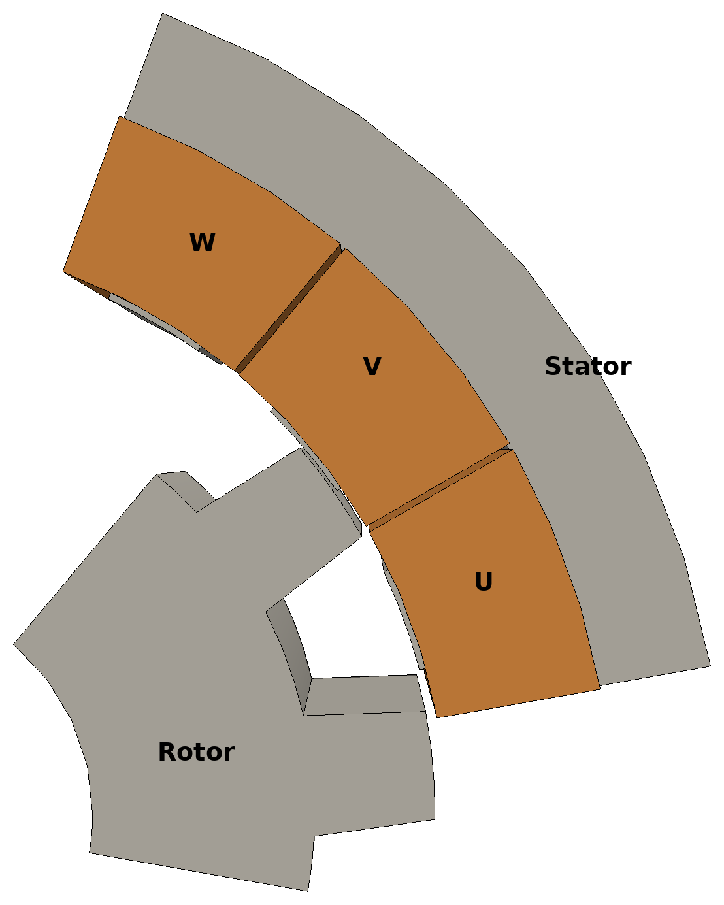
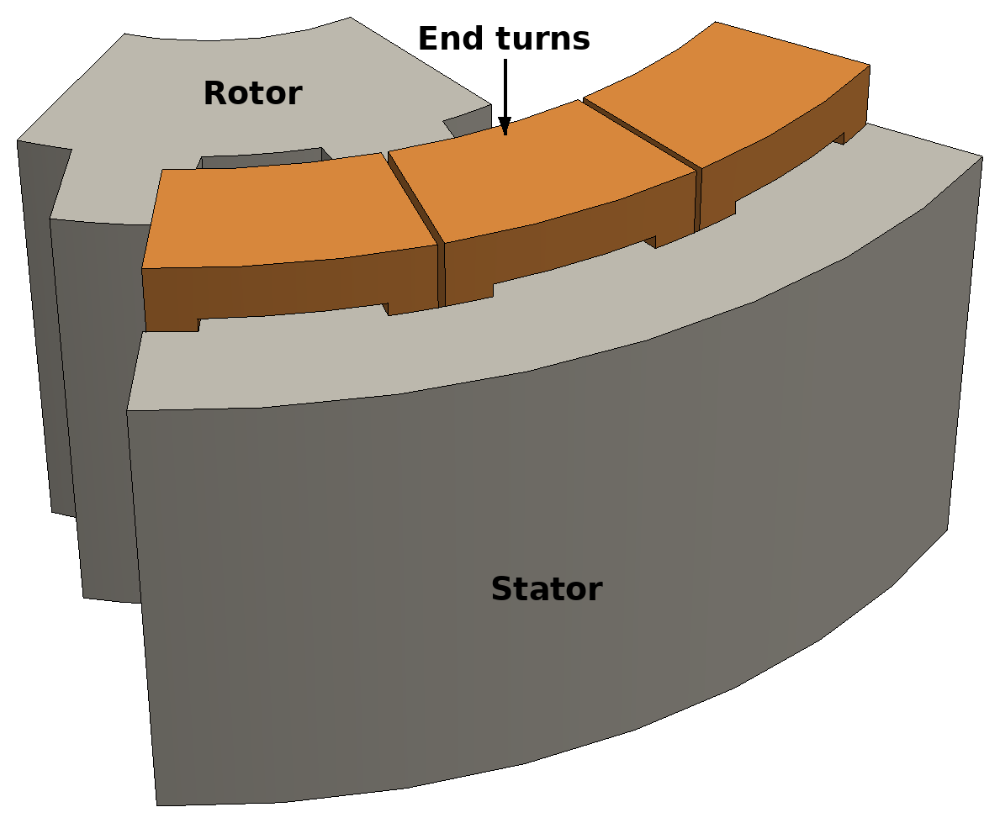
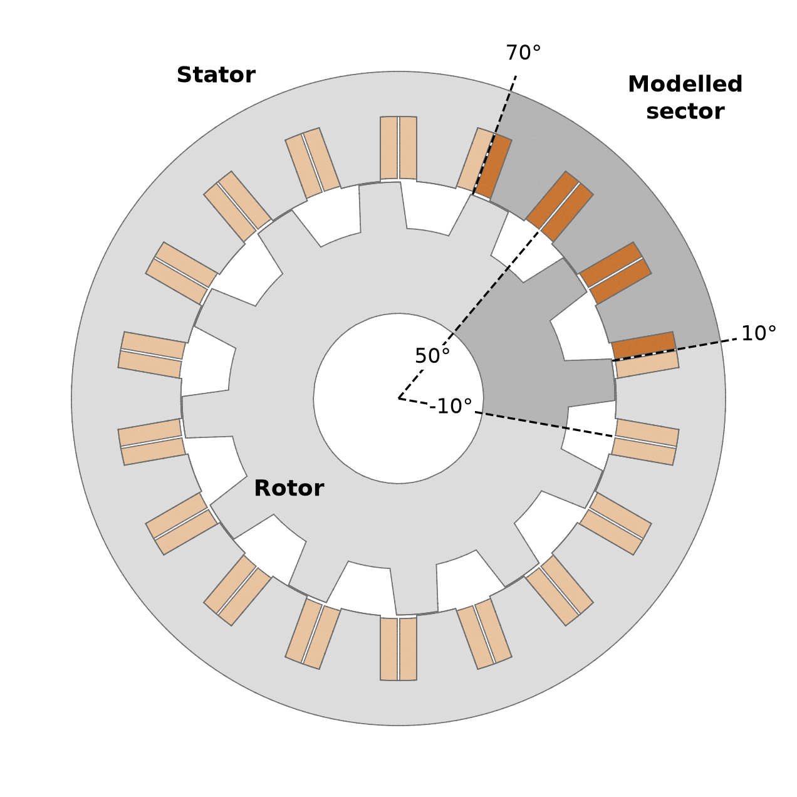
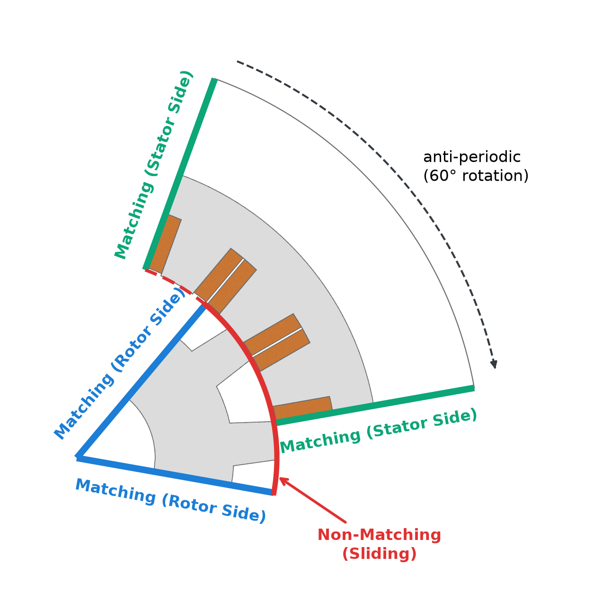
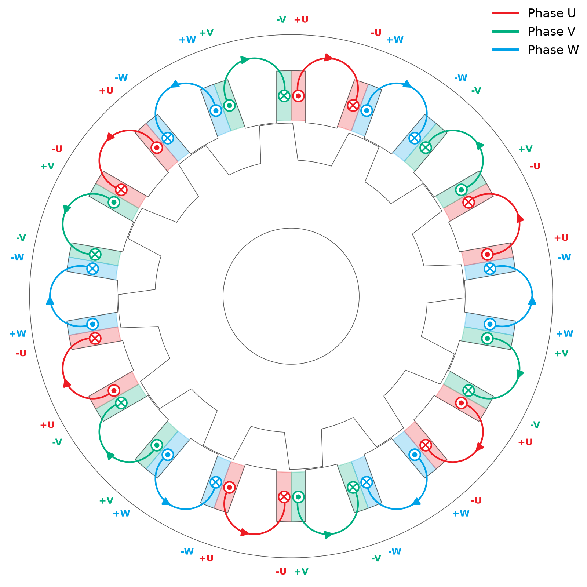
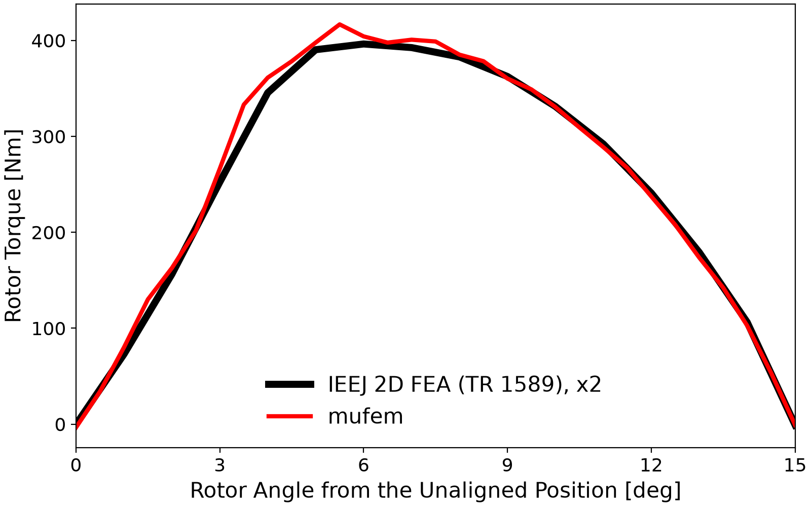
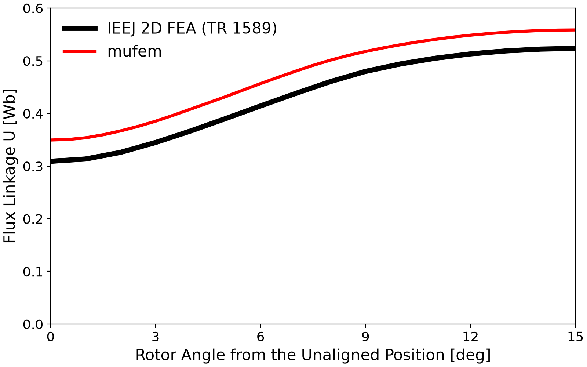
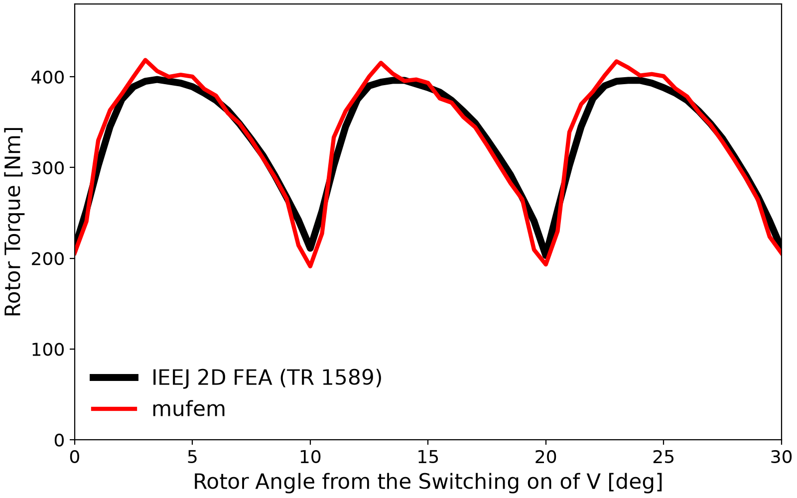
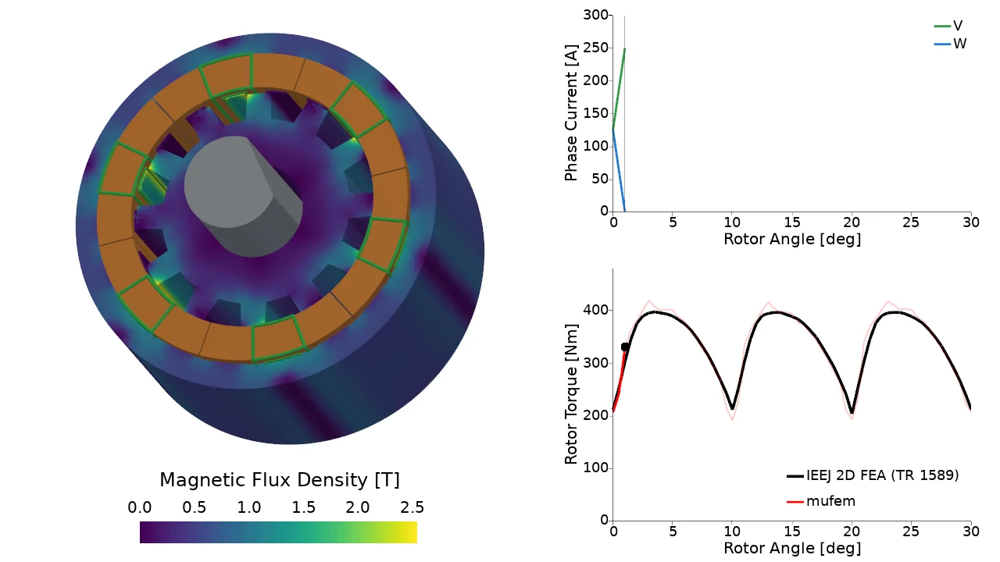

# IEEJ 2025: Switched Reluctance Motor SRM_HV

## Introduction

*SRM_HV* (called *SRM2* in its source) is the 18/12 switched reluctance motor of the *IEEJ Public
Use Motors* [1], designed by Chiba et al. [2] as a rare-earth-free replacement for the interior
permanent magnet traction motor of the second Toyota Prius hybrid: the same outer diameter
(269 mm), axial length (155 mm) and torque density, 50 kW from 1200 to 6000 min⁻¹. The portal
publishes its cross-section and its static characteristics, torque and flux linkage against rotor
position and current, from the 2D analysis of IEEJ TR 1589 [3].

The case first turns the rotor from the unaligned to the aligned position with a DC current in
phase U, and then drives the machine: the phases take turns at 250 A, switched on the rotor
position. It combines saturating thin-gauge silicon steel at pole tips that meet across a 0.5 mm
air gap, a torque from the change of reluctance alone (no magnets), coils with end turns, and a
rotor turning on a sliding interface. It is solved using [case.py](case.py).

<div align="center">


<br/>
<br/>
<em>Figure 1: The modeled sector, without the air: stator, rotor, and the coils of the three stator poles with their end turns, from the top and from the side. The rotor is in the unaligned position of phase U; only z &ge; 0 is modeled.</em>
</div>
<br/>

## Setup

### Geometry and Materials

The cross-section is the drawing [SRM2_CAD.dxf](data/SRM2_CAD.dxf) of the portal [1]. The motor is
modeled in 3D, over one sixth of the machine (Figure 2).

<div align="center">

<br/>
<br/>
<em>Figure 2: The cross-section at mid-stack and the modeled 60° sector (darker). The stator sector is cut through the slot centers (10° to 70°), the rotor sector through the gaps between its poles (−10° to 50°).</em>
</div>
<br/>

| Quantity | Value |
| -------- | ----- |
| Stator / rotor poles | $`18`$ / $`12`$ |
| Air gap | $`0.5\,\mathrm{mm}`$ |
| Stack | $`135\,\mathrm{mm}`$; the coils reach $`10\,\mathrm{mm}`$ beyond it |
| Iron (stator, rotor) | 10JNEX900 ($`0.1\,\mathrm{mm}`$ sheets), $`B(H)`$ curve digitized from the portal figure ([table](data/10JNEX900_BH.csv)), no eddy currents |
| Coils | stranded copper, 17 turns per pole, no eddy currents |
| Air, shaft | $`\mu_0`$ |

**Why a 60° sector is enough.** With $`\gcd(18, 12) = 6`$ the machine repeats every $`60°`$, with
three stator poles (phases U, V, W) and two rotor poles. The six pole coils of a phase alternate in
polarity, so that the flux of an excited pole closes through its two neighbors of the same phase.
The sources, and with them the field, are therefore anti-periodic over $`60°`$:

```math
\vec{B}(R_{60°}\,\vec{x}) = -R_{60°}\,\vec{B}(\vec{x}) .
```

<div align="center">

<br/>
<br/>
<em>Figure 3: The interface conditions of the modeled sector. Each pair of cut faces is coupled anti-periodically. The rotor-side faces turn with the rotor, and the two sides of the sliding cylinder are meshed independently.</em>
</div>
<br/>

The model uses this in three places (Figure 3), with the results multiplied by $`2 \cdot 6 = 12`$
for the full machine:

* The cut faces of the stator side ($`10°`$ and $`70°`$) and of the rotor side ($`-10°`$ and
  $`50°`$) are meshed periodically and coupled with the opposite sign by anti-periodic
  `MatchingInterfaceCondition`s. The stator cut runs through the slot centers, between the two coil
  sides of a slot (a $`1\,\mathrm{mm}`$ separator), so that each coil lies whole inside the sector.
* A cylinder in the middle of the air gap separates the air turning with the rotor from the outer
  air. The two sides are meshed independently and coupled by a `NonMatchingInterfaceCondition`.
  Where one sector reaches past the other, it couples to the anti-periodic image, so the rotor
  turns freely without remeshing.
* The axial midplane $`z = 0`$ is a symmetry plane with a tangential-flux condition, and only
  $`z \ge 0`$ is modeled. The air reaches $`60\,\mathrm{mm}`$ beyond the stack.

### Formulation

The case uses the field-conforming ($`T`$-$`\Omega`$) formulation with first-order elements.
Nothing conducts eddy currents, so every time step is the magnetostatic field at one rotor
position. A position ends when the torque has settled, at the latest after 20 nonlinear iterations.

### Winding and Excitation

Each stator pole carries one coil: its two sides in the halves of the neighboring slots and an end
turn over the pole, $`2\,\mathrm{mm}`$ clear of the iron. The six coils of a phase are in series.

<div align="center">

<br/>
<br/>
<em>Figure 4: The winding seen from +z. Positive current leaves the page in the +sides (dot) and enters it in the −sides (cross); each slot holds one side of the coils of its two poles. The poles of a phase alternate in polarity.</em>
</div>
<br/>

The run has two parts, at two rotor positions per degree:

* **Static stroke.** Phase U carries a DC current of $`250\,\mathrm{A}`$, V and W none. The rotor
  turns by $`15°`$, half a rotor pole pitch, from the unaligned to the aligned position of U.
* **Commutated drive.** Each phase carries $`250\,\mathrm{A}`$ over the middle $`10°`$ of its
  $`15°`$ stroke, where its torque exceeds that of the phases before and after it: V to U at
  $`2.5°`$, U to W at $`12.5°`$ and W to V at $`22.5°`$ from the unaligned position of U, the
  switching of the portal's commutated torque. The drive starts where the stroke ends and is
  reported over one rotor pole pitch ($`30°`$, each phase once) from the switching on of V at
  $`22.5°`$.

The current of a phase cannot jump: in a real drive it rises and falls over several degrees. As a
modification of the ideal commutation of the portal, the current crosses over from one phase to the
next linearly within $`\pm 1°`$ of each switching angle, with the two currents adding up to
$`250\,\mathrm{A}`$.

### Modifications

The portal publishes the cross-section and 2D results only. The 3D model and the drive add the
following, which are not part of the portal data:

* **End turns.** Each coil is closed by an end turn over its pole, $`2\,\mathrm{mm}`$ clear of the
  iron, within the $`10\,\mathrm{mm}`$ that the coils reach beyond the stack. The end turn is
  rectangular in section and flat over the pole; the shape of the real end windings is not
  published.
* **Slot separator.** The two coil sides of a slot are kept $`1\,\mathrm{mm}`$ apart at the slot
  center, so that the stator cut runs through air and each coil lies whole inside the sector.
* **Switching ramp.** The portal's commutated torque switches the current instantly. Here the
  current crosses over from one phase to the next linearly within $`\pm 1°`$ of each switching
  angle (see above). The dips of the torque at the switching angles therefore differ from the
  portal's.
* **Ideal current drive.** The phases carry a flat-top current; the drive of the prototype, its
  turn-on and turn-off angles and current waveforms, is not published.
* **Shaft.** The shaft is non-magnetic (air). The D-shaft in the animation is drawn for the eye
  only.

## Reference Data

* **IEEJ 2D FEA** (portal [1], IEEJ TR 1589 [3]): the torque and the flux linkage of phase U at
  250 A against the rotor position, `SRM2_T-position.csv` and `SRM2_Flux-I.csv`
  ([torque](data/Reference_Torque_250A.csv), [flux linkage](data/Reference_Flux_Linkage_250A.csv)),
  and the torque of the commutated machine, `SRM2_torque.csv`
  ([table](data/Reference_Commutated_Torque_250A.csv)). The tables run over the rotor positions
  10 to 20 with zero torque at both ends; they are taken to span the unaligned to the aligned
  position, $`\theta = 1.5\,(x - 10)`$.
* The co-energy torque computed from the portal's own flux linkage table,
  $`\partial_\theta \int_0^{250\,\mathrm{A}} \Psi\,\mathrm{d}i`$, is twice its torque table: the
  torque table is that of the half-machine model of the portal. The static torque is compared with
  twice the table.

## Results

All values are for the full machine.

| Rotor angle [deg] | Torque mufem [Nm] | Torque IEEJ 2D, x2 [Nm] | Flux linkage mufem [Wb] | Flux linkage IEEJ 2D [Wb] |
| ----------------: | ----------------: | ----------------------: | ----------------------: | ------------------------: |
| 0 (unaligned) | −3.5 | −0.4 | 0.349 | 0.309 |
| 2 | 162.7 | 156.2 | 0.367 | 0.326 |
| 4 | 361.2 | 345.4 | 0.408 | 0.367 |
| 6 | 404.2 | 396.2 | 0.457 | 0.414 |
| 8 | 385.1 | 382.8 | 0.501 | 0.461 |
| 10 | 330.5 | 331.1 | 0.530 | 0.494 |
| 12 | 237.3 | 240.9 | 0.549 | 0.513 |
| 14 | 102.7 | 106.2 | 0.557 | 0.522 |
| 15 (aligned) | −0.9 | −1.0 | 0.558 | 0.523 |

| Quantity | mufem | IEEJ 2D |
| -------- | ----: | ------: |
| Mean torque over the stroke [Nm] | 264.8 | 260.0 |
| Peak torque over the stroke [Nm] | 416.7 (at 5.5°) | 396.2 (at 6°) |
| Commutated torque at 250 A, min / max [Nm] | 191 / 418 | 203 / 397 |
| Commutated torque at 250 A, mean [Nm] | 340.0 | 337.5 |

The case checks:

| Check | Reference | Tolerance | Deviation |
| ----- | --------: | --------: | --------: |
| Mean torque over the stroke against IEEJ 2D, x2 | 260.0 Nm | 5 % | +1.9 % |
| Aligned flux linkage against IEEJ 2D | 0.523 Wb | 10 % | +6.7 % |
| Mean commutated torque against IEEJ 2D | 337.5 Nm | 5 % | +0.7 % |

* **Torque.** The shape and the position of the peak agree. From the peak to the aligned position
  the torque is within −3 to +2 % of the reference; early in the stroke, with only the pole tips
  facing each other, it is 4 to 5 % above it.
* **Flux linkage.** 7 to 13 % above the 2D table, most at the unaligned position. This is the end
  field that a 2D model does not have: the end turns and the fringing at the stack ends, which leak
  most where the air gap is wide.
* **End turns.** Against straight coil sides ending at a flux-tangential plane 10 mm beyond the
  stack, the end turns and the open air above them lower the torque by 2.5 to 7 % over the stroke
  and raise the unaligned flux linkage by 3 %. Chiba et al. [2] found the same direction with their
  3D analysis.
* **Commutated torque.** The ripple follows the portal's commutated torque in shape, with the peaks
  about 5 % higher and the mean within 1 %. The dips at the switching angles are a little deeper and
  wider than with the instant switching of the portal: within the ramp the two phases share the
  current, and the torque goes roughly with its square.

| Rotor Torque | Flux Linkage U |
| ------------ | -------------- |
|  |  |

| Commutated Torque at 250 A |
| -------------------------- |
|  |

## Scenes

<div align="center">

<br/>
<br/>
<em>Figure 5: The commutated machine at 250 A over a full turn, repeated from the modeled twelfth. The iron is shaded by the magnetic flux density; the conducting coils are outlined in the color of their phase (U red, V green, W blue), fading in and out with their current through the switching ramps. The field repeats every rotor pole pitch, so the fields of the reported pitch are shown twelve times. The shaft with its flat is drawn for the eye only; the bore is air in the model. Right: the phase currents and the torque over the pitch from the switching on of V.</em>
</div>
<br/>

## References

[1] IEEJ Public Use Motors, SRM_HV. http://www2.iee.or.jp/~drm/PublicUseMotors/

[2] A. Chiba, K. Kiyota, N. Hoshi, M. Takemoto and S. Ogasawara (2015). *Development of a
Rare-Earth-Free SR Motor With High Torque Density for Hybrid Vehicles*. IEEE Transactions on Energy
Conversion, 30(1), 175–182. https://doi.org/10.1109/TEC.2014.2343962

[3] IEEJ Technical Report No. 1589 (2025). *High-precision modeling and advanced optimization of
rotating machines by electromagnetic field analysis* (in Japanese).
