# Validations

This page lists the validation cases of mufem, tested against the pinned [version](../VERSION).
Each case compares its results with published, measured, or analytical reference values and
reports every check. Many cases are based on well-known benchmark suites, such as the
[TEAM](https://www.compumag.org/wp/team/) (Testing Electromagnetic Analysis Methods) problems of
the International Compumag Society and the
[NAFEMS](https://www.nafems.org/publications/resource_center/r0006/) benchmarks.

See [Running the cases](#running-the-cases) for how to run them.

## Validation cases

* [Electromagnetics](#electromagnetics):
  [Electrostatics](#electrostatics) ·
  [Time-Domain Magnetic](#time-domain-magnetic) ·
  [Time-Harmonic Magnetic](#time-harmonic-magnetic) ·
  [Time-Harmonic Maxwell](#time-harmonic-maxwell)
* [Structural](#structural):
  [Solid Mechanics](#solid-mechanics) ·
  [Solid Temperature](#solid-temperature)

### Electromagnetics

#### [Electrostatics](https://raiden-numerics.github.io/mufem-doc/models/electromagnetics/electrostatics/model.html)

Static electric fields in conductors and dielectrics, solved for the electric potential. Gives
capacitances, stored energies, and electrostatic forces, as needed for high-voltage insulation,
capacitors, and MEMS devices.

<table>
<tr>
<td width="25%" height="130" align="center"><a href="Electromagnetics/David_2019_Nonuniform_Charge_Density/README.md">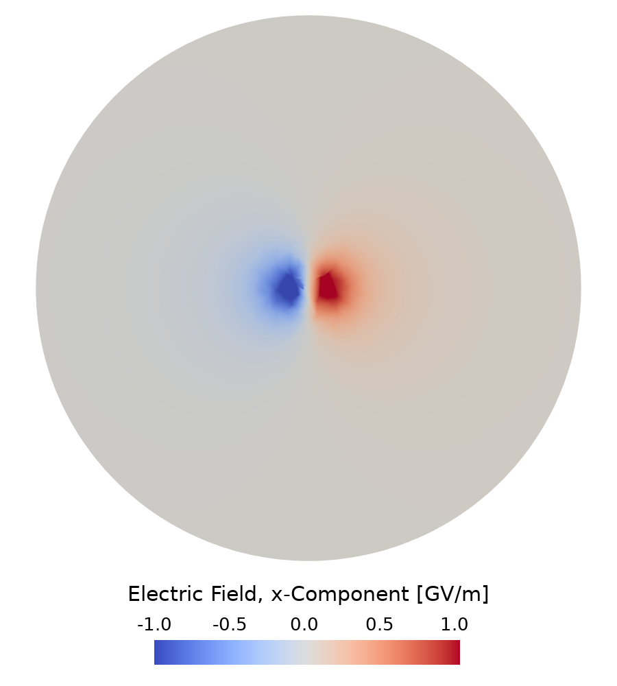</a></td>
<td width="75%" valign="top">
<strong><a href="Electromagnetics/David_2019_Nonuniform_Charge_Density/README.md">David 2019: Nonuniform Charge Density</a></strong><br>
A spherical cloud of charge in free space whose density falls off as a Gaussian from its center.
The electric field around the charge is checked against the closed-form solution from Gauss's
law. The case also serves as a step-by-step mufem tutorial.
</td>
</tr>
<tr></tr>
<tr>
<td width="25%" height="130" align="center"><a href="Electromagnetics/Ren_2014_MEMS_Comb_Drive/README.md">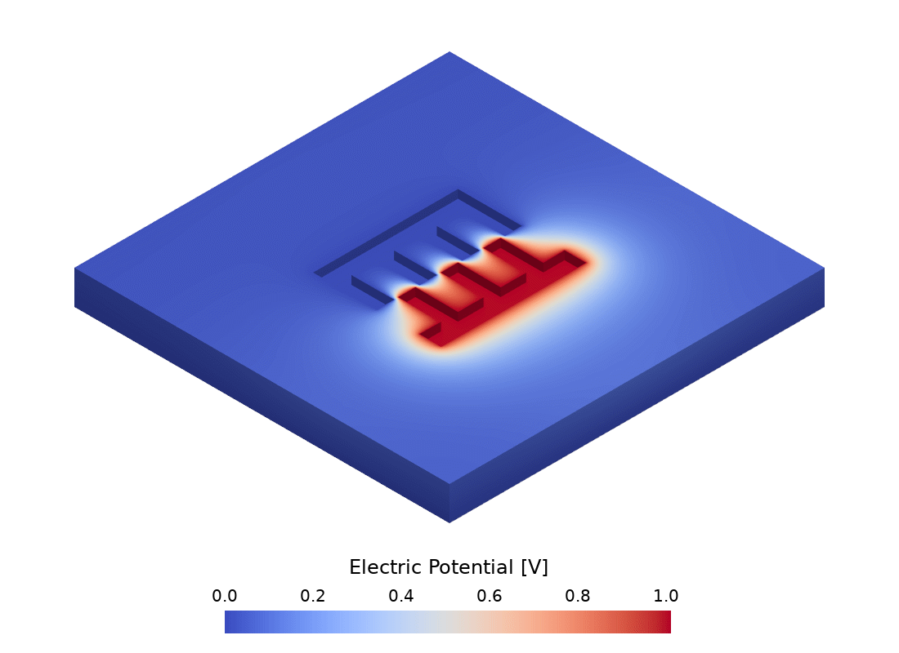</a></td>
<td width="75%" valign="top">
<strong><a href="Electromagnetics/Ren_2014_MEMS_Comb_Drive/README.md">Ren 2014: MEMS Comb Drive</a></strong><br>
An electrostatic comb drive, the actuator used in many MEMS sensors and switches: two
interdigitated micrometer-scale combs above a grounded plate. The capacitance, whose change with
displacement sets the actuation force, is computed as the combs are pulled apart; at full overlap it
is checked against the bounds of two published finite-element formulations.
</td>
</tr>
</table>

#### [Time-Domain Magnetic](https://raiden-numerics.github.io/mufem-doc/models/electromagnetics/time_domain_magnetic/model.html)

Low-frequency magnetic fields in the time domain, solved for the magnetic vector potential with
displacement currents neglected. Covers static fields, transient eddy currents, saturating
materials, permanent magnets, and superconductors, as found in electric machines, actuators, and
transformers. Coils are driven by the [Excitation Coil](https://raiden-numerics.github.io/mufem-doc/models/electromagnetics/excitation_coil/model.html) model, and moving parts by the Rigid Body Motion model.

<table>
<tr>
<td width="25%" height="130"><a href="Electromagnetics/Berger_2017_HTS_Cube/README.md">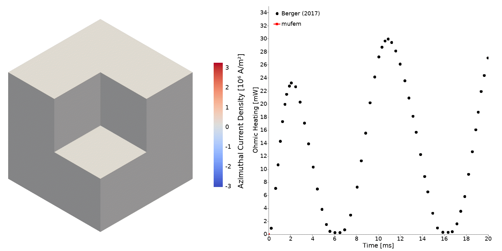</a></td>
<td width="75%" valign="top">
<strong><a href="Electromagnetics/Berger_2017_HTS_Cube/README.md">Berger 2017: High-Temperature Superconductor Cube</a></strong><br>
A cube of high-temperature superconductor in a sinusoidal external magnetic field, as found in
superconducting magnets and power devices. The shielding currents follow a strongly nonlinear
power law, and the resulting AC loss is checked against results of five independent research
teams.
</td>
</tr>
<tr></tr>
<tr>
<td width="25%" height="130"><a href="Electromagnetics/Compumag-Team1b-Felix-Cylinder/README.md">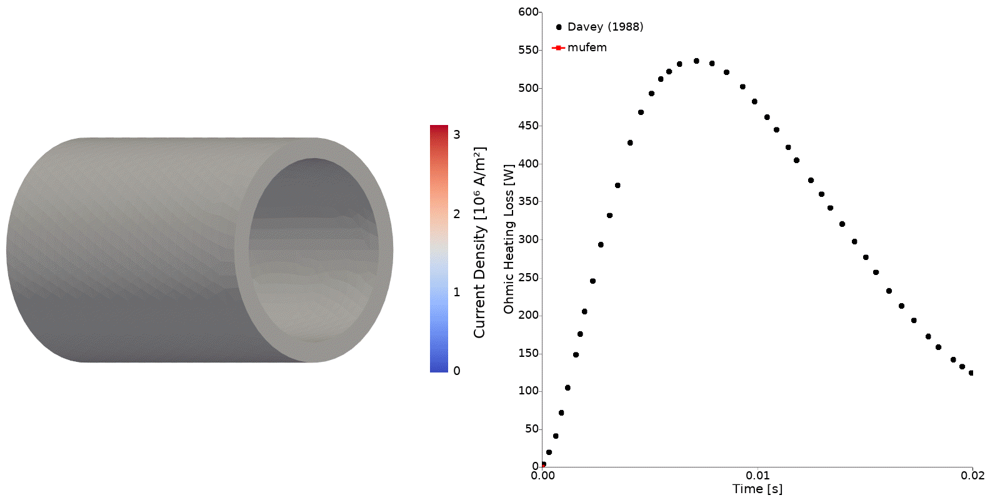</a></td>
<td width="75%" valign="top">
<strong><a href="Electromagnetics/Compumag-Team1b-Felix-Cylinder/README.md">Compumag TEAM 1b: The FELIX Short Cylinder</a></strong><br>
A hollow aluminum cylinder in a uniform transverse magnetic field that decays exponentially,
after the FELIX fusion experiment at Argonne National Laboratory. The Ohmic loss over time is
compared with the codes of the 1988 TEAM workshop, and the induced field at the center with
measurements.
</td>
</tr>
<tr></tr>
<tr>
<td width="25%" height="130" align="center"><a href="Electromagnetics/Compumag-Team13-3-D-Non-Linear-Magnetostatic-Model/README.md">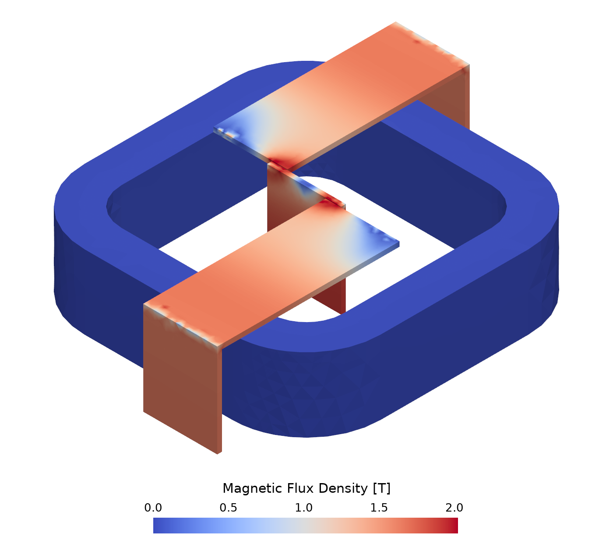</a></td>
<td width="75%" valign="top">
<strong><a href="Electromagnetics/Compumag-Team13-3-D-Non-Linear-Magnetostatic-Model/README.md">Compumag TEAM 13: 3-D Non-Linear Magnetostatic Model</a></strong><br>
Two steel channels and a steel plate between them, magnetized by a rectangular coil strong
enough to drive the steel deep into saturation. The flux density along a line in the air is
compared with Hall-probe measurements.
</td>
</tr>
<tr></tr>
<tr>
<td width="25%" height="130" align="center"><a href="Electromagnetics/Compumag-Team20-3D-Static-Force-Problem/README.md">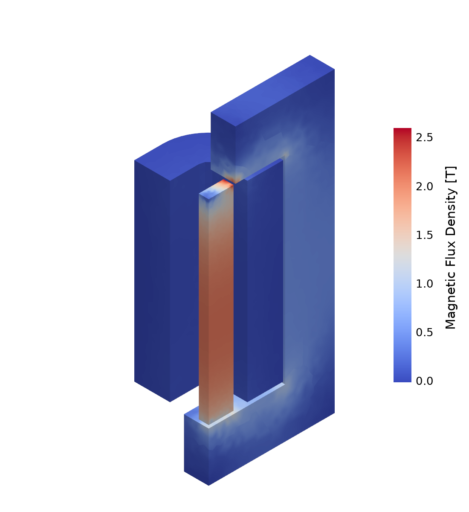</a></td>
<td width="75%" valign="top">
<strong><a href="Electromagnetics/Compumag-Team20-3D-Static-Force-Problem/README.md">Compumag TEAM 20: 3-D Static Force Problem</a></strong><br>
An electromagnet: a steel center pole and yoke excited by a copper coil with a constant current.
The force pulling the pole toward the yoke is computed over a range of currents, from the linear
regime into saturation, and checked against experiment.
</td>
</tr>
<tr></tr>
<tr>
<td width="25%" height="130"><a href="Electromagnetics/Compumag-Team24-Locked-Rotor/README.md">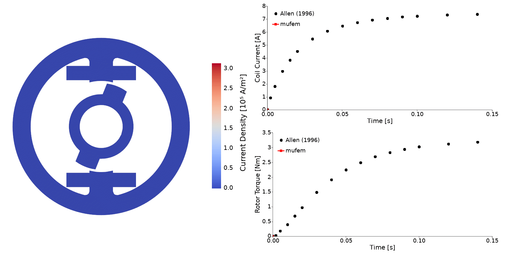</a></td>
<td width="75%" valign="top">
<strong><a href="Electromagnetics/Compumag-Team24-Locked-Rotor/README.md">Compumag TEAM 24: Nonlinear Time-Transient Rotational Test Rig</a></strong><br>
A rotating-machine test rig: a solid steel rotor locked inside a steel stator carrying two coils.
A voltage step energizes the coils, and the coil current, the rotor torque, and the air-gap flux
density are followed in time and compared with measurements.
</td>
</tr>
<tr></tr>
<tr>
<td width="25%" height="130"><a href="Electromagnetics/Lubin_2015_Axial_Flux_Eddy_Current_Brake/README.md">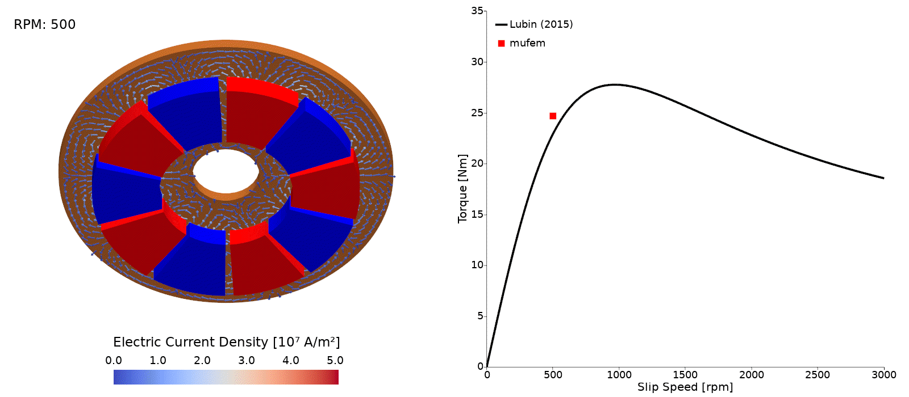</a></td>
<td width="75%" valign="top">
<strong><a href="Electromagnetics/Lubin_2015_Axial_Flux_Eddy_Current_Brake/README.md">Lubin 2015: Axial-Flux Eddy-Current Brake</a></strong><br>
An axial-flux eddy-current brake: a permanent-magnet rotor spinning in front of a copper disc.
The eddy currents induced in the disc produce a braking torque, computed over a range of speeds and
compared with a 3-D analytical model.
</td>
</tr>
</table>

#### [Time-Harmonic Magnetic](https://raiden-numerics.github.io/mufem-doc/models/electromagnetics/time_harmonic_magnetic/model.html)

Low-frequency magnetic fields at a single frequency, represented as complex amplitudes, so that the
AC steady state follows from one solve instead of a time march. Suited to eddy currents and skin
and proximity effects in transformers, induction heaters, and conductors. Coils are driven by the
[Excitation Coil](https://raiden-numerics.github.io/mufem-doc/models/electromagnetics/excitation_coil/model.html) model.

<table>
<tr>
<td width="25%" height="130" align="center"><a href="Electromagnetics/Biro_1993_3D_Iron_Core_Current_Driven_Conductors/README.md">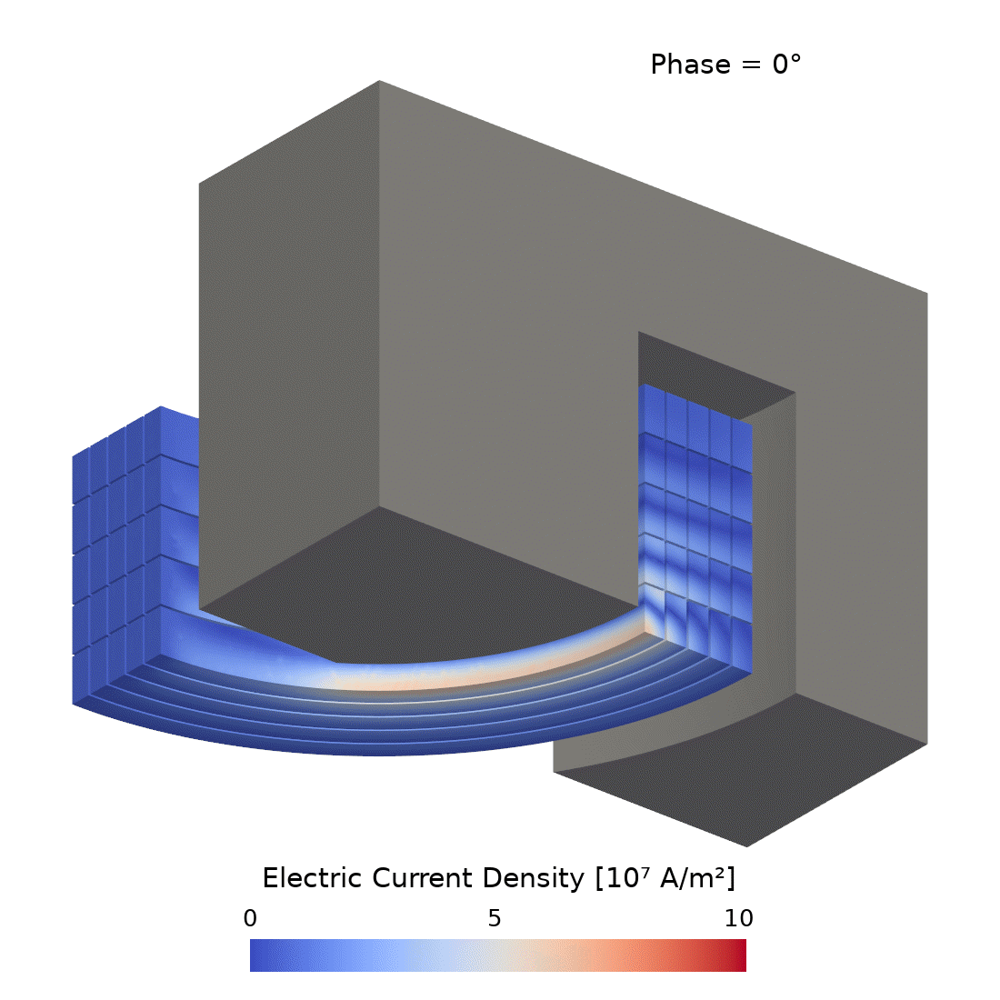</a></td>
<td width="75%" valign="top">
<strong><a href="Electromagnetics/Biro_1993_3D_Iron_Core_Current_Driven_Conductors/README.md">Biro 1993: 3D Iron Core Current Driven Conductors</a></strong><br>
An iron core with an air gap and 25 solid copper turns carrying a 5 kHz current. Skin and
proximity effects make the loss differ from turn to turn; the Ohmic loss in each turn is compared
with published values.
</td>
</tr>
<tr></tr>
<tr>
<td width="25%" height="130"><a href="Electromagnetics/Compumag-Team7-Asymmetrical-Conductor-with-a-Hole/README.md">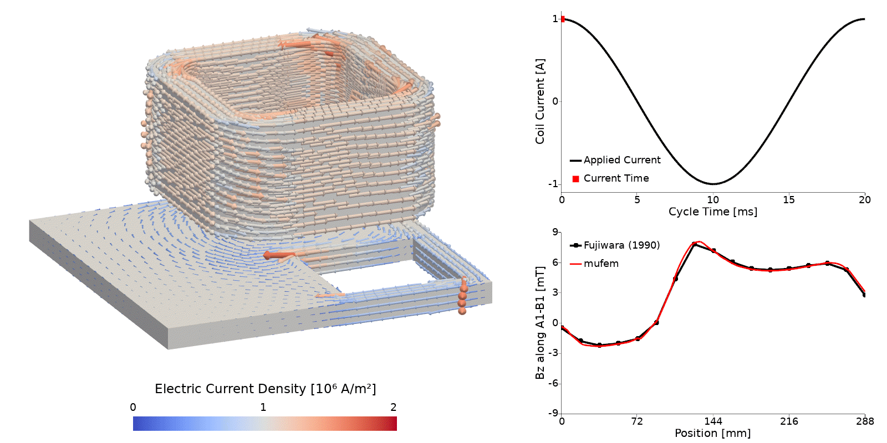</a></td>
<td width="75%" valign="top">
<strong><a href="Electromagnetics/Compumag-Team7-Asymmetrical-Conductor-with-a-Hole/README.md">Compumag TEAM 7: Asymmetrical Conductor with a Hole</a></strong><br>
A thick aluminum plate with an off-center hole beneath a coil carrying a sinusoidal current, a
classic test for 3-D eddy currents. The flux density above the plate and the current density in it
are compared with measurements at 50 Hz and 200 Hz.
</td>
</tr>
<tr></tr>
<tr>
<td width="25%" height="130" align="center"><a href="Electromagnetics/Compumag-Team36-Induction-Heating-Device/README.md">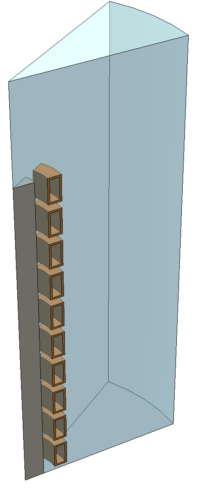</a></td>
<td width="75%" valign="top">
<strong><a href="Electromagnetics/Compumag-Team36-Induction-Heating-Device/README.md">Compumag TEAM 36: Induction Heating Device</a></strong><br>
An induction heater: a coil heats a steel billet through induced eddy currents. The electrical
and thermal properties of the steel depend on temperature, and the permeability collapses at the
Curie point, so the magnetic and thermal fields are solved fully coupled. The heating power and the
billet temperature over the first 100 s are compared with published results.
</td>
</tr>
</table>

#### [Time-Harmonic Maxwell](https://raiden-numerics.github.io/mufem-doc/models/electromagnetics/time_harmonic_maxwell/model.html)

Full-wave electromagnetic fields at a single frequency, solved for the electric field including
wave propagation. With waveguide ports, absorbing boundaries, S-parameters, and far-field reports,
it targets RF and microwave devices such as waveguides, filters, and antennas.

<table>
<tr>
<td width="25%" height="130"><a href="Electromagnetics/Montejo-Garai_1995_Circular_Cavity_Filter/README.md">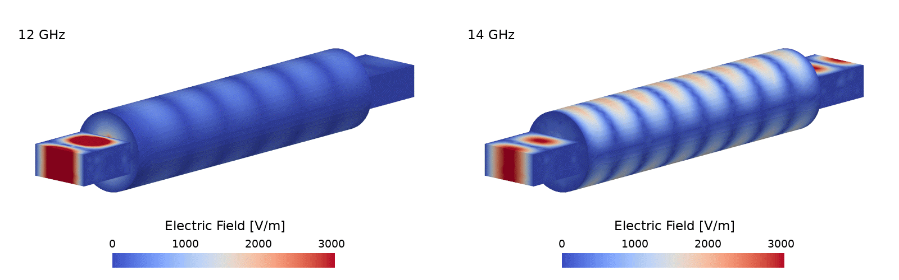</a></td>
<td width="75%" valign="top">
<strong><a href="Electromagnetics/Montejo-Garai_1995_Circular_Cavity_Filter/README.md">Montejo-Garai 1995: Circular Cavity Filter</a></strong><br>
A microwave waveguide filter of the kind used in satellite communications: a circular cavity
resonator coupled to rectangular waveguides through thin irises. Its transmission over frequency
is compared with measurements.
</td>
</tr>
<tr></tr>
<tr>
<td width="25%" height="130" align="center"><a href="Electromagnetics/Stutzman_2012_Dipole_Antenna/README.md">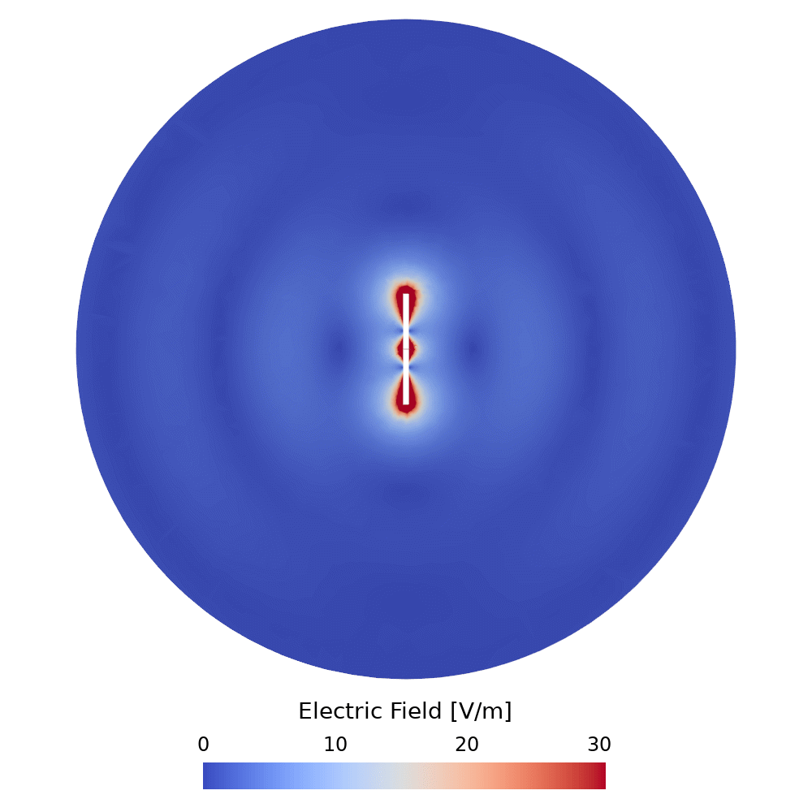</a></td>
<td width="75%" valign="top">
<strong><a href="Electromagnetics/Stutzman_2012_Dipole_Antenna/README.md">Stutzman 2012: Dipole Antenna</a></strong><br>
A half-wave dipole antenna, the basic radiating element of Wi-Fi, cellular, and broadcast
systems. The far-field radiation pattern is compared with the classical thin-dipole solution.
</td>
</tr>
</table>

### Structural

#### [Solid Mechanics](https://raiden-numerics.github.io/mufem-doc/models/mechanical/solid_mechanics/model.html)

Small-strain, quasi-static deformation of linear elastic solids, solved for the displacement under
prescribed displacements and surface tractions.

<table>
<tr>
<td width="25%" height="130"><a href="Structural/Slaughter_2002_Linear_Cantilever_Beam/README.md">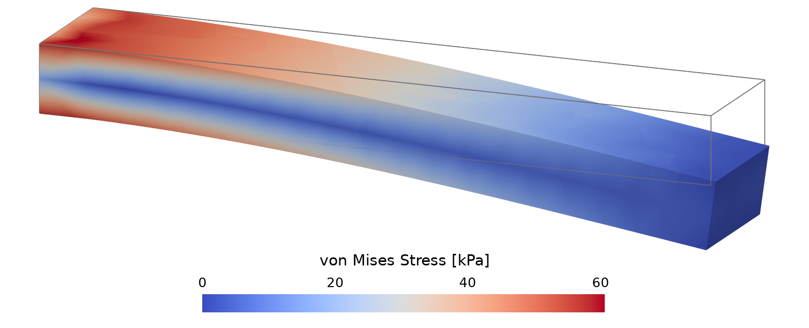</a></td>
<td width="75%" valign="top">
<strong><a href="Structural/Slaughter_2002_Linear_Cantilever_Beam/README.md">Slaughter 2002: Linear Cantilever Beam</a></strong><br>
A cantilever beam clamped at one end and loaded transversely at the free end. The deflection
and the stress along the beam are compared with Euler–Bernoulli beam theory.
</td>
</tr>
</table>

#### [Solid Temperature](https://raiden-numerics.github.io/mufem-doc/models/mechanical/solid_temperature/model.html)

Steady and transient heat conduction in solids with volumetric heat sources, and heat exchange at
the boundaries through convection, radiation, and prescribed heat fluxes. Couples with the
electromagnetic models, for example for induction heating in
[TEAM 36](Electromagnetics/Compumag-Team36-Induction-Heating-Device/README.md).

<table>
<tr>
<td width="25%" height="130" align="center"><a href="Thermal/Cameron_1986_Heat_Transfer_With_Convection/README.md">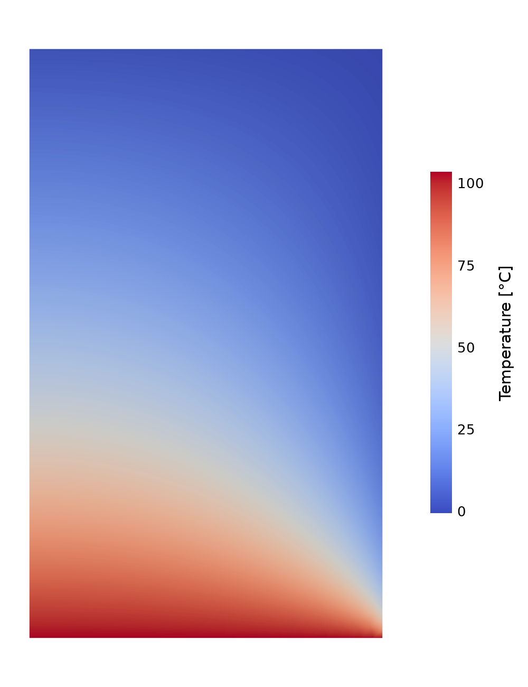</a></td>
<td width="75%" valign="top">
<strong><a href="Thermal/Cameron_1986_Heat_Transfer_With_Convection/README.md">Cameron 1986: Heat Transfer With Convection</a></strong><br>
NAFEMS benchmark T4: steady heat conduction in a rectangular plate with fixed-temperature,
insulated, and convective edges. The temperature at the benchmark point is checked against the
NAFEMS target.
</td>
</tr>
<tr></tr>
<tr>
<td width="25%" height="130" align="center"><a href="Thermal/Goldak_1984_Welding_Heat_Source/README.md">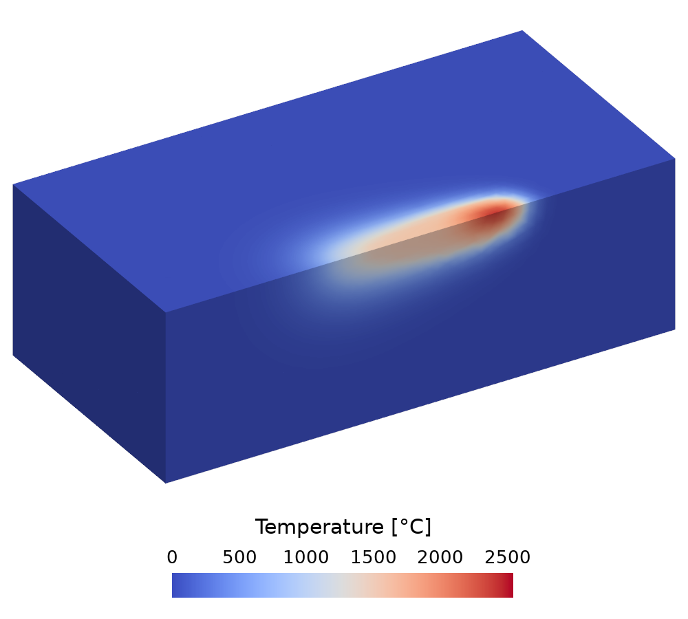</a></td>
<td width="75%" valign="top">
<strong><a href="Thermal/Goldak_1984_Welding_Heat_Source/README.md">Goldak 1984: Welding Heat Source</a></strong><br>
A weld bead laid on a 10 cm thick steel plate, with the arc represented by Goldak's moving
double-ellipsoid heat source. The temperature profile across the weld is compared with
measurements.
</td>
</tr>
<tr></tr>
<tr>
<td width="25%" height="130" align="center"><a href="Thermal/Guenin_2011_Heat_Transfer_Electronic_Design/README.md">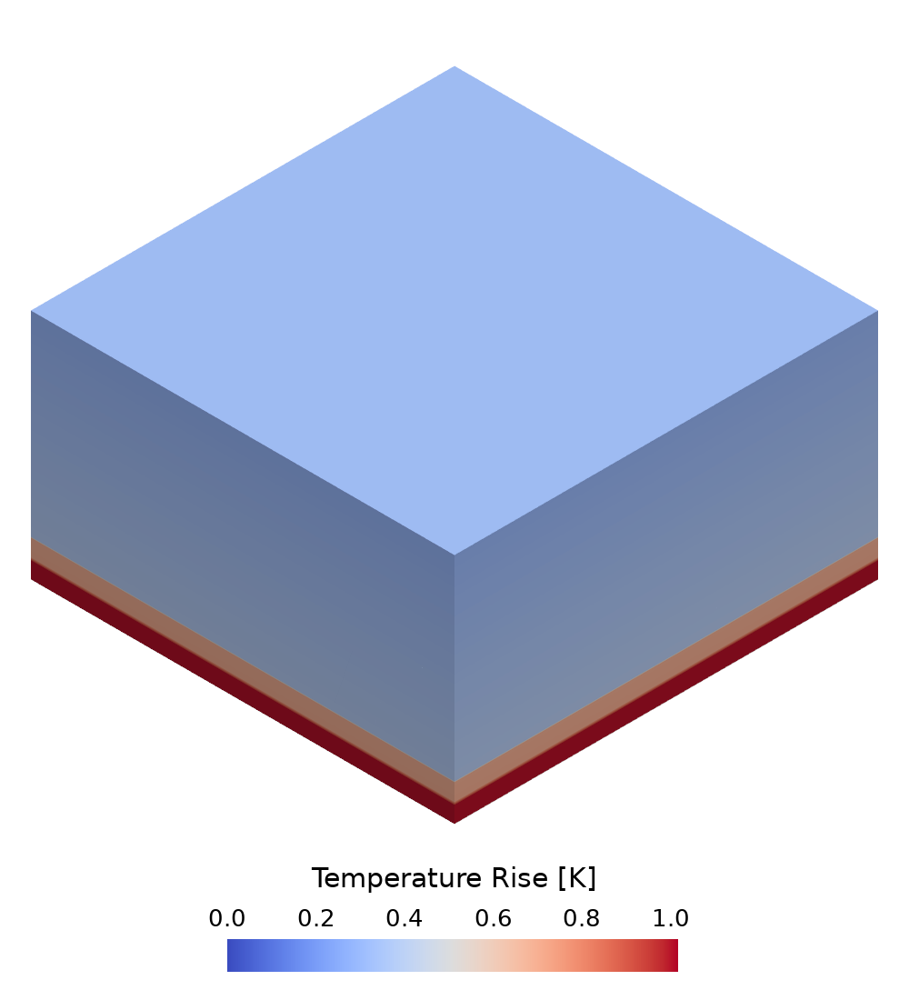</a></td>
<td width="75%" valign="top">
<strong><a href="Thermal/Guenin_2011_Heat_Transfer_Electronic_Design/README.md">Guenin 2011: Heat Transfer in Electronic Design</a></strong><br>
A high-power IC package: a silicon die, a copper lid, and a heat sink stacked with thermal
interface layers and cooled by convection. The temperature rise of the die and the lid after a
1 W power step is compared with published transient results.
</td>
</tr>
</table>

---

## Working with the cases

### Running the cases

#### Setup

After following the mufem
[Installation guide](https://raiden-numerics.github.io/mufem-doc/getting_started/installation.html),
install the shared helpers of the cases (`casekit`) and their dependencies from the repository
root; the `scenes` extra is needed only to render the [scenes](#scenes):

```bash
(mufem-venv) pip install -e ./casekit             # helpers, plots, and meshers (netgen, gmsh)
(mufem-venv) pip install -e "./casekit[scenes]"   # optional: PyVista scenes
```

#### A single case

```bash
(mufem-venv) pymufem Validations/Electromagnetics/Compumag-Team1b-Felix-Cylinder/case.py
```

The case runs in its own directory, whatever the current one, compares its results with the
reference, and reports every check; `python case.py` runs it serially. The options of `case.py`:

| Option | Runs the case | Effect |
| ------ | :-----------: | ------ |
| `--rebuild-mesh` | no | rebuilds `geometry.step` and the mesh (see [Meshes](#meshes)) |
| `--render-geometry` | no | creates the geometry image from `geometry.step` (see [Geometry images](#geometry-images)) |
| `--render-scenes` | yes | also creates the scenes after the run (see [Scenes](#scenes)) |
| `--render-scenes-only` | no | creates the scenes from the output of a previous run |

#### All cases

`run_cases.py` runs every `case.py` below a directory (default: the current directory) and lists
the failed cases and the run times at the end:

```bash
(mufem-venv) python run_cases.py                       # all cases
(mufem-venv) python run_cases.py Validations/Thermal   # all thermal cases
```

| Option | Effect |
| ------ | ------ |
| `--launcher CMD` | command that runs each case (default `pymufem`; `python` for a serial run) |
| `--rebuild-mesh` | rebuilds the geometry and mesh of each case, then runs it |
| `--render-geometry` | also creates the geometry image of each case (needs a display, see [Geometry images](#geometry-images)) |
| `--render-scenes` | also creates the scenes of each case |

Unlike for `case.py`, the options of `run_cases.py` never replace the run: every case is run.

### Case structure

| Path | Content |
| ---- | ------- |
| `case.py` | the case: geometry, mesh, setup, run, checks, plots, and scenes |
| `README.md` | the description of the case and its results |
| `geometry.step` | the geometry, built by the case |
| `geometry.mesh`, `geometry.msh` | the committed mesh (netgen or gmsh) |
| `data/` | reference data and the geometry image |
| `results/` | plots, scenes, and animations created from the run |
| `VisualizationOutput/` | fields exported by the run for the scenes (not committed) |

### Meshes

* **Committed meshes.** Each case, except those listed under missing meshes, runs with its
  committed mesh, `geometry.mesh` (netgen) or `geometry.msh` (gmsh). The netgen meshes were
  generated with netgen-mesher 6.2.2608; other versions produce slightly different meshes, but the
  results should still pass the checks.
* **Regenerating.** The geometry and mesh are built in the case itself, together with
  `geometry.step`. `case.py --rebuild-mesh` only rebuilds them; run the case afterwards as usual.
  `run_cases.py --rebuild-mesh` does both for every case.
* **Missing meshes.** Meshes too large to commit, such as those of
  [Ren 2014](Electromagnetics/Ren_2014_MEMS_Comb_Drive/README.md) (`geometry_xshift=<shift>.msh`,
  one per comb shift), are built by `run_cases.py` and by a serial `python case.py` before the run;
  an MPI run asks for `--rebuild-mesh` first.

### Images

#### Geometry images

The geometry image `data/Geometry.png` is taken from `geometry.step` with the
[netgen](https://ngsolve.org/) viewer, in the view of the scenes of the case. The colors of the
bodies come from the STEP file: the cases built with netgen set them in `build_geometry()`, and
those built with gmsh, which writes no colors, add them with `color_step()` of
`casekit/gmsh_meshing.py`. The viewer needs a display; on a machine without one, run it in a
virtual X server:

```bash
(mufem-venv) xvfb-run -a -s "-screen 0 2400x1600x24" python case.py --render-geometry
```

#### Scenes

The scenes and animations, `results/Scene_*.png` and `results/Animation_*.gif`, are rendered with
[PyVista](https://pyvista.org/) from the fields exported to `VisualizationOutput/`:

```bash
(mufem-venv) pymufem case.py --render-scenes        # run, then render
(mufem-venv) python case.py --render-scenes-only    # render from a previous run
```

The scenes render off screen and need no display; in a bare Linux container, install the EGL
library first (`apt-get install libegl1` on Ubuntu).
