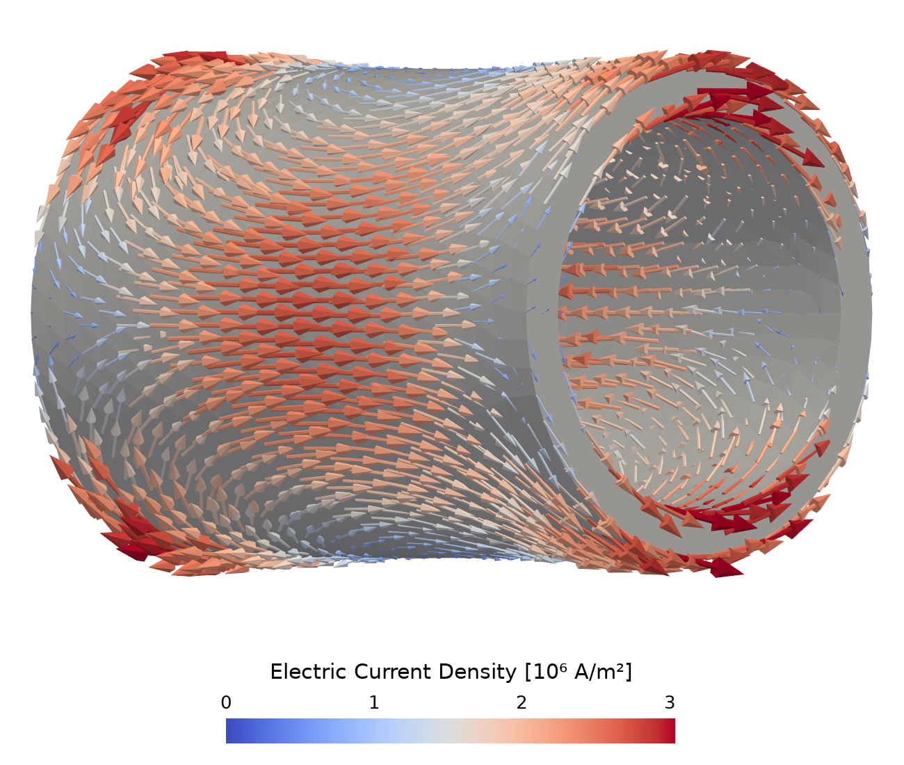
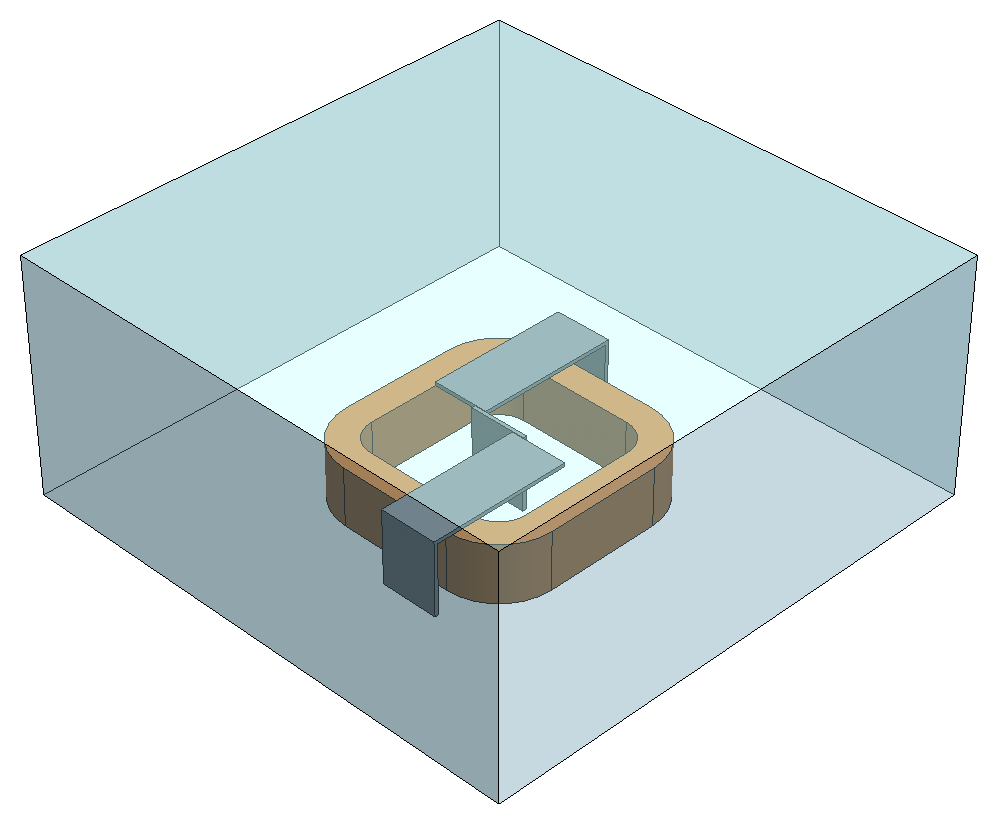
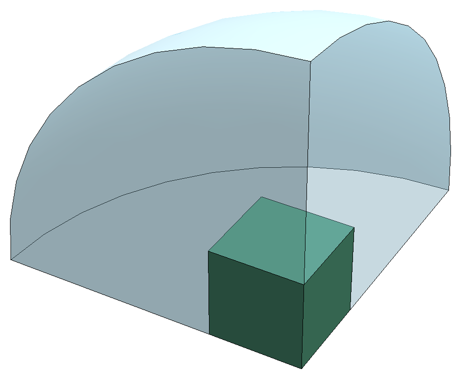
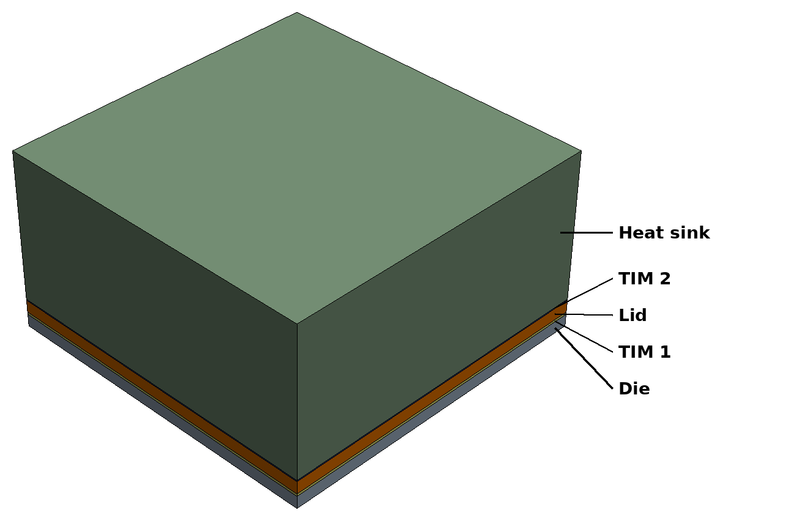

# Validation cases

The validation cases of mufem (tested against the pinned [version](../VERSION)).
Each case compares its results with published, measured, or analytical reference values and
reports every check.

## Getting started

After following the [Installation guide](https://raiden-numerics.github.io/mufem-doc/getting_started/installation.html),
install the shared helpers and dependencies of the cases from the repository root:

```bash
(mufem-venv) pip install -e ./casekit
```

Then run a specific case with:

```bash
(mufem-venv) pymufem Validations/Electromagnetics/Compumag-Team1b-Felix-Cylinder/case.py
```

To run all cases, or all cases below a directory, use [run_cases.py](#run_casespy).

## Cases

### Electromagnetics

mufem covers electromagnetics from electrostatics through low-frequency magnetics, such as
magnetostatics and eddy currents in the time domain or at a single frequency, to high-frequency
full-wave Maxwell problems. Coils are driven by the
[Excitation Coil](https://raiden-numerics.github.io/mufem-doc/models/electromagnetics/excitation_coil/model.html) model. Many cases come from the
[TEAM](https://www.compumag.org/wp/team/) (Testing Electromagnetic Analysis Methods) benchmark
suite of the International Compumag Society, the standard reference for low-frequency
electromagnetic solvers.

#### [Electrostatics](https://raiden-numerics.github.io/mufem-doc/models/electromagnetics/electrostatics/model.html)

<table>
<tr>
<td width="25%" height="130" align="center"><a href="Electromagnetics/Ren_2014_MEMS_Comb_Drive/README.md"></a></td>
<td width="75%" valign="top">
<strong><a href="Electromagnetics/Ren_2014_MEMS_Comb_Drive/README.md">Ren 2014: MEMS Comb Drive</a></strong><br>
An electrostatic comb drive, the actuator used in many MEMS sensors and switches: two
interdigitated micrometer-scale combs above a grounded plate. The capacitance between the combs is
computed as they slide into each other; its change with displacement sets the actuation force.
</td>
</tr>
<tr></tr>
<tr>
<td width="25%" height="130" align="center"><a href="Electromagnetics/David_2019_Nonuniform_Charge_Density/README.md"></a></td>
<td width="75%" valign="top">
<strong><a href="Electromagnetics/David_2019_Nonuniform_Charge_Density/README.md">David 2019: Nonuniform Charge Density</a></strong><br>
A spherical cloud of charge in free space whose density falls off as a Gaussian from its center.
The electric field around the charge is checked against the closed-form solution from Gauss's
law. The case also serves as a step-by-step mufem tutorial.
</td>
</tr>
</table>

#### [Time-Domain Magnetic](https://raiden-numerics.github.io/mufem-doc/models/electromagnetics/time_domain_magnetic/model.html)

<table>
<tr>
<td width="25%" height="130" align="center"><a href="Electromagnetics/Compumag-Team1b-Felix-Cylinder/README.md"></a></td>
<td width="75%" valign="top">
<strong><a href="Electromagnetics/Compumag-Team1b-Felix-Cylinder/README.md">Compumag TEAM 1b: The FELIX Short Cylinder</a></strong><br>
A hollow aluminum cylinder in a uniform transverse magnetic field that decays exponentially,
after the FELIX fusion experiment at Argonne National Laboratory. The induced eddy currents, the
Ohmic losses, and the stored magnetic energy are tracked in time against the reference.
</td>
</tr>
<tr></tr>
<tr>
<td width="25%" height="130" align="center"><a href="Electromagnetics/Compumag-Team13-3-D-Non-Linear-Magnetostatic-Model/README.md"></a></td>
<td width="75%" valign="top">
<strong><a href="Electromagnetics/Compumag-Team13-3-D-Non-Linear-Magnetostatic-Model/README.md">Compumag TEAM 13: 3-D Non-Linear Magnetostatic Model</a></strong><br>
Two steel channels and a steel plate between them, magnetized by a rectangular coil strong
enough to drive the steel deep into saturation. The computed flux density in the steel and in the
air gaps is compared with measurements.
</td>
</tr>
<tr></tr>
<tr>
<td width="25%" height="130" align="center"><a href="Electromagnetics/Compumag-Team20-3D-Static-Force-Problem/README.md"></a></td>
<td width="75%" valign="top">
<strong><a href="Electromagnetics/Compumag-Team20-3D-Static-Force-Problem/README.md">Compumag TEAM 20: 3-D Static Force Problem</a></strong><br>
An electromagnet: a steel center pole and yoke excited by a copper coil with a constant current.
The force pulling the pole toward the yoke is computed over a range of currents, from the linear
regime into saturation, and checked against experiment.
</td>
</tr>
<tr></tr>
<tr>
<td width="25%" height="130"><a href="Electromagnetics/Compumag-Team24-Locked-Rotor/README.md"></a></td>
<td width="75%" valign="top">
<strong><a href="Electromagnetics/Compumag-Team24-Locked-Rotor/README.md">Compumag TEAM 24: Nonlinear Time-Transient Rotational Test Rig</a></strong><br>
A rotating-machine test rig: a solid steel rotor locked inside a steel stator carrying two coils.
A voltage step energizes the coils, and the coil current, the rotor torque, and the air-gap flux
density are followed in time and compared with measurements.
</td>
</tr>
<tr></tr>
<tr>
<td width="25%" height="130"><a href="Electromagnetics/Lubin_2015_Axial_Flux_Eddy_Current_Brake/README.md"></a></td>
<td width="75%" valign="top">
<strong><a href="Electromagnetics/Lubin_2015_Axial_Flux_Eddy_Current_Brake/README.md">Lubin 2015: Axial-Flux Eddy-Current Brake</a></strong><br>
An axial-flux eddy-current brake: a permanent-magnet rotor spinning in front of a copper disc.
The eddy currents induced in the disc produce a braking torque, computed over a range of speeds and
compared with a 3-D analytical model.
</td>
</tr>
<tr></tr>
<tr>
<td width="25%" height="130" align="center"><a href="Electromagnetics/Berger_2017_HTS_Cube/README.md"></a></td>
<td width="75%" valign="top">
<strong><a href="Electromagnetics/Berger_2017_HTS_Cube/README.md">Berger 2017: High-Temperature Superconductor Cube</a></strong><br>
A cube of high-temperature superconductor in a sinusoidal external magnetic field, as found in
superconducting magnets and power devices. The shielding currents follow a strongly nonlinear
power law, and the resulting AC loss is checked against results of five independent research
teams.
</td>
</tr>
</table>

#### [Time-Harmonic Magnetic](https://raiden-numerics.github.io/mufem-doc/models/electromagnetics/time_harmonic_magnetic/model.html)

<table>
<tr>
<td width="25%" height="130"><a href="Electromagnetics/Compumag-Team7-Asymmetrical-Conductor-with-a-Hole/README.md"></a></td>
<td width="75%" valign="top">
<strong><a href="Electromagnetics/Compumag-Team7-Asymmetrical-Conductor-with-a-Hole/README.md">Compumag TEAM 7: Asymmetrical Conductor with a Hole</a></strong><br>
A thick aluminum plate with an off-center hole beneath a coil carrying a sinusoidal current, a
classic test for 3-D eddy currents. The flux density above the plate and the current density in it
are compared with measurements at 50 Hz and 200 Hz.
</td>
</tr>
<tr></tr>
<tr>
<td width="25%" height="130" align="center"><a href="Electromagnetics/Compumag-Team36-Induction-Heating-Device/README.md"></a></td>
<td width="75%" valign="top">
<strong><a href="Electromagnetics/Compumag-Team36-Induction-Heating-Device/README.md">Compumag TEAM 36: Induction Heating Device</a></strong><br>
An induction heater: a coil heats a steel billet through induced eddy currents. All steel
properties depend on temperature, and the permeability collapses at the Curie point, so the
magnetic and thermal fields are solved fully coupled. The heating power and the billet temperature
over the heating cycle are compared with published results.
</td>
</tr>
<tr></tr>
<tr>
<td width="25%" height="130" align="center"><a href="Electromagnetics/Biro_1993_3D_Iron_Core_Current_Driven_Conductors/README.md"></a></td>
<td width="75%" valign="top">
<strong><a href="Electromagnetics/Biro_1993_3D_Iron_Core_Current_Driven_Conductors/README.md">Biro 1993: 3D Iron Core Current Driven Conductors</a></strong><br>
An iron core with an air gap and 25 solid copper turns carrying a 5 kHz current. Skin and
proximity effects make the loss differ from turn to turn; the Ohmic loss in each turn is checked
against published values.
</td>
</tr>
</table>

#### [Time-Harmonic Maxwell](https://raiden-numerics.github.io/mufem-doc/models/electromagnetics/time_harmonic_maxwell/model.html)

<table>
<tr>
<td width="25%" height="130"><a href="Electromagnetics/Montejo-Garai_1995_Circular_Cavity_Filter/README.md"></a></td>
<td width="75%" valign="top">
<strong><a href="Electromagnetics/Montejo-Garai_1995_Circular_Cavity_Filter/README.md">Montejo-Garai 1995: Circular Cavity Filter</a></strong><br>
A microwave waveguide filter of the kind used in satellite communications: a circular cavity
resonator coupled to rectangular waveguides through thin irises. Its transmission over frequency
is compared with measurements.
</td>
</tr>
<tr></tr>
<tr>
<td width="25%" height="130" align="center"><a href="Electromagnetics/Stutzman_2012_Dipole_Antenna/README.md"></a></td>
<td width="75%" valign="top">
<strong><a href="Electromagnetics/Stutzman_2012_Dipole_Antenna/README.md">Stutzman 2012: Dipole Antenna</a></strong><br>
A half-wave dipole antenna, the basic radiating element of Wi-Fi, cellular, and broadcast
systems. The far-field radiation pattern is compared with the classical thin-dipole solution.
</td>
</tr>
</table>

### Structural

mufem computes the small-strain, quasi-static deformation of linear elastic solids under
prescribed displacements and surface tractions.

#### [Solid Mechanics](https://raiden-numerics.github.io/mufem-doc/models/mechanical/solid_mechanics/model.html)

<table>
<tr>
<td width="25%" height="130"><a href="Structural/Slaughter_2002_Linear_Cantilever_Beam/README.md"></a></td>
<td width="75%" valign="top">
<strong><a href="Structural/Slaughter_2002_Linear_Cantilever_Beam/README.md">Slaughter 2002: Linear Cantilever Beam</a></strong><br>
A cantilever beam clamped at one end and loaded transversely at the free end. The deflection
and the stress along the beam are compared with Euler–Bernoulli beam theory.
</td>
</tr>
</table>

### Thermal

mufem solves transient heat conduction in solids with volumetric heat sources, and heat exchange
at the boundaries through convection, radiation, and prescribed heat fluxes. The thermal model
couples with the electromagnetic models, for example for induction heating in
[TEAM 36](Electromagnetics/Compumag-Team36-Induction-Heating-Device/README.md).
The Cameron 1986 validation case comes from the
[NAFEMS](https://www.nafems.org/publications/resource_center/r0006/) benchmark suite, a
long-standing set of reference problems from the NAFEMS simulation community covering structural,
thermal, fluid, and multi-physics analyses.

#### [Solid Temperature](https://raiden-numerics.github.io/mufem-doc/models/mechanical/solid_temperature/model.html)

<table>
<tr>
<td width="25%" height="130" align="center"><a href="Thermal/Goldak_1984_Welding_Heat_Source/README.md"></a></td>
<td width="75%" valign="top">
<strong><a href="Thermal/Goldak_1984_Welding_Heat_Source/README.md">Goldak 1984: Welding Heat Source</a></strong><br>
A weld bead laid on a 10 cm thick steel plate, with the arc represented by Goldak's moving
double-ellipsoid heat source. The temperature profile across the weld is compared with
measurements.
</td>
</tr>
<tr></tr>
<tr>
<td width="25%" height="130" align="center"><a href="Thermal/Cameron_1986_Heat_Transfer_With_Convection/README.md"></a></td>
<td width="75%" valign="top">
<strong><a href="Thermal/Cameron_1986_Heat_Transfer_With_Convection/README.md">Cameron 1986: Heat Transfer With Convection</a></strong><br>
NAFEMS benchmark T4: steady heat conduction in a rectangular plate with fixed-temperature,
insulated, and convective edges. The temperature at the benchmark point is checked against the
NAFEMS target.
</td>
</tr>
<tr></tr>
<tr>
<td width="25%" height="130" align="center"><a href="Thermal/Guenin_2011_Heat_Transfer_Electronic_Design/README.md"></a></td>
<td width="75%" valign="top">
<strong><a href="Thermal/Guenin_2011_Heat_Transfer_Electronic_Design/README.md">Guenin 2011: Heat Transfer in Electronic Design</a></strong><br>
A high-power IC package: a silicon die, a copper lid, and a heat sink stacked with thermal
interface layers and cooled by convection. The temperature rise of the die and the lid after a
1 W power step is compared with published transient results.
</td>
</tr>
</table>

## run_cases.py

`run_cases.py` runs every `case.py` below a directory (default: the repository root):

```bash
(mufem-venv) python run_cases.py                       # all cases
(mufem-venv) python run_cases.py Validations/Thermal   # all thermal cases
(mufem-venv) python run_cases.py --exclude-tag long --exclude-tag eternal
```

| Option | Effect |
| ------ | ------ |
| `--exclude-tag TAG` | skips the cases with the tag; repeatable |
| `--launcher CMD` | command that runs each case (default `pymufem`; `python` for a serial run) |
| `--rebuild-mesh` | rebuilds the geometry and mesh of each case before running it |
| `--render-geometry` | also creates the geometry image of each case (see [Geometry images](#geometry-images)) |
| `--render-scenes` | also creates the scenes of each case (see [Scenes](#scenes)) |

## Images

### Geometry images

The geometry image of a case, `data/Geometry.png`, is taken from its `geometry.step` with the
[netgen](https://ngsolve.org/) viewer by `create_geometry_image()` (`--render-geometry`), in the
view of the scenes of the case. The viewer needs a display; on a machine without one, run it in a
virtual X server:

```bash
(mufem-venv) xvfb-run -a -s "-screen 0 2400x1600x24" python Validations/Structural/Slaughter_2002_Linear_Cantilever_Beam/case.py --render-geometry
```

`--rebuild-mesh --render-geometry` builds `geometry.step` first. The colors of the bodies come from
the STEP file: the cases built with netgen set them in `build_geometry()`, and those built with
gmsh, which writes no colors, add them with `color_step()` of `casekit/gmsh_meshing.py`.

### Scenes

The scenes and animations of a case, `results/Scene_*.png` and `results/Animation_*.gif`, are
rendered from the fields exported to `VisualizationOutput/` with [PyVista](https://pyvista.org/) by
`create_scenes()`. They need the optional dependencies and are created after the run
(`--render-scenes`), or from the output of a previous one (`--render-scenes-only`):

```bash
(mufem-venv) pip install "./casekit[scenes]"
(mufem-venv) pymufem Validations/Electromagnetics/Compumag-Team24-Locked-Rotor/case.py --render-scenes
(mufem-venv) python Validations/Electromagnetics/Compumag-Team24-Locked-Rotor/case.py --render-scenes-only
```

The scenes render off screen and need no display; in a bare Linux container install the EGL
library first (`apt-get install libegl1` on Ubuntu).

## Tags

| Tag | Meaning |
| --- | ------- |
| `moderate`, `long`, `eternal` | run time of the case |
| `mumps` | needs the MUMPS direct solver |

## Meshes

Each case loads its committed mesh (`geometry.mesh`, or `geometry.msh` for the cases meshed with
gmsh). The geometry and mesh are built in the case itself, together with `geometry.step`, using
[netgen](https://ngsolve.org/) or [gmsh](https://gmsh.info/) (both installed with the shared
helpers), and can be regenerated with:

```bash
(mufem-venv) pymufem Validations/Thermal/Cameron_1986_Heat_Transfer_With_Convection/case.py --rebuild-mesh
```

The flag only rebuilds the mesh; run the case afterwards as usual (`run_cases.py --rebuild-mesh`
does both for every case). A mesh that is missing, such as those of
[Ren 2014](Electromagnetics/Ren_2014_MEMS_Comb_Drive/README.md)
(`geometry_xshift=<shift>.msh`, one per comb shift, not committed), is built by `run_cases.py`
before it runs the case, and by a serial `python case.py`; an MPI run asks for `--rebuild-mesh`
first. The committed netgen meshes were generated with netgen-mesher 6.2.2608; other versions
produce slightly different meshes, but the results should still pass the case's checks.
